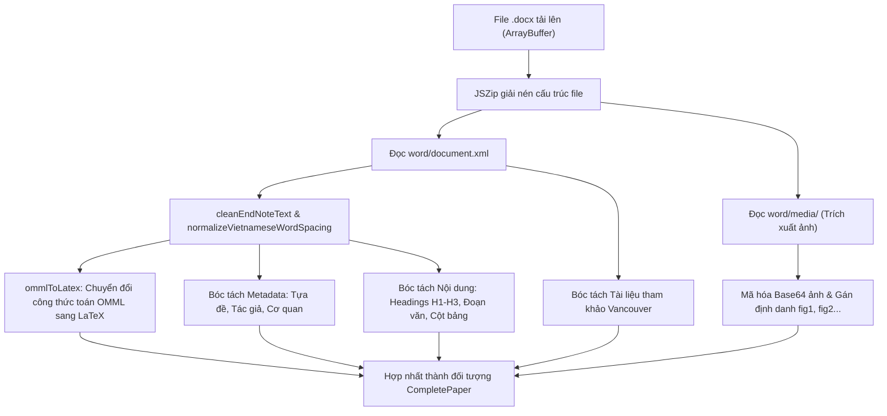
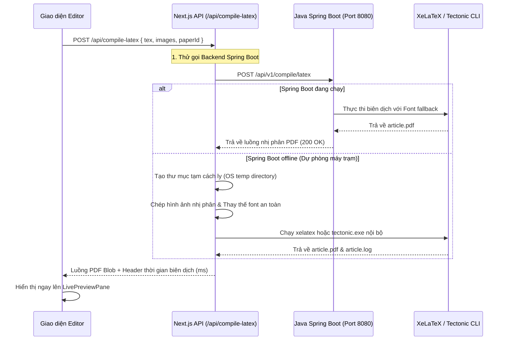

# BÁO CÁO CHI TIẾT HIỆN TRẠNG DỰ ÁN STRUCTPAPER: LUỒNG UPLOAD VÀ TRANG SOẠN THẢO (EDITOR)

> **Tài liệu đặc tả kiến trúc kỹ thuật & chức năng nghiệp vụ**  
> **Phạm vi:** Trọng tâm Tab Tải file bản thảo (`Upload`) $\rightarrow$ Cơ chế chuyển giao trạng thái $\rightarrow$ Chi tiết toàn bộ tính năng và cấu trúc mã nguồn trang Biên tập (`Editor`).  
> **Phiên bản tài liệu:** Cập nhật theo mã nguồn hiện tại của dự án `StructPaper`.

---

## MỤC LỤC TỔNG QUAN

1. [Kiến trúc tổng thể dự án](#1-kiến-trúc-tổng-thể-dự-án)
2. [Chi tiết Tab Tải file (Upload Tab - `/upload`)](#2-chi-tiết-tab-tải-file-upload-tab---upload)
   - 2.1. Giao diện người dùng & Các khối chức năng
   - 2.2. Lựa chọn tạp chí đích (Target Journal)
   - 2.3. Chế độ bóc tách văn bản: OpenXML cục bộ vs Trí tuệ nhân tạo (AI)
   - 2.4. Vùng kéo thả file DOCX (Dropzone)
   - 2.5. Khởi tạo bản thảo từ Template trống
   - 2.6. Kho nạp nhanh bài báo mẫu thử nghiệm (Preloaded Samples)
   - 2.7. Mã nguồn xử lý bóc tách OpenXML & Toán học OMML
3. [Cơ chế đồng bộ dữ liệu & Chuyển trang (Upload $\rightarrow$ Editor)](#3-cơ-chế-đồng-bộ-dữ-liệu--chuyển-trang-upload--editor)
   - 3.1. Mô hình dữ liệu chuẩn (`CompletePaper`)
   - 3.2. Quản lý trạng thái toàn cục (`PaperContext`)
   - 3.3. Chuẩn hóa tự động cấu trúc bảng và đơn vị công tác
   - 3.4. Lưu trữ phiên (`sessionStorage`) & Điều hướng Next.js Router
4. [Chi tiết toàn diện Trang Biên tập (Editor Page - `/editor`)](#4-chi-tiết-toàn-diện-trang-biên-tập-editor-page---editor)
   - 4.1. Kiến trúc phân chia màn hình (`ResizableSplitLayout`)
   - 4.2. Thanh công cụ đứng bên trái (`EditorLeftDock`)
   - 4.3. Thanh điều hướng phân mục bản thảo (`EditorTabNav`)
   - 4.4. Chi tiết từng Tab biên tập nội dung:
     - 4.4.1. Tab Tựa đề (`MetadataTab`)
     - 4.4.2. Tab Tác giả (`AuthorsTab`)
     - 4.4.3. Tab Tóm tắt (`AbstractTab`)
     - 4.4.4. Tab Nội dung bản thảo (`SectionsTab`)
     - 4.4.5. Tab Tài liệu tham khảo (`ReferencesTab`)
     - 4.4.6. Tab Trích dẫn bài báo (`CitationTab`)
     - 4.4.7. Tab Kiểm định chất lượng bản thảo (`PreflightQCTab`)
   - 4.5. Khung xem trước bản in trực tiếp (`LivePreviewPane`)
   - 4.6. Ngăn kéo kiểm tra nội dung bóc tách (`ExtractedContentDrawer`)
   - 4.7. Ngăn kéo thiết lập dàn trang (`LayoutSettingsDrawer`)
   - 4.8. Các hộp thoại chuyên sâu: Bảng tính (`TableSpreadsheetModal`), Thuộc tính Bảng & Hình ảnh
5. [Quy trình biên dịch PDF & Hệ thống xuất bản](#5-quy-trình-biên-dịch-pdf--hệ-thống-xuất-bản)
   - 5.1. Luồng biên dịch XeLaTeX / Tectonic (`/api/compile-latex`)
   - 5.2. Tích hợp backend Spring Boot Java (`struct-paper-backend`)
   - 5.3. Xuất Word DOCX, Bản in PDF và Gói nén LaTeX ZIP
6. [Bảng danh mục các file mã nguồn cốt lõi & Trách nhiệm](#6-bảng-danh-mục-các-file-mã-nguồn-cốt-lõi--trách-nhiệm)

---

## 1. KIẾN TRÚC TỔNG THỂ DỰ ÁN

Dự án **StructPaper** được thiết kế theo mô hình Monorepo lai gồm 2 hệ thống phụ trợ gắn kết chặt chẽ:

```
StructPaper/
├── struct-paper-app/          # Ứng dụng Frontend & Fullstack Next.js (App Router)
│   ├── src/
│   │   ├── app/               # Định tuyến trang (upload, editor, api endpoints)
│   │   ├── components/        # Thư viện component UI & các view chuyên biệt
│   │   │   ├── editor/        # Toàn bộ module của trang Soạn thảo / Biên tập
│   │   │   └── ui/            # Thành phần giao diện dùng chung (Select, DatePicker...)
│   │   ├── context/           # PaperContext lưu trữ trạng thái tài liệu
│   │   ├── lib/               # Bóc tách docx, sinh LaTeX, kiểm định IMRAD
│   │   └── types/             # Kiểu dữ liệu TypeScript chuẩn hóa
├── struct-paper-backend/      # Dịch vụ Backend Java Spring Boot 3
│   └── src/main/java/vn/edu/vnu/structpaper/
│       ├── controller/        # REST API biên dịch LaTeX sang PDF (/api/v1/compile)
│       └── service/           # Tích hợp công cụ biên dịch XeLaTeX / Tectonic CLI
└── bin/                       # Binary công cụ biên dịch ngoại tuyến (tectonic.exe)
```

- **Môi trường Frontend:** Next.js 14+ (App Router), React 18, TypeScript, Tailwind CSS, Lucide React, Framer Motion.
- **Thư viện bóc tách tài liệu phía Client:** `mammoth` (chuyển đổi Word thô sang HTML/văn bản thô), `jszip` (giải nén cấu trúc file `.docx` OpenXML để can thiệp trực tiếp vào `word/document.xml`, `word/media/`, trích xuất hình ảnh chất lượng cao và công thức toán học OMML).
- **Hệ thống biên dịch bản in:** Hỗ trợ mô hình kép:
  1. Proxy gọi trực tiếp Backend Spring Boot Java trên cổng `8080` (`/api/v1/compile/latex`).
  2. Tự động dự phòng sang CLI nội bộ hệ điều hành (`xelatex` hoặc `tectonic.exe` trong thư mục `bin/`) thông qua API Route Next.js (`/api/compile-latex`).

---

## 2. CHI TIẾT TAB TẢI FILE (UPLOAD TAB - `/upload`)

### 2.1. Giao diện người dùng & Các khối chức năng

Khi người dùng truy cập trang gốc của hệ thống (`/`), hệ thống được định cấu hình tại `struct-paper-app/src/app/page.tsx` sẽ tự động chuyển hướng (`redirect('/upload')`) vào Tab đầu tiên là **Tải file DOCX**.

Giao diện của Tab này được quản trị bởi component:
- File trang: `struct-paper-app/src/app/upload/page.tsx`
- Component giao diện chính: `struct-paper-app/src/components/UploadView.tsx`

Bố cục giao diện được sắp xếp trực quan từ trên xuống dưới gồm 4 phân khu chính:
1. **Thanh lựa chọn Tạp chí đích (Target Journal Selector Card)**.
2. **Khối bật/tắt & Cấu hình chế độ Trích xuất bằng AI (AI Extraction Mode Switcher)**.
3. **Phân vùng thao tác chính (Bố cục 7:3)**:
   - Cột trái (Chiếm 70% chiều rộng): Vùng kéo thả file Word DOCX (`Dropzone`).
   - Cột phải (Chiếm 30% chiều rộng): Thẻ khởi tạo bản thảo từ `Template trống`.
4. **Kho thử nghiệm nhanh với 8 bài báo mẫu chuẩn (Preloaded Sample Papers)** cho toàn bộ 7 tạp chí thuộc hệ thống ĐHQG-HCM.

---

### 2.2. Lựa chọn tạp chí đích (Target Journal)

Kho dữ liệu tạp chí được định nghĩa trong `src/lib/templates.ts` (`JOURNAL_TEMPLATES`), bao gồm đầy đủ 7 phân san của Tạp chí Phát triển Khoa học và Công nghệ - ĐHQG-HCM (VNUHCM):

| Mã tạp chí (`journalId`) | Tên đầy đủ phân san | Tên viết tắt (`shortName`) | Màu chủ đạo nhận diện |
| :--- | :--- | :--- | :--- |
| **VNUHCM-HS** | Khoa học Sức khỏe (Health Sciences) | *Sci. Tech. Dev. J. - Health Sci.* | `#006838` (Xanh lá y sinh) |
| **VNUHCM-ARNS** | Khoa học Tự nhiên (Natural Sciences) | *Sci. Tech. Dev. J. - Nat. Sci.* | `#1B365D` (Xanh dương đậm) |
| **VNUHCM-EBL** | Kinh tế - Luật và Quản lý (Economics, Business and Law) | *Sci. Tech. Dev. J. - Eco. Bus. Law* | `#8B1E41` (Đỏ mận kinh tế) |
| **VNUHCM-EES** | Khoa học Trái đất và Môi trường (Earth & Environmental Sci.) | *Sci. Tech. Dev. J. - Earth Env. Sci.*| `#007A87` (Xanh cổ vịt) |
| **VNUHCM-SSH** | Khoa học Xã hội và Nhân văn (Social Sci. & Humanities) | *Sci. Tech. Dev. J. - Soc. Sci. Hum.* | `#8A5E3C` (Nâu đất nhân văn)|
| **VNUHCMJ-ET** | Kỹ thuật và Công nghệ (Engineering and Technology) | *VNUHCM J. - Eng. Tech.* | `#D9531E` (Cam kỹ thuật) |
| **VNUHCM-STD** | Khoa học & Công nghệ tổng hợp | *Sci. Tech. Dev. J.* | `#205493` (Xanh hoàng gia) |

**Cơ chế hoạt động trên UI:**
- Người dùng có thể thay đổi tạp chí đích bất kỳ lúc nào thông qua bộ chọn `Select` có tính năng tìm kiếm nhanh (`searchable={true}`).
- Tạp chí được chọn sẽ lưu ngay vào biến trạng thái toàn cục `currentJournal` của `PaperContext`, tự động cập nhật màu sắc nhận diện và tên mẫu hiển thị trên thanh Header.

---

### 2.3. Chế độ bóc tách văn bản: OpenXML cục bộ vs Trí tuệ nhân tạo (AI)

Hệ thống cung cấp một công tắc trượt linh hoạt để chuyển đổi giữa hai phương thức phân tích:

#### A. Chế độ mặc định: Trích xuất OpenXML nội bộ (Offline, Fast & Free)
- **Ưu điểm:** Tốc độ tức thì (< 1 giây), xử lý 100% tại trình duyệt, không phụ thuộc mạng, không tốn token OpenAI, bảo mật toàn diện bản thảo chưa công bố.
- **Cơ chế:** Đọc nhị phân file Word bằng `JSZip`, duyệt cây thư mục `word/document.xml`, dùng biểu thức chính quy (Regex) và phân tích quan hệ cấu trúc DOM để bóc tách:
  - Tựa đề tiếng Việt và tiếng Anh.
  - Danh sách tác giả, phân tách chỉ số đơn vị công tác (superscripts).
  - Tóm tắt (`Abstract`) và Từ khóa (`Keywords`).
  - Toàn bộ đề mục H1, H2, H3, các đoạn văn.
  - Bảng số liệu: bóc tách ô gộp (`w:gridSpan`, `w:vMerge`), tái tạo bảng đa tầng.
  - Công thức toán: chuyển đổi cú pháp OMML (`<m:oMath>`) sang LaTeX math.
  - Hình ảnh: trích xuất nhị phân từ `word/media/` và chuyển đổi thành Data URI dạng base64.
  - Danh mục tài liệu tham khảo Vancouver (`[1]`, `[2]`, ...).

#### B. Chế độ nâng cao: Trích xuất bằng mô hình AI (OpenAI LLM)
- Khi người dùng gạt công tắc `useAi`, giao diện mở rộng phần cấu hình:
  - **OpenAI API Key:** Cho phép nhập khóa `sk-proj-...` cá nhân (hoặc đọc ngầm định từ biến môi trường `NEXT_PUBLIC_OPENAI_API_KEY`).
  - **Mô hình AI:** Tùy chọn giữa `gpt-5.4-mini` (Khuyên dùng - Nhanh & Chính xác nhất), `gpt-4o-mini` (Dự phòng) hoặc `gpt-4o` (Đầy đủ).
- **Quy trình hoạt động hai bước (`parseDocxFileWithAi`):**
  1. *Bước 1 (Nền tảng):* Vẫn chạy bộ bóc tách OpenXML để trích xuất đầy đủ hình ảnh, bảng thô và công thức toán học.
  2. *Bước 2 (Tinh chỉnh tri thức):* Gửi văn bản trích xuất thô lên API Route `/api/ai-extract`, yêu cầu mô hình nhận diện chính xác tên các tác giả người Việt (chuẩn hóa lỗi gõ dấu cách rời, phân biệt tác giả liên hệ `corresponding author`, ghép đúng cơ quan công tác), bóc tách phần tóm tắt tiếng Anh - Việt, phân loại bài báo và trích xuất cấu trúc bảng biểu phức tạp.
  3. Kết quả phản hồi JSON từ AI được hợp nhất đè lên dữ liệu OpenXML thô.

---

### 2.4. Vùng kéo thả file DOCX (Dropzone)

- **Hỗ trợ định dạng:** `.docx`, `.doc`. Nếu tải lên định dạng sai (ví dụ: `.pdf`, `.txt`), hệ thống sẽ chặn ngay từ Client và hiển thị thông báo lỗi rõ ràng.
- **Trạng thái kéo thả (`dragOver`):** Khi người dùng kéo file vào, thẻ Dropzone lập tức phóng to nhẹ (`scale-[1.01]`), đổi viền nét đứt sang màu xanh lá `#78C841` đặc trưng cùng nền mờ dịu mắt.
- **Tiến trình xử lý (`isParsing`):** Trong lúc phân tích nhị phân, giao diện chuyển sang trạng thái chờ với biểu tượng xoay `Loader2`, hiệu ứng phát xung `animate-pulse` và thông báo tiến độ theo từng bước:
  - *"Đang đọc file Word..."*
  - *"Đang phân tích cấu trúc OpenXML..."*
  - *"Đang bóc tách hình ảnh và công thức toán học..."*
- **Xử lý hoàn tất:** Khi trích xuất thành công, hệ thống hiển thị thông báo `DynamicIslandToast` (Sileo Toast) ở cạnh trên màn hình: *"Đã xử lý & trích xuất cấu trúc văn bản [Tên file]"*, sau đó tự động điều hướng sang trang Soạn thảo `/editor`.

---

### 2.5. Khởi tạo bản thảo từ Template trống

Bên cạnh vùng Dropzone tải file Word, hệ thống bố trí thẻ **"Template trống"** (chiếm 30% hàng ngang).
- Tính năng này giải quyết nhu cầu soạn thảo trực tiếp bài báo khoa học từ đầu mà không cần có sẵn file Word mẫu.
- Khi người dùng click chọn: hàm `createEmptyPaper(currentJournal)` trong `src/types/paper.ts` được kích hoạt.
- Hệ thống tạo ra một khung bài báo mới tinh nhưng đã được gắn sẵn:
  - Mã định danh tạp chí đích đang chọn (ví dụ: `VNUHCM-HS`).
  - Tên cơ quan xuất bản, loại bài mặc định là *"Bài báo nghiên cứu"*.
  - Năm hiện tại, tập 1, số 1.
  - Các mảng rỗng sẵn sàng để nhập liệu: tác giả, tóm tắt, nội dung, tài liệu tham khảo.
- Ngay sau đó, người dùng được chuyển thẳng sang `/editor` để bắt đầu viết bài.

---

### 2.6. Kho nạp nhanh bài báo mẫu thử nghiệm (Preloaded Samples)

Hệ thống tích hợp sẵn kho 8 bài báo khoa học thực tế đã được chuẩn hóa cấu trúc hoàn hảo trong `src/lib/sample-papers.ts`:

1. **ID630_HS** (Khoa học Sức khỏe): *"Hiệu quả của việc kết hợp thở áp lực dương liên tục và tập phục hồi chức năng phổi trên bệnh nhân COPD"* (Tác giả: Trần Văn Hùng, Nguyễn Thị Mai...).
2. **ID1421_ARNS** (Khoa học Tự nhiên): *"Nghiên cứu quá trình tổng hợp và đặc tính quang học của vật liệu nano cấu trúc"* (Tác giả: Lê Hoàng Nam, Phạm Quốc Bảo...).
3. **ID1750_EBL** (Kinh tế - Luật): *"Tác động của chuyển đổi số và quản trị chuỗi cung ứng xanh đến hiệu quả tài chính doanh nghiệp"* (Tác giả: Võ Thành Long...).
4. **ID850_EES** (Khoa học Trái đất & Môi trường): *"Đánh giá chất lượng nước mặt lưu vực sông Đồng Nai giai đoạn 2020-2025"* (Tác giả: Đặng Minh Tuấn...).
5. **ID1102_SSH** (Khoa học Xã hội & Nhân văn): *"Biến đổi sinh kế và cấu trúc xã hội của cộng đồng cư dân ven biển Nam Bộ"*.
6. **ID1563_ET** (Kỹ thuật & Công nghệ): *"Tối ưu hóa thiết kế kết cấu cầu nhịp lớn sử dụng thuật toán tiến hóa đa mục tiêu"*.
7. **ID4581_STD** (Khoa học Tổng hợp): *"Phân tích đối sánh các thuật toán học máy trong phân loại dữ liệu y sinh đa chiều"*.
8. **HS_722** (Bản thảo lâm sàng Health Sciences mở rộng).

**Tính năng trên UI:**
- **Thanh lọc nhanh (Filter Pills):** Cho phép lọc danh sách bài mẫu theo từng tạp chí hoặc xem tất cả (Tất cả, STDJ-HS, STDJ-ARNS, STDJ-EBL, STDJ-EES, STDJ-SSH, ET, STDJ).
- **Thẻ xem trước thông tin bài báo:** Hiển thị tựa đề, tên tác giả, số lượng bảng, số lượng hình ảnh và số lượng tài liệu tham khảo (TLTK).
- **Nạp một chạm:** Click vào bất kỳ bài mẫu nào sẽ tự động đổi tạp chí đích phù hợp và nạp ngay toàn bộ bài báo vào trang `/editor`.

---

### 2.7. Mã nguồn xử lý bóc tách OpenXML & Toán học OMML

Toàn bộ logic phân giải file Word được đóng gói trong `struct-paper-app/src/lib/docx-parser.ts` (hơn 2.100 dòng mã nguồn chuyên sâu). Các hàm nòng cốt gồm:



#### Các cơ chế đặc sắc trong mã nguồn:
1. **Chuẩn hóa lỗi dấu cách tiếng Việt (`normalizeVietnameseWordSpacing`):** Khắc phục lỗi phổ biến của các tài liệu Word khi gõ tiếng Việt bị tách rời chữ cái (ví dụ: `Nguy ễ n` $\rightarrow$ `Nguyễn`, `H ù ng` $\rightarrow$ `Hùng`).
2. **Khử mã nhị phân rác EndNote (`cleanEndNoteText`):** Loại bỏ sạch sẽ các khối mã trường `ADDIN EN.CITE` và các đoạn base64 do tiện ích EndNote nhúng vào văn bản.
3. **Bộ dịch toán học OMML sang LaTeX (`ommlToLatex`):**
   - Phân số `<m:f>` $\rightarrow$ `\frac{tử}{mẫu}`
   - Chỉ số trên `<m:sSup>` $\rightarrow$ `{cơ số}^{mũ}`
   - Chỉ số dưới `<m:sSub>` $\rightarrow$ `{cơ số}_{dưới}`
   - Căn bậc hai `<m:rad>` $\rightarrow$ `\sqrt{biểu thức}`
   - Dấu ngoặc co giãn `<m:d>` $\rightarrow$ `\left( ... \right)`
4. **Nhận diện tạp chí tự động (`detectJournalFromContent`):** Phân tích các từ khóa chuyên ngành trong 2.000 ký tự đầu tiên để tự động đề xuất phân san tạp chí VNUHCM chính xác nhất.

---

## 3. CƠ CHẾ ĐỒNG BỘ DỮ LIỆU & CHUYỂN TRANG (UPLOAD $\rightarrow$ EDITOR)

### 3.1. Mô hình dữ liệu chuẩn (`CompletePaper`)

Được định nghĩa tại `src/types/paper.ts`, đối tượng `CompletePaper` là "trái tim" dữ liệu của toàn bộ ứng dụng:

```typescript
export interface CompletePaper {
  id: string;                         // Định danh duy nhất của bản thảo (ví dụ: paper_172900000)
  metadata: PaperMetadata;            // Tựa đề, tác giả, cơ quan, tóm tắt, từ khóa, DOI, số tập...
  sections: PaperSection[];           // Danh sách tuyến tính các khối nội dung: H1, H2, H3, đoạn văn, bảng, hình
  references: PaperReference[];       // Danh mục tài liệu tham khảo Vancouver chuẩn
  layoutSettings?: LayoutSettings;    // Kích thước khổ giấy, 2 cột hay 1 cột, cỡ chữ, số trang
  templateId?: string;
  templateName?: string;
  updatedAt?: string;
  createdAt?: string;
  status?: 'draft' | 'review' | 'ready';
}
```

Trong đó:
- `PaperMetadata`: Chứa cả tựa đề tiếng Việt và tiếng Anh (`title`, `titleEn`), loại bài báo (`articleType`), danh sách tác giả (`authors`), danh sách viện/trường (`affiliations`), thông tin tác giả liên hệ (`corresponding`), tóm tắt song ngữ (`abstract`, `abstractEn`), từ khóa (`keywords`, `keywordsEn`), các mốc thời gian tòa soạn (`dates: { received, revised, accepted, published }`).
- `PaperSection`: Đại diện cho từng phần tử với các loại: `'h1' | 'h2' | 'h3' | 'paragraph' | 'figure' | 'table' | 'quote' | 'box' | 'citation'`. Mỗi phần tử hình ảnh mang theo đối tượng `PaperFigure` và bảng mang theo `PaperTable`.
- `PaperReference`: Mỗi mục tham khảo gồm số thứ tự `id`, chuỗi trích dẫn thô `raw`, chỉ số trích dẫn `doi`, cờ trạng thái `isCited` (đã được gọi trong bài hay chưa) và tần suất xuất hiện `citationCount`.

---

### 3.2. Quản lý trạng thái toàn cục (`PaperContext`)

File: `struct-paper-app/src/context/PaperContext.tsx`

`PaperContext` đóng vai trò là kho lưu trữ dữ liệu tập trung (Single Source of Truth):
- Cung cấp hook `usePaper()` cho toàn bộ các trang và component.
- Cung cấp các hàm xử lý:
  - `paper`: Dữ liệu bài báo hiện hành.
  - `setPaper(newPaper)`: Cập nhật bài báo mới, đồng thời chạy chuẩn hóa và tự động lưu đệm vào trình duyệt.
  - `updatePaper(updated)`: Cập nhật sửa đổi từng phần.
  - `currentJournal` & `setCurrentJournal(journalId)`: Đồng bộ mã tạp chí đích.
  - `preflight`: Kết quả kiểm định chất lượng bản thảo được tính toán phản ứng tức thì (`computePreflightCheck(paper)`).

---

### 3.3. Chuẩn hóa tự động cấu trúc bảng và đơn vị công tác

Mỗi khi dữ liệu bài báo đi qua `setPaper`, hàm `normalizeCompletePaper()` trong `src/types/paper.ts` sẽ được kích hoạt để đảm bảo:
1. **Chuẩn hóa bảng đa tầng (`normalizePaperTable`):**
   - Tự động nhận diện khi hàng đầu tiên trong bảng thực chất là hàng tiêu đề phụ (subheader) bị phân tách nhầm.
   - Phát hiện các cột có ký hiệu gộp nhóm (ví dụ: `"Chức năng hô hấp / FEV1"`, `"Chức năng hô hấp / FVC"`) để tái tạo ma trận tiêu đề 2 tầng (`headerRows`) với `colSpan` và `rowSpan` chuẩn xác.
2. **Hợp nhất đơn vị công tác song ngữ (`normalizeAffiliations`):**
   - Loại bỏ các mục trùng lặp, ghép tên tiếng Việt và tên tiếng Anh vào chung một thẻ định danh cơ quan duy nhất.

---

### 3.4. Lưu trữ phiên (`sessionStorage`) & Điều hướng Next.js Router

Tại component `UploadPage` (`src/app/upload/page.tsx`):
```typescript
const handlePaperLoaded = (newPaper: CompletePaper) => {
  setPaper(newPaper);
  // Sau khi tải và bóc tách thành công, lập tức điều hướng sang trang Soạn thảo & Xem trước!
  router.push('/editor');
};
```
- Khi gọi `setPaper`, dữ liệu được đồng bộ ngay vào `sessionStorage` của trình duyệt dưới 2 khóa:
  - `'structpaper_current_paper'`: Toàn bộ cây đối tượng JSON của bản thảo.
  - `'structpaper_current_journal'`: Mã định danh tạp chí.
- Nhờ cơ chế này, khi chuyển hướng sang `/editor` (hoặc ngay cả khi người dùng nhấn **F5 F5 Reload** trình duyệt), toàn bộ nội dung bản thảo, bảng biểu và hình ảnh vừa tải lên đều được khôi phục 100%, không bị mất dữ liệu.

---

## 4. CHI TIẾT TOÀN DIỆN TRANG BIÊN TẬP (EDITOR PAGE - `/editor`)

Khi chuyển hướng tới `/editor`, component chính điều phối là `struct-paper-app/src/components/editor/UnifiedEditorView.tsx`. Đây là không gian làm việc chuyên nghiệp, mô phỏng studio xuất bản khoa học hiện đại.

```
┌────────────────────────────────────────────────────────────────────────────────────────┐
│                                   MÀN HÌNH CHÍNH /editor                               │
├────────┬───────────────────────────────────────────┬───────────────────────────────────┤
│ DOCK   │ CỘT TRÁI: KHUNG SOẠN THẢO (EDITOR PANE)   │ CỘT PHẢI: XEM TRƯỚC BẢN IN (PDF)  │
│ DỌC    │                                           │                                   │
│ [Trang]│ ┌───────────────────────────────────────┐ │ ┌───────────────────────────────┐ │
│ [Nội]  │ │ TabNav: Tựa đề | Tác giả | Tóm tắt... │ │ │ XeLaTeX / Tectonic            │ │
│ [Dàn]  │ ├───────────────────────────────────────┤ │ │ Live PDF Viewer (Iframe)      │ │
│        │ │                                       │ │ │                               │ │
│ [Lưu]  │ │  Khu vực biểu mẫu biên tập chi tiết   │ │ │  Hiển thị trang in PDF        │ │
│ [Dịch] │ │  (Tự động giãn dòng, cuộn độc lập)    │ │ │  chuẩn khổ báo VNUHCM 2 cột   │ │
│ [Tải]  │ │                                       │ │ │                               │ │
│ [Phóng]│ │                                       │ │ │                               │ │
│        │ ├───────────────────────────────────────┤ │ │ ┌───────────────────────────┐ │ │
│ [QC%]  │ │ Chỉ báo kết thúc danh sách & Thao tác │ │ │ │ Trạng thái: 1.8s | 1.4 MB   │ │ │
│        │ └───────────────────────────────────────┘ │ │ └───────────────────────────┘ │ │
│        │ <═══════════ RESIZABLE SPLIT DIVIDER (28% - 72%) ═══════════════════════════> │
└────────┴───────────────────────────────────────────┴───────────────────────────────────┘
```

---

### 4.1. Kiến trúc phân chia màn hình (`ResizableSplitLayout`)

- Màn hình làm việc máy tính được chia làm 2 nửa thông qua component `ResizableSplitLayout.tsx`.
- Người dùng có thể kéo thả thanh trượt ở giữa để thay đổi tỷ lệ hiển thị linh hoạt từ **28% đến 72%** (mặc định chia đôi 50/50).
- Cột bên trái dành riêng cho việc biên tập dữ liệu khoa học; cột bên phải hiển thị trực quan bản in PDF thời gian thực.
- Cả hai bên đều có vùng cuộn độc lập, không làm tràn khung hình trình duyệt.

---

### 4.2. Thanh công cụ đứng bên trái (`EditorLeftDock`)

Component: `src/components/editor/EditorLeftDock.tsx`  
Được thiết kế theo phong cách phím bấm dạng con nhộng thủy tinh mờ (Liquid Glass Dock) cố định dọc mép trái màn hình với các nút chức năng:

1. **Quay lại trang chủ (`Home`):** Chuyển hướng nhanh về `/upload` để tải bài khác.
2. **Mở ngăn kéo Nội dung bóc tách (`Layers`):** Bật bảng trượt đáy xem toàn bộ dữ liệu Word thô.
3. **Mở ngăn kéo Dàn trang (`Sliders`):** Bật tùy chỉnh khổ giấy, số cột, khoảng cách cột, lề trang.
4. **Nút Lưu bản thảo (`Save`):**
   - Tích hợp phát hiện thay đổi (`isDirty`): Nút phát sáng báo hiệu có chỉnh sửa chưa lưu.
   - Hỗ trợ phím tắt toàn cục: Nhấn **Ctrl + S** (hoặc **Cmd + S** trên Mac) để lưu ngay lập tức kèm thông báo toast xanh.
5. **Nút Biên dịch lại PDF (`RefreshCw`):**
   - Kích hoạt tiến trình biên dịch mã nguồn LaTeX sang PDF thời gian thực. Biểu tượng xoay tròn liên tục trong lúc máy chủ đang dàn trang.
6. **Nút Tải xuống bản thảo (`Download`):**
   - Click vào sẽ mở ra **Menu ngữ cảnh xuất bản chuyên nghiệp** (gồm 3 định dạng xuất bản):
     - **Tài liệu Word (`.docx`):** Xuất bản thảo hoàn chỉnh với bảng và ảnh được định dạng lại sạch sẽ.
     - **Bản in PDF (`.pdf`):** Tải trực tiếp file PDF chất lượng in ấn cao do XeLaTeX sinh ra.
     - **Gói nén ZIP LaTeX (`.zip`):** Nén toàn bộ file mã nguồn `.tex`, file thư viện trích dẫn `.bib` và toàn bộ hình ảnh trong thư mục `images/`.
7. **Phóng to PDF toàn màn hình (`Maximize2`):** Mở file PDF đã biên dịch sang một tab trình duyệt mới để phóng to kiểm tra chi tiết lỗi sắp chữ.
8. **Widget Điểm chất lượng bản thảo (`QC Score %`):**
   - Hiển thị phần trăm điểm kiểm định (từ `0%` đến `100%`).
   - Có chấm nhấp nháy màu đỏ (nếu có lỗi bắt buộc) hoặc màu vàng cam (nếu có khuyến nghị).
   - Click vào nút này sẽ lập tức chuyển sang Tab Kiểm định (`PreflightQCTab`).

---

### 4.3. Thanh điều hướng phân mục bản thảo (`EditorTabNav`)

File: `src/components/editor/EditorTabNav.tsx`  
Bố trí dạng hàng thanh trượt con nhộng mờ nằm trên cùng của cột soạn thảo, bao gồm 6 tab tác vụ chính:
1. **Tựa đề (`metadata`):** Tựa đề tiếng Việt/Anh, loại bài, mã DOI, các mốc thời gian xuất bản.
2. **Tác giả (`authors`):** Huy hiệu số lượng tác giả, danh sách tác giả, viện/trường, tác giả liên hệ.
3. **Tóm tắt (`abstract`):** Tóm tắt song ngữ, các thẻ từ khóa, đếm số từ.
4. **Nội dung (`sections`):** Huy hiệu số lượng đoạn mục, toàn bộ thân bài báo (tiêu đề, đoạn, hình, bảng).
5. **Tài liệu tham khảo (`refs`):** Huy hiệu số lượng tham khảo, danh sách chuẩn Vancouver, kiểm tra cite.
6. **Trích dẫn (`citation`):** Cách trích dẫn bài báo này (How to cite).

---

### 4.4. Chi tiết từng Tab biên tập nội dung

#### 4.4.1. Tab Tựa đề (`MetadataTab.tsx`)
- **Tựa đề tiếng Việt:** Khung soạn thảo nhiều dòng tự động co giãn độ cao theo độ dài văn bản (`autoResize`), chữ to đậm.
- **Tựa đề tiếng Anh:** Khung nhập chữ in nghiêng chuyên nghiệp cho các bài báo song ngữ.
- **Loại bài báo (Article Type):**
  - Hệ thống tự động phân loại theo quy định: Phân san Khoa học Sức khỏe (**VNUHCM-HS**) có đủ 8 phân loại bài viết khoa học chuẩn mực: *Bài báo nghiên cứu, Bài tổng quan, Báo cáo ca lâm sàng, Phương pháp luận, Bình luận & Ý kiến, Đính chính, Bài xã luận, Thư gửi tòa soạn*.
  - Các phân san còn lại mặc định khóa ở loại *Bài báo nghiên cứu*.
- **Mã định danh DOI:** Hỗ trợ nhập và hiển thị tiền tố chuẩn hóa `10.32508/stdj...`
- **Các mốc thời gian xuất bản của Tòa soạn:** 4 ô lịch `DatePicker` chuyên dụng: *Ngày nhận bài, Ngày sửa đổi, Ngày chấp nhận, Ngày xuất bản*.

#### 4.4.2. Tab Tác giả (`AuthorsTab.tsx`)
- **Quản lý Tác giả:**
  - Thêm, sửa, xóa tác giả linh hoạt.
  - Tích chọn **Tác giả liên hệ (Corresponding Author)** với biểu tượng ngôi sao màu vàng.
  - Nhập địa chỉ **Email liên hệ** (hệ thống có bộ xác thực định dạng email regex thời gian thực).
  - Nhập mã định danh học thuật quốc tế **ORCID** (dạng `0000-0002-...`).
  - Gắn đơn vị công tác cho từng tác giả bằng các huy hiệu chọn nhanh (hỗ trợ 1 tác giả thuộc nhiều cơ quan).
- **Quản lý Đơn vị công tác (Affiliations):**
  - Tự động đánh số cơ quan: `[1]`, `[2]`, `[3]...`
  - Nhập tên cơ quan tiếng Việt và tên tiếng Anh tương ứng.
  - Tính năng tự động cuộn mượt và lấy tiêu điểm (focus) vào ô nhập khi nhấn nút *"Thêm tác giả"* hoặc *"Thêm đơn vị"*.

#### 4.4.3. Tab Tóm tắt (`AbstractTab.tsx`)
- **Tóm tắt tiếng Việt:** Khung soạn thảo kèm bộ đếm số từ tự động thời gian thực (`vnWordCount`). Có huy hiệu thông báo số từ giúp tác giả căn chỉnh trong giới hạn tiêu chuẩn (thường từ 150 - 250 từ).
- **Tóm tắt tiếng Anh (Abstract):** Khung nhập bản dịch tiếng Anh kèm bộ đếm từ riêng biệt (`enWordCount`).
- **Từ khóa tiếng Việt & Tiếng Anh:** Cho phép nhập các từ khóa phân cách bằng dấu phẩy. Hệ thống tự động tách thành các thẻ chip trực quan, có nút xóa nhanh từng thẻ.
- Hộp chú dẫn quy chuẩn xuất bản ĐHQG-HCM nhắc nhở tác giả cần tối thiểu từ 3 đến 5 từ khóa cốt lõi.

#### 4.4.4. Tab Nội dung bản thảo (`SectionsTab.tsx` & thư mục `sections/`)
Đây là khu vực đồ sộ và tinh vi nhất của trình soạn thảo, chia nhỏ thành các thẻ linh hoạt:
- **Bộ lọc danh mục (Filter Pills):** Cho phép lọc nhanh chỉ xem: *Tất cả, Đề mục (Heading), Đoạn văn (Paragraph), Bảng số liệu (Table), hoặc Hình ảnh (Figure)*.
- **Thao tác cấu trúc:**
  - Nút di chuyển lên/xuống (`Move Up` / `Move Down`) để đảo thứ tự các phần tử.
  - Phím chèn ở giữa (`SectionInsertDivider`): Cho phép thêm Tiêu đề H1/H2/H3, Đoạn văn, Bảng hoặc Hình vào **bất kỳ vị trí nào** giữa 2 đoạn có sẵn.
  - Ngắt trang chủ động (`pageBreakAfter`): Bật công tắc để ép sang trang mới trong bản in PDF.
- **Biên tập Đoạn văn:** Tự động phát hiện các chỉ số trích dẫn trong văn bản (ví dụ: `[1]`, `[2, 3]`, `[4-7]`) và tô màu nổi bật dạng thẻ badge có thể click.
- **Biên tập Hình ảnh (`FigureSectionItem.tsx`):**
  - Hiển thị ảnh trích xuất, số thứ tự `Hình X:` và chú thích ảnh.
  - Tích hợp nút phóng to xem ảnh kích thước gốc (`Lightbox`).
  - Cho phép tải ảnh mới từ máy tính để thay thế ảnh trích xuất.
  - Mở bảng thuộc tính hình ảnh (`FigureSettingsModal`): Căn chỉnh hiển thị 1 cột hay 2 cột toàn trang, tỷ lệ co giãn (50% - 100%), căn lề trái/giữa/phải, viền khung và vị trí neo trang in (`[tbp]`, `[!h]`...).
- **Biên tập Bảng số liệu (`TableSectionItem.tsx`):**
  - Hiển thị bảng số liệu kèm phân tầng tiêu đề.
  - **Dán trực tiếp dữ liệu từ Excel / Google Sheets (`parsePastedTableText`):** Chỉ cần copy các ô từ Excel và nhấn Ctrl + V vào bảng, hệ thống sẽ tự động bóc tách các tab (`\t`) và dòng mới (`\n`) để điền vào ma trận hàng/cột.
  - Mở hộp thoại **Bảng tính tương tác đa năng (`TableSpreadsheetModal`)**.
  - Mở bảng thuộc tính bảng (`TableSettingsModal`): Cấu hình bảng 1 cột hay 2 cột, xoay ngang bảng 90 độ (`sidewaystable`) cho bảng nhiều cột, cỡ chữ bảng (7pt - 10pt), độ giãn dòng và sọc màu so le (`zebra stripes`).

#### 4.4.5. Tab Tài liệu tham khảo (`ReferencesTab.tsx`)
- Quản lý danh mục trích dẫn theo chuẩn quốc tế **Vancouver**:
  - Tự động đánh số thứ tự liên tục `[1]`, `[2]`, `[3]...`. Khi xóa một mục ở giữa, toàn bộ các mục phía sau tự động được đánh số lại ngay lập tức.
  - Nhập chuỗi trích dẫn thô tự động co giãn dòng.
  - Nhập mã số `DOI` kèm nút bấm mở trực tiếp đường dẫn kiểm tra trên `doi.org`.
  - **Kiểm định chéo đối chiếu với thân bài:** Hệ thống quét toàn bộ các đoạn văn trong bài báo để hiển thị huy hiệu:
    - Màu xanh lá: *"Đã cite trong bài"* (kèm số lần xuất hiện).
    - Màu vàng cam: *"Chưa gọi cite"* (cảnh báo tài liệu thừa chưa được tham chiếu trong nội dung).
  - Nút cuộn nhanh về đầu danh sách (`EndOfListIndicator`).

#### 4.4.6. Tab Trích dẫn bài báo (`CitationTab.tsx`)
- Quản lý khối văn bản hướng dẫn bạn đọc trích dẫn bài báo này (*How to cite this article*):
  - Nút **"Tạo từ Metadata" (`Sparkles`):** Tự động thu thập Tác giả + Năm + Tựa đề + Tên tạp chí + Tập/Số/Trang + DOI để tự động tổng hợp thành đoạn trích dẫn chuẩn hóa theo quy định ĐHQG-HCM.
  - Nút **"Sao chép" (`Copy`):** Sao chép nhanh chuỗi trích dẫn vào bộ nhớ tạm.
  - Khối trích dẫn này sẽ được tự động xuất vào chân trang đầu tiên của bài báo trên bản in PDF.

#### 4.4.7. Tab Kiểm định chất lượng bản thảo (`PreflightQCTab.tsx`)
Hệ thống tích hợp sẵn một bộ kiểm định tiêu chuẩn tòa soạn tự động chấm điểm trên thang **100 điểm**:
- Kiểm tra tựa đề song ngữ (VN & EN).
- Kiểm tra tóm tắt và số lượng từ khóa (đủ từ 3-5 từ khóa).
- Kiểm tra danh sách tác giả, đơn vị công tác và email tác giả liên hệ.
- **Kiểm định cấu trúc bài báo khoa học IMRAD:** Tự động phát hiện sự hiện diện của 5 phần cốt lõi:
  1. *Đặt vấn đề (Introduction)*
  2. *Phương pháp nghiên cứu (Methods)*
  3. *Kết quả (Results)*
  4. *Bàn luận (Discussion)*
  5. *Kết luận (Conclusion)*
- **Báo cáo sự cố cấu trúc (Structural Issues):** Liệt kê chi tiết từng mục chưa đạt, phân loại theo mức độ: Lỗi nghiêm trọng (`error`), Cảnh báo (`warning`), Thông tin (`info`). Mỗi mục đều có nút bấm chuyển hướng tức thì đến đúng Tab cần chỉnh sửa.

---

### 4.5. Khung xem trước bản in trực tiếp (`LivePreviewPane.tsx`)

Nằm trọn vẹn ở cột bên phải màn hình:
- **Trình nhúng PDF nhúng trực tiếp (`iframe`):** Hiển thị bản PDF chất lượng cao nhất do bộ biên dịch sinh ra kèm thanh công cụ xem trang, phóng to thu nhỏ và in ấn của trình duyệt.
- **Lớp phủ hiệu ứng mờ cao cấp (Liquid Glass Loading Overlay):** Khi người dùng nhấn nút biên dịch lại hoặc thay đổi cài đặt dàn trang, khung PDF phủ một lớp làm mờ mềm mại với huy hiệu con nhộng thông báo *"Đang biên dịch PDF XeLaTeX..."*. Khi biên dịch xong, biểu tượng dấu tích xanh xuất hiện thông báo *"Đã hoàn tất biên dịch PDF"* trước khi gỡ lớp phủ mờ.
- **Báo cáo lỗi biên dịch chi tiết (`CompileErrorInfo`):** Nếu mã nguồn LaTeX có lỗi cú pháp hoặc thiếu gói, giao diện hiển thị ngay bảng báo lỗi đỏ, cho phép xem các dòng nhật ký lỗi chính xác trích từ file `article.log` để người dùng khắc phục.

---

### 4.6. Ngăn kéo kiểm tra nội dung bóc tách (`ExtractedContentDrawer.tsx`)

Bật lên từ mép đáy màn hình (chiếm 95% chiều cao):
- Cho phép biên tập viên đối chiếu lại toàn bộ dữ liệu gốc đã được trích xuất từ file DOCX lúc mới tải lên.
- Phân loại rõ ràng qua các tab con: *Thông tin xuất bản (Meta), Tóm tắt (Abstract), Thân bài (Body), Khối trích dẫn (Citation), Đa phương tiện Hình & Bảng (Media Gallery), và Danh mục tài liệu tham khảo (References)*.
- Hỗ trợ xem danh sách toàn bộ ảnh vector/raster và bảng số liệu trích xuất nguyên bản từ file Word.

---

### 4.7. Ngăn kéo thiết lập dàn trang (`LayoutSettingsDrawer.tsx`)

Trượt ra từ cạnh phải màn hình, mang lại khả năng tùy biến sâu cho ấn phẩm khoa học:
1. **Chuyển đổi Tạp chí đích:** Cho phép chuyển đổi tức thì giao diện bài báo sang 1 trong 7 phân san của ĐHQG-HCM, tự động thay đổi biểu trưng, dải màu và quy chuẩn tiêu đề đầu trang.
2. **Khổ giấy bài báo:**
   - *Khổ chuẩn VNUHCM (Custom):* $210 \times 277\text{ mm}$ (Quy cách xuất bản thực tế của ĐHQG-HCM).
   - *Khổ tiêu chuẩn quốc tế:* A4 ($210 \times 297\text{ mm}$), Letter ($215.9 \times 279.4\text{ mm}$), B5 ($182 \times 257\text{ mm}$).
3. **Cấu hình chia cột:** Tùy chọn **2 cột** (chuẩn tạp chí quốc tế) hoặc **1 cột** (toàn chiều rộng trang).
4. **Cỡ chữ nội dung (`fontSize`):** Tùy biến `9pt` (mặc định của tạp chí), `10pt` hoặc `11pt`.
5. **Khoảng cách giữa 2 cột (`columnSep`):** `1pc` ($4.2\text{ mm}$ - chuẩn), `1.5pc` ($6.3\text{ mm}$) hoặc `2pc` ($8.5\text{ mm}$).
6. **Độ giãn dòng (`lineSpacing`):** $1.13\times$ (chuẩn bản in), $1.2\times$ hoặc $1.3\times$.
7. **Cấu hình Đánh số trang (`PageNumberingSettings`):**
   - Vị trí: Đáy trang so le (`bottom-alternating`), đáy trang ở giữa, góc phải, góc trái, hoặc đỉnh trang.
   - Định dạng số: Số Ả Rập (`1, 2, 3...`), La Mã thường (`i, ii, iii...`), La Mã hoa (`I, II, III...`), Chữ cái (`a, b, c...`), Dạng *"Trang X / Y"*, hoặc Dạng gạch nối (`- 1 -`).
   - Số trang bắt đầu: Cho phép đặt số trang tùy ý theo số trang trong kỷ yếu/tập san (ví dụ: bắt đầu từ trang 145).
   - Ẩn số trang ở trang đầu tiên (*Different First Page / Suppress on first page*).
   - Mô phỏng trực quan trang in mẫu ngay trên ngăn kéo để người dùng quan sát trước khi áp dụng.

---

### 4.8. Các hộp thoại chuyên sâu: Bảng tính & Thuộc tính

#### A. Hộp thoại Bảng tính Excel cho Bảng khoa học (`TableSpreadsheetModal.tsx`)
- Trình soạn thảo dạng lưới bảng tính tương tự Microsoft Excel / Google Sheets:
  - Các cột được đặt tên $A, B, C...$, các hàng được đánh số $1, 2, 3...$
  - Chọn vùng dữ liệu bằng chuột (Range Selection) dạng khung chữ nhật.
  - **Menu chuột phải:** Thêm hàng trên/dưới, thêm cột trái/phải, xóa hàng/cột, căn lề ô (trái/giữa/phải), in đậm, in nghiêng.
  - **Gộp ô (`Merge Cells`) & Tách ô (`Split Cells`):** Cho phép gộp nhiều ô liên tiếp tạo tiêu đề đa tầng phức tạp.
  - Chức năng Hoàn tác (`Undo`).
  - Lưu và tự động chuẩn hóa cấu trúc bảng trở lại dạng `normalizePaperTable`.

#### B. Hộp thoại thuộc tính Hình ảnh (`FigureSettingsModal.tsx`)
- Tùy chỉnh phạm vi hiển thị: 1 cột (`\begin{figure}`) hay 2 cột toàn trang (`\begin{figure*}`).
- Tỷ lệ kích thước từ 50% đến 100%.
- Căn lề trái, giữa, phải.
- Tùy chọn đóng khung viền mỏng quanh hình.

#### C. Hộp thoại thuộc tính Bảng (`TableSettingsModal.tsx`)
- Tùy chỉnh phạm vi: 1 cột (`\begin{table}`) hay 2 cột (`\begin{table*}`).
- Tùy chọn xoay ngang bảng 90 độ (`sidewaystable`) cho các bảng số liệu y sinh/kinh tế có quá nhiều biến số.
- Cỡ chữ riêng trong bảng (từ 7pt đến 10pt) và độ giãn dòng của bảng.
- Bật/tắt dải màu xen kẽ giữa các hàng (`zebra stripes`).

---

## 5. QUY TRÌNH BIÊN DỊCH PDF & HỆ THỐNG XUẤT BẢN

### 5.1. Luồng biên dịch XeLaTeX / Tectonic (`/api/compile-latex`)

File: `struct-paper-app/src/app/api/compile-latex/route.ts`



#### Các cơ chế bảo đảm biên dịch không bị ngắt quãng:
- **Cơ chế thay thế Font chữ thông minh (Font Fallback):** Nếu máy tính không cài sẵn các font thương mại bản quyền như `MinionPro` hay `MyriadPro`, hệ thống tự động thế bằng `Times New Roman` và `Calibri` với chỉ thị `[Ligatures=TeX]`, đảm bảo tài liệu hiển thị trơn tru, không bị lỗi font tiếng Việt.
- **Tự động định vị hình ảnh:** Tất cả hình ảnh tải lên từ Word được mã hóa base64 và ghi vào thư mục biên dịch với cả định dạng gốc lẫn các tên định danh quy chuẩn (`fig1.png`, `fig1.jpg`, `image1.png`), giúp mã LaTeX luôn tìm thấy ảnh.

---

### 5.2. Tích hợp backend Spring Boot Java (`struct-paper-backend`)

- Được phát triển bằng Spring Boot 3 trên nền tảng Java 17/21.
- Controller: `vn.edu.vnu.structpaper.controller.LatexCompilerController`.
- Cung cấp các API:
  - `POST /api/v1/compile/latex`: Nhận JSON mã TeX, trả về trực tiếp luồng PDF nhị phân (`application/pdf`).
  - `POST /api/v1/compile/latex/json`: Trả về dữ liệu PDF dạng Base64 kèm đầy đủ thông số thời gian chạy và nhật ký máy chủ.
  - `POST /api/v1/compile/upload`: Nhận file `.tex` trực tiếp từ form `multipart/form-data`.
- Tích hợp tài liệu OpenAPI Swagger UI tại đường dẫn `/swagger-ui.html`.

---

### 5.3. Xuất Word DOCX, Bản in PDF và Gói nén LaTeX ZIP

Hệ thống cho phép xuất bản thảo ra 3 định dạng đích thực tế:
1. **Xuất file Word (`src/lib/docx-export.ts`):** Sử dụng thư viện `docx` của JavaScript để tái tạo lại tài liệu `.docx` có cấu trúc chuẩn mực: tựa đề, danh sách tác giả, bảng kẻ 3 đường ngang (Three-line table tiêu chuẩn bài báo quốc tế), hình ảnh và tài liệu tham khảo Vancouver.
2. **Xuất bản in PDF trực tiếp:** Tải trực tiếp tệp PDF chất lượng cao do trình biên dịch XeLaTeX sinh ra từ mã nguồn.
3. **Xuất gói nén LaTeX Package (`src/lib/exporters.ts`):** Tạo file `.zip` chứa file `article.tex`, file cơ sở dữ liệu trích dẫn `references.bib` và toàn bộ các hình ảnh đi kèm trong thư mục `images/`. Tác giả có thể lấy gói nén này nộp trực tiếp lên hệ thống tòa soạn hoặc dịch vụ Overleaf.

---

## 6. BẢNG DANH MỤC CÁC FILE MÃ NGUỒN CỐT LÕI & TRÁCH NHIỆM

Dưới đây là bảng tổng hợp danh mục toàn bộ các tập tin mã nguồn chịu trách nhiệm vận hành luồng **Upload $\rightarrow$ Chuyển giao $\rightarrow$ Editor**:

| Đường dẫn tập tin | Trách nhiệm & Chức năng chính |
| :--- | :--- |
| **`struct-paper-app/src/app/page.tsx`** | Trang gốc, tự động điều hướng sang `/upload`. |
| **`struct-paper-app/src/app/upload/page.tsx`** | Trang Upload, tiếp nhận file phân tích xong và chuyển sang `/editor`. |
| **`struct-paper-app/src/components/UploadView.tsx`** | Giao diện Upload: chọn tạp chí, bật/tắt AI, Dropzone, Template trống, 8 bài mẫu. |
| **`struct-paper-app/src/lib/docx-parser.ts`** | Bóc tách nhị phân file Word OpenXML, chuyển toán OMML sang LaTeX, trích xuất ảnh. |
| **`struct-paper-app/src/lib/docx-extractor.ts`** | Phân tích cấu trúc, tính điểm kiểm định chất lượng bản thảo (0-100 điểm). |
| **`struct-paper-app/src/context/PaperContext.tsx`** | State trung tâm lưu giữ `paper`, tự động lưu và khôi phục từ `sessionStorage`. |
| **`struct-paper-app/src/types/paper.ts`** | Định nghĩa kiểu `CompletePaper`, hàm chuẩn hóa bảng đa tầng và đơn vị công tác. |
| **`struct-paper-app/src/app/editor/page.tsx`** | Trang Editor, kết nối dữ liệu từ `usePaper()` vào `UnifiedEditorView`. |
| **`struct-paper-app/src/components/editor/UnifiedEditorView.tsx`** | View tổng thể của Editor: điều phối Dock trái, Split Pane, các Tab và Iframe PDF. |
| **`struct-paper-app/src/components/editor/EditorLeftDock.tsx`** | Thanh công cụ thủy tinh mờ bên trái: Lưu, Biên dịch, Tải xuống, Điểm QC. |
| **`struct-paper-app/src/components/editor/EditorTabNav.tsx`** | Thanh trượt chuyển đổi 6 phân mục biên tập (Tựa đề, Tác giả, Tóm tắt...). |
| **`struct-paper-app/src/components/editor/MetadataTab.tsx`** | Biên tập tựa đề song ngữ, 8 loại bài báo Health Sciences, mã DOI, mốc xuất bản. |
| **`struct-paper-app/src/components/editor/AuthorsTab.tsx`** | Biên tập tác giả, tác giả liên hệ, email, ORCID và đơn vị công tác song ngữ. |
| **`struct-paper-app/src/components/editor/AbstractTab.tsx`** | Biên tập tóm tắt song ngữ, đếm từ thời gian thực, quản lý thẻ từ khóa. |
| **`struct-paper-app/src/components/editor/SectionsTab.tsx`** | Biên tập thân bài: H1-H3, đoạn văn, dán bảng Excel, đổi ảnh, ngắt trang. |
| **`struct-paper-app/src/components/editor/ReferencesTab.tsx`** | Quản lý danh mục tài liệu tham khảo Vancouver, tự đánh số lại, kiểm tra cite trong bài. |
| **`struct-paper-app/src/components/editor/CitationTab.tsx`** | Tự động sinh trích dẫn chuẩn "Cách trích dẫn bài báo này" từ Metadata. |
| **`struct-paper-app/src/components/editor/PreflightQCTab.tsx`** | Báo cáo kiểm định chất lượng bản thảo, đối chiếu IMRAD, nút nhảy sửa lỗi. |
| **`struct-paper-app/src/components/editor/LivePreviewPane.tsx`** | Khung Iframe hiển thị PDF XeLaTeX, lớp phủ làm mờ và báo lỗi biên dịch. |
| **`struct-paper-app/src/components/editor/ExtractedContentDrawer.tsx`** | Ngăn kéo đáy 95vh kiểm tra toàn bộ dữ liệu thô bóc tách từ file Word. |
| **`struct-paper-app/src/components/editor/LayoutSettingsDrawer.tsx`** | Ngăn kéo trượt cấu hình dàn trang: tạp chí, khổ giấy, số cột, cỡ chữ, số trang. |
| **`struct-paper-app/src/components/editor/TableSpreadsheetModal.tsx`** | Hộp thoại bảng tính Excel chỉnh sửa ma trận bảng khoa học chuyên nghiệp. |
| **`struct-paper-app/src/components/editor/FigureSettingsModal.tsx`** | Hộp thoại cấu hình ảnh: 1 cột/2 cột, co giãn %, căn lề, viền khung, neo trang. |
| **`struct-paper-app/src/components/editor/TableSettingsModal.tsx`** | Hộp thoại cấu hình bảng: 1 cột/2 cột, xoay ngang 90 độ, cỡ chữ, sọc màu hàng. |
| **`struct-paper-app/src/app/api/compile-latex/route.ts`** | API biên dịch LaTeX phía Next.js (gọi Spring Boot hoặc chạy CLI cục bộ). |
| **`struct-paper-app/src/lib/exporters.ts`** | Trình sinh mã nguồn LaTeX (`.tex`) và đóng gói nén ZIP tài liệu xuất bản. |
| **`struct-paper-backend/.../LatexCompilerController.java`** | API REST biên dịch LaTeX sang PDF trong dịch vụ Spring Boot Java. |

---

## TỔNG KẾT

Hiện trạng của phân hệ **Upload $\rightarrow$ Editor** trong dự án **StructPaper** đã hoàn thiện ở mức độ ứng dụng thực tế cao:
1. **Khâu Tải lên (Upload):** Linh hoạt tuyệt đối giữa phân tích cục bộ tốc độ cao và trí tuệ nhân tạo, cho phép nạp từ file Word có sẵn, khởi tạo từ template trống, hoặc nạp ngay từ 8 bài báo mẫu chuẩn của ĐHQG-HCM.
2. **Khâu Chuyển giao:** Tự động chuẩn hóa dữ liệu, bảo toàn công thức toán học và hình ảnh, đồng bộ trạng thái qua `PaperContext` và lưu đệm `sessionStorage` để không bao giờ mất dữ liệu khi tải lại trang.
3. **Khâu Soạn thảo (Editor):** Đầy đủ các công cụ tương tác trực quan chia đôi màn hình, từ sửa tựa đề, tác giả, tóm tắt, bảng tính Excel, chỉnh hình ảnh, tài liệu tham khảo Vancouver đến kiểm định cấu trúc IMRAD và dàn trang in PDF tức thì theo đúng quy chuẩn tạp chí của Đại học Quốc gia Thành phố Hồ Chí Minh.
