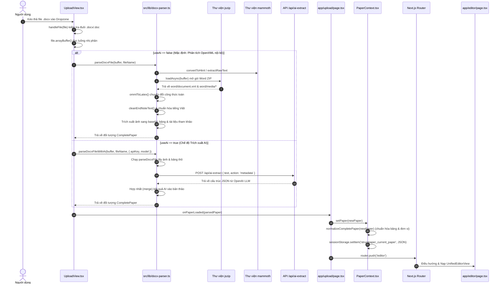
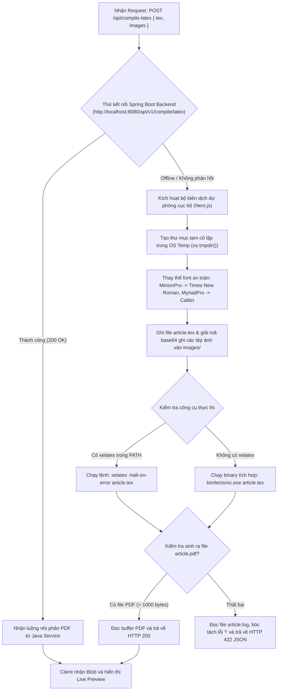

# KIẾN TRÚC CHI TIẾT & LUỒNG DỮ LIỆU END-TO-END (UPLOAD $\rightarrow$ STATE $\rightarrow$ EDITOR $\rightarrow$ PREVIEW)

> **Tài liệu chuyên sâu về cơ chế kỹ thuật nội bộ của dự án StructPaper**  
> **Mục tiêu:** Làm rõ từng tệp mã nguồn (file), hàm (function), cấu trúc dữ liệu JSON (`CompletePaper`), vòng đời trạng thái (State Lifecycle), cơ chế biến đổi cài đặt dàn trang sang mã nguồn XeLaTeX và quy trình cập nhật bản in thời gian thực (Live Preview).

---

## MỤC LỤC CHI TIẾT

1. [Quy trình Upload bài báo: File nào làm gì và luồng thực thi trong code](#1-quy-trình-upload-bài-báo-file-nào-làm-gì-và-luồng-thực-thi-trong-code)
   - 1.1. Sơ đồ tuần tự (Sequence Diagram) luồng Upload
   - 1.2. Bước 1: Tiếp nhận tệp tại `UploadView.tsx` (`handleFile`)
   - 1.3. Bước 2: Bóc tách nhị phân OpenXML tại `src/lib/docx-parser.ts`
   - 1.4. Bước 3: Bộ dịch công thức toán học OMML sang LaTeX (`ommlToLatex`)
   - 1.5. Bước 4: Trích xuất hình ảnh nhị phân sang Data URI Base64
   - 1.6. Bước 5: Trích xuất bảng số liệu & Bóc tách ô gộp (`w:gridSpan`, `w:vMerge`)
   - 1.7. Bước 6: Phân tích tài liệu tham khảo Vancouver & Nhận diện phân san tạp chí
   - 1.8. Bước 7: Phân tích nâng cao bằng OpenAI (nếu kích hoạt `useAi`)
2. [Cấu trúc dữ liệu bài báo (`CompletePaper`): Tổ chức ra sao để hiển thị trong Editor](#2-cấu-trúc-dữ-liệu-bài-báo-completepaper-tổ-chức-ra-sao-để-hiển-thị-trong-editor)
   - 2.1. Lược đồ dữ liệu JSON chuẩn (`CompletePaper Schema`)
   - 2.2. Ánh xạ trực tiếp từ thuộc tính dữ liệu đến từng Tab trong Editor
   - 2.3. Cấu trúc đa hình của các khối nội dung (`PaperSection`)
   - 2.4. Cấu trúc ma trận bảng đa tầng (`PaperTable` & `TableCell`)
3. [Quy trình ghi nhận thay đổi (Khi sửa Text, Sửa Design, Đánh số trang)](#3-quy-trình-ghi-nhận-thay-đổi-khi-sửa-text-sửa-design-đánh-số-trang)
   - 3.1. Mô hình 2 tầng State: `formData` (Local Draft) vs `PaperContext` (Global Store)
   - 3.2. Luồng phản ứng khi người dùng gõ phím sửa văn bản (Text mutation)
   - 3.3. Luồng phản ứng khi cấu hình dàn trang & Đánh số trang (`LayoutSettingsDrawer`)
   - 3.4. Luồng xử lý khi người dùng nhấn "Lưu" hoặc gõ phím tắt `Ctrl + S`
   - 3.5. Cơ chế tự động lưu đệm phiên (`sessionStorage`) chống mất dữ liệu khi F5 Reload
4. [Quy trình sinh mã XeLaTeX & Cập nhật Live Preview chính xác](#4-quy-trình-sinh-mã-xelatex--cập-nhật-live-preview-chính-xác)
   - 4.1. Cơ chế biến đổi cài đặt thiết kế sang lệnh XeLaTeX (`latex-template.ts`)
   - 4.2. Cơ chế chuyển đổi Đánh số trang linh hoạt (Arabic, Roman, Alpha, Hyphen, X of Y)
   - 4.3. Đóng gói mã nguồn & Thu thập hình ảnh nhị phân gửi đến API
   - 4.4. Cơ chế biên dịch PDF: Spring Boot Backend vs Tectonic CLI nội bộ
   - 4.5. Cơ chế cập nhật khung xem trước Iframe (`LivePreviewPane`)

---

## 1. QUY TRÌNH UPLOAD BÀI BÁO: FILE NÀO LÀM GÌ VÀ LUỒNG THỰC THI TRONG CODE

### 1.1. Sơ đồ tuần tự (Sequence Diagram) luồng Upload



---

### 1.2. Bước 1: Tiếp nhận tệp tại `UploadView.tsx` (`handleFile`)

- **Tập tin:** `struct-paper-app/src/components/UploadView.tsx`
- **Hàm thực thi:** `handleFile(file: File)` (dòng 83)
- **Nhiệm vụ:**
  1. Kiểm tra phần mở rộng: `if (!file.name.endsWith('.docx') && !file.name.endsWith('.doc'))` $\rightarrow$ nếu không hợp lệ sẽ set `errorMsg` và hủy tác vụ.
  2. Đặt cờ trạng thái xử lý: `setIsParsing(true)`, `setParsingStatus('Đang đọc file Word...')`.
  3. Đọc dữ liệu nhị phân: `const buffer = await file.arrayBuffer();`.
  4. Quyết định phân nhánh xử lý:
     - Nếu `useAi === true`: Gọi `parseDocxFileWithAi(buffer, file.name, { apiKey, model, onProgress })`.
     - Nếu `useAi === false`: Gọi `parseDocxFile(buffer, file.name)`.
  5. Đồng bộ mã tạp chí: Nếu bản thảo tự nhận diện được `journalId`, cập nhật `setCurrentJournal(parsed.metadata.journalId)`. Nếu không, gán mã tạp chí đang chọn trên màn hình vào bản thảo.
  6. Kích hoạt thông báo thành công: `sileo.success(...)`.
  7. Gọi callback hoàn tất: `onPaperLoaded(parsed)`.

---

### 1.3. Bước 2: Bóc tách nhị phân OpenXML tại `src/lib/docx-parser.ts`

- **Tập tin:** `struct-paper-app/src/lib/docx-parser.ts`
- **Hàm thực thi:** `export async function parseDocxFile(fileBuffer: ArrayBuffer, fileName?: string): Promise<CompletePaper>` (dòng 844)
- **Bản chất của file `.docx`:** Thực chất là một gói nén ZIP chứa nhiều tệp XML chuẩn OpenXML:
  - `word/document.xml`: Chứa toàn bộ nội dung văn bản, cấu trúc đoạn `<w:p>`, đề mục, bảng `<w:tbl>`, công thức toán học `<m:oMath>`.
  - `word/media/`: Chứa tất cả tệp ảnh nhúng (PNG, JPEG, WMF, EMF).
  - `word/_rels/document.xml.rels`: Chứa ánh xạ giữa ID hình ảnh (`r:id="rId5"`) với đường dẫn file trong `word/media/`.

**Quy trình thực thi trong `parseDocxFile`:**
```typescript
// 1. Dùng mammoth để lấy bản dựng HTML thô và trích xuất raw text
const htmlResult = await mammoth.convertToHtml(mammothOpts, { convertImage: mammoth.images.dataUri });
html = htmlResult.value;

// 2. Mở cấu trúc tệp DOCX bằng JSZip
const zip = await JSZip.loadAsync(fileBuffer);

// 3. Đọc cây XML nội dung chính
const docXmlFile = zip.files['word/document.xml'];
const docXml = await docXmlFile.async('string');
```

---

### 1.4. Bước 3: Bộ dịch công thức toán học OMML sang LaTeX (`ommlToLatex`)

- **Tập tin:** `struct-paper-app/src/lib/docx-parser.ts` (dòng 48 - 95)
- **Vấn đề:** Microsoft Word lưu công thức toán bằng ngôn ngữ OMML (Office Math Markup Language) với các thẻ `<m:oMath>`, `<m:f>`, `<m:sSup>`... LaTeX không hiểu được các thẻ này.
- **Giải pháp xử lý:** Hàm đệ quy `ommlToLatex(ommlXml: string)` quét qua cây XML toán học và dịch sang cú pháp LaTeX chuẩn:
  - Phân số: `<m:f>` chứa `<m:num>` và `<m:den>` $\rightarrow$ `\frac{tử}{mẫu}`.
  - Số mũ: `<m:sSup>` chứa `<m:e>` (cơ số) và `<m:sup>` (số mũ) $\rightarrow$ `{cơ số}^{mũ}`.
  - Chỉ số dưới: `<m:sSub>` chứa `<m:e>` và `<m:sub>` $\rightarrow$ `{cơ số}_{dưới}`.
  - Chỉ số trên & dưới đồng thời: `<m:sSubSup>` $\rightarrow$ `{cơ số}_{dưới}^{mũ}`.
  - Căn thức: `<m:rad>` $\rightarrow$ `\sqrt{biểu thức}`.
  - Dấu ngoặc co giãn: `<m:d>` $\rightarrow$ `\left( ... \right)`.
  - Văn bản toán học trong `<m:t>` được giữ nguyên vẹn.

---

### 1.5. Bước 4: Trích xuất hình ảnh nhị phân sang Data URI Base64

- **Tập tin:** `struct-paper-app/src/lib/docx-parser.ts` (dòng 862 - 890)
- **Cách thức hoạt động:**
  1. Quét toàn bộ danh sách file trong gói ZIP có tiền tố `word/media/`.
  2. Đọc luồng nhị phân dưới dạng Base64:
     ```typescript
     const base64 = await zip.files[path].async('base64');
     const ext = path.split('.').pop()?.toLowerCase();
     const mimeType = ext === 'png' ? 'image/png' : 'image/jpeg';
     const dataUri = `data:${mimeType};base64,${base64}`;
     imageMap.set(path, dataUri);
     ```
  3. Ghép nối với thẻ `<w:drawing>` và `<a:blip r:embed="rIdX">` trong `document.xml` để biết ảnh nào nằm tại vị trí nào trong bài báo.
  4. Đóng gói thành đối tượng `PaperFigure`:
     ```typescript
     figure: {
       id: `fig_${index}`,
       num: figNum,
       caption: 'Chú thích trích xuất từ văn bản',
       src: dataUri, // Chuỗi Base64 hoàn chỉnh
       isFullWidth: true
     }
     ```

---

### 1.6. Bước 5: Trích xuất bảng số liệu & Bóc tách ô gộp (`w:gridSpan`, `w:vMerge`)

- **Tập tin:** `struct-paper-app/src/lib/docx-parser.ts` (dòng 920 - 1200)
- **Xử lý phức tạp của bảng Word:**
  - Một ô bảng `<w:tc>` trong Word có thể gộp nhiều cột thông qua thẻ `<w:gridSpan w:val="3"/>`.
  - Có thể gộp hàng dọc thông qua thẻ `<w:vMerge w:val="restart"/>` (bắt đầu gộp) và `<w:vMerge/>` (tiếp tục gộp hàng dưới).
- **Quy trình bóc tách:**
  1. Duyệt từng phần tử `<w:tbl>`.
  2. Tách chú thích bảng từ đoạn văn liền trước hoặc liền sau có tiền tố `Bảng X:` hoặc `Table X:`.
  3. Duyệt từng dòng `<w:tr>`, từng ô `<w:tc>`.
  4. Tính toán chính xác giá trị `colSpan` và `rowSpan` để tạo ma trận `headerRows` (dành cho tiêu đề 2 tầng) và `bodyRows` (dành cho dữ liệu).

---

### 1.7. Bước 6: Phân tích tài liệu tham khảo Vancouver & Nhận diện phân san tạp chí

1. **Bóc tách danh mục tài liệu tham khảo (References):**
   - Tìm kiếm phần đuôi văn bản chứa các tiêu đề: *"Tài liệu tham khảo"*, *"References"*, *"Tài liệu trích dẫn"*.
   - Nhận diện các mục bắt đầu bằng `[1]`, `[2]`, `1.`, `2.`...
   - Tách chuỗi trích dẫn thô, tự động quét tìm chuỗi `doi: 10.xxxx/...` hoặc `https://doi.org/...` để gán vào trường `doi`.
   - Quét ngược toàn bộ thân bài báo xem số `[X]` có xuất hiện trong các đoạn văn hay không để gán cờ `isCited: true/false`.
2. **Nhận diện tạp chí tự động (`detectJournalFromContent`):**
   - Đọc 3.000 ký tự đầu tiên của bài báo và tên tệp tin.
   - Nếu chứa `"health"`, `"sức khỏe"`, `"hs"` $\rightarrow$ Tạp chí Khoa học Sức khỏe (`VNUHCM-HS`).
   - Nếu chứa `"arns"`, `"natural sci"`, `"hóa học"`, `"vật lý"` $\rightarrow$ Tạp chí Khoa học Tự nhiên (`VNUHCM-ARNS`).
   - Nếu chứa `"ebl"`, `"kinh tế"`, `"luật"` $\rightarrow$ Tạp chí Kinh tế - Luật (`VNUHCM-EBL`).
   - Nếu chứa `"et"`, `"kỹ thuật"`, `"công nghệ"` $\rightarrow$ Tạp chí Kỹ thuật Công nghệ (`VNUHCMJ-ET`).

---

### 1.8. Bước 7: Phân tích nâng cao bằng OpenAI (nếu kích hoạt `useAi`)

- **Tập tin:** `struct-paper-app/src/lib/docx-parser.ts` (`parseDocxFileWithAi`) và `src/app/api/ai-extract/route.ts`
- Khi bật `useAi`:
  1. Bản thảo chạy qua bóc tách cơ bản để lấy ảnh và bảng thô.
  2. Gửi văn bản trích xuất lên `POST /api/ai-extract` với prompt chỉ đạo chuyên gia xuất bản ĐHQG-HCM.
  3. Mô hình GPT phân tách chính xác:
     - Họ tên tác giả người Việt (loại bỏ số mũ, ghép nối chuẩn).
     - Đơn vị công tác chính xác của từng tác giả.
     - Xác định đúng tác giả liên hệ (`corresponding author`) và email.
     - Tóm tắt song ngữ tiếng Việt & tiếng Anh.
  4. Trả về JSON và hợp nhất đè lên `CompletePaper`.

---

## 2. CẤU TRÚC DỮ LIỆU BÀI BÁO (`CompletePaper`): TỔ CHỨC RA SAO ĐỂ HIỂN THỊ TRONG EDITOR

### 2.1. Lược đồ dữ liệu JSON chuẩn (`CompletePaper Schema`)

Toàn bộ thông tin của một bài báo khoa học trong hệ thống `StructPaper` được quy chuẩn hóa trong giao diện TypeScript duy nhất tại `src/types/paper.ts`:

```typescript
export interface CompletePaper {
  id: string;                         // Mã định danh bài báo (vd: "paper_1729000000000")
  metadata: PaperMetadata;            // Dữ liệu tiền sảnh (Frontmatter / Tựa đề, Tác giả, Tạp chí...)
  sections: PaperSection[];           // Thân bài báo (Body / Chuỗi tuyến tính các khối nội dung)
  references: PaperReference[];       // Hậu sảnh (Backmatter / Danh mục trích dẫn Vancouver)
  layoutSettings?: LayoutSettings;    // Thiết lập dàn trang (Khổ giấy, 2 cột/1 cột, đánh số trang...)
  templateId?: string;                // ID của mẫu thiết kế
  templateName?: string;
  updatedAt?: string;
  createdAt?: string;
  status?: 'draft' | 'review' | 'ready';
}
```

Dưới đây là một ví dụ JSON thực tế của một bài báo hoàn chỉnh trong bộ nhớ:

```json
{
  "id": "paper_173000000",
  "metadata": {
    "title": "Hiệu quả của việc kết hợp thở áp lực dương liên tục trên bệnh nhân COPD",
    "titleEn": "Efficacy of combining continuous positive airway pressure in COPD patients",
    "articleType": "Bài báo nghiên cứu",
    "journalId": "VNUHCM-HS",
    "journalName": "Tạp chí Phát triển Khoa học & Công nghệ – Health Sciences",
    "journalAbbv": "Sci. Tech. Dev. J. - Health Sci.",
    "authors": [
      {
        "id": "a_1",
        "name": "Trần Văn Hùng",
        "affiliationIds": [1, 2],
        "isCorresponding": true,
        "email": "tvhung@medvnu.edu.vn",
        "orcid": "0000-0002-1234-5678"
      },
      {
        "id": "a_2",
        "name": "Nguyễn Thị Mai",
        "affiliationIds": [1],
        "isCorresponding": false
      }
    ],
    "affiliations": [
      { "id": 1, "name": "Khoa Y, Đại học Quốc gia TP.HCM", "nameEn": "Faculty of Medicine, VNU-HCM" },
      { "id": 2, "name": "Bệnh viện Chợ Rẫy, TP.HCM", "nameEn": "Cho Ray Hospital, HCMC" }
    ],
    "corresponding": {
      "name": "Trần Văn Hùng",
      "email": "tvhung@medvnu.edu.vn",
      "affiliation": "Khoa Y, Đại học Quốc gia TP.HCM"
    },
    "abstract": "Nghiên cứu được tiến hành trên 120 bệnh nhân COPD giai đoạn II-IV...",
    "abstractEn": "This study was conducted on 120 COPD patients from stage II to IV...",
    "keywords": ["COPD", "Thở áp lực dương", "Hô hấp", "Phục hồi chức năng"],
    "keywordsEn": ["COPD", "CPAP", "Respiration", "Rehabilitation"],
    "dates": {
      "received": "02-10-2026",
      "revised": "05-10-2026",
      "accepted": "08-10-2026",
      "published": "10-10-2026"
    },
    "doi": "10.32508/stdjhs.v7i2.630",
    "volume": "7",
    "issue": "2",
    "year": "2026",
    "firstPage": 1,
    "lastPage": 9
  },
  "sections": [
    {
      "id": "sec_1",
      "type": "h1",
      "title": "ĐẶT VẤN ĐỀ",
      "content": ""
    },
    {
      "id": "sec_2",
      "type": "paragraph",
      "content": "Bệnh phổi tắc nghẽn mạn tính (COPD) là một trong những nguyên nhân gây tử vong hàng đầu [1, 2]..."
    },
    {
      "id": "sec_3",
      "type": "figure",
      "content": "Sơ đồ phân bố bệnh nhân theo phân nhóm GOLD",
      "figure": {
        "id": "fig_1",
        "num": 1,
        "caption": "Sơ đồ phân bố bệnh nhân theo phân nhóm GOLD",
        "src": "data:image/png;base64,iVBORw0KGgo...",
        "columnSpan": "1-column",
        "scalePercent": 95,
        "alignment": "center",
        "placement": "auto",
        "hasBorder": true
      }
    },
    {
      "id": "sec_4",
      "type": "table",
      "content": "Bảng 1: Đặc điểm nhân khẩu học và lâm sàng của đối tượng nghiên cứu",
      "table": {
        "id": "tab_1",
        "num": 1,
        "caption": "Bảng 1: Đặc điểm nhân khẩu học và lâm sàng của đối tượng nghiên cứu",
        "headers": ["Chỉ số", "Nhóm can thiệp (n=60)", "Nhóm chứng (n=60)", "p"],
        "rows": [
          ["Tuổi trung bình", "64.2 ± 8.1", "65.0 ± 7.9", "> 0.05"],
          ["Nam giới (%)", "48 (80%)", "50 (83.3%)", "> 0.05"]
        ],
        "columnSpan": "2-column",
        "fontSize": "8pt",
        "rowStretch": 1.4,
        "hasZebraStripes": true
      }
    }
  ],
  "references": [
    {
      "id": 1,
      "raw": "Global Initiative for Chronic Obstructive Lung Disease. Global strategy for the diagnosis, management, and prevention of chronic obstructive pulmonary disease (2024 report). 2024.",
      "doi": "10.1164/rccm.202401-001",
      "isCited": true,
      "citationCount": 3
    },
    {
      "id": 2,
      "raw": "Nguyễn Văn A, Trần Văn B. Đánh giá chức năng thông khí phổi ở người cao tuổi. Tạp chí Y học TP.HCM. 2022;26(4):112-118.",
      "isCited": true,
      "citationCount": 1
    }
  ],
  "layoutSettings": {
    "paperSize": "custom",
    "columnLayout": "2-column",
    "fontSize": "9pt",
    "columnSep": "1pc",
    "lineSpacing": "1.13",
    "pageNumbering": {
      "enabled": true,
      "position": "bottom-alternating",
      "format": "arabic",
      "startNumber": 1,
      "suppressOnFirstPage": false,
      "prefixText": ""
    }
  }
}
```

---

### 2.2. Ánh xạ trực tiếp từ thuộc tính dữ liệu đến từng Tab trong Editor

Trong component `UnifiedEditorView.tsx`, toàn bộ đối tượng `formData` được truyền xuống các tab con:

| Thành phần dữ liệu trong `CompletePaper` | Component tiếp nhận | Các trường giao diện tương tác |
| :--- | :--- | :--- |
| `paper.metadata` | `MetadataTab.tsx` | - Textarea `metadata.title` (Tiêu đề VN)<br>- Textarea `metadata.titleEn` (Tiêu đề EN)<br>- Select `metadata.articleType` (8 loại bài)<br>- Input `metadata.doi`<br>- DatePickers `metadata.dates.{received, revised, accepted, published}` |
| `paper.metadata.authors`<br>`paper.metadata.affiliations` | `AuthorsTab.tsx` | - Danh sách thẻ tác giả (`authors`): Tên, nút gán sao Tác giả liên hệ, Email, ORCID, chọn các cơ quan tương ứng.<br>- Danh sách thẻ cơ quan (`affiliations`): ID, tên tiếng Việt, tên tiếng Anh. |
| `paper.metadata.abstract`<br>`paper.metadata.keywords` | `AbstractTab.tsx` | - Textarea `metadata.abstract` (kèm đếm từ VN)<br>- Textarea `metadata.abstractEn` (kèm đếm từ EN)<br>- Thẻ chip từ khóa `keywords` & `keywordsEn` (thêm/xóa từ khóa bằng dấu phẩy). |
| `paper.sections` | `SectionsTab.tsx` | Duyệt mảng `sections.map()` sinh ra các thẻ tương ứng:<br>- Đề mục: `HeadingSectionItem.tsx` (H1, H2, H3)<br>- Đoạn văn: `ParagraphSectionItem.tsx` (có tô màu cite `[1]`)<br>- Hình ảnh: `FigureSectionItem.tsx` (ảnh, chú thích, nút phóng to)<br>- Bảng: `TableSectionItem.tsx` (bảng số liệu, nút Excel) |
| `paper.references` | `ReferencesTab.tsx` | Duyệt mảng `references.map()`:<br>- Số thứ tự `[1]`, `[2]...`<br>- Textarea chuỗi trích dẫn thô `raw`<br>- Input mã `doi` (nút kiểm tra link)<br>- Huy hiệu xanh *"Đã cite"* hoặc cam *"Chưa gọi cite"*. |
| `paper.sections.type === 'citation'` | `CitationTab.tsx` | Khung trích dẫn *"How to cite this article"*, nút *"Tạo từ Metadata"* tự động ráp tên tác giả + năm + tên bài. |
| Toàn bộ `CompletePaper` | `PreflightQCTab.tsx` | Bộ quét `computePreflightCheck(formData)` tính điểm 0-100%, kiểm tra đủ 5 phần IMRAD, đối chiếu tham khảo và hiển thị danh sách lỗi. |

---

## 3. QUY TRÌNH GHI NHẬN THAY ĐỔI (KHI SỬA TEXT, SỬA DESIGN, ĐÁNH SỐ TRANG)

### 3.1. Mô hình 2 tầng State: `formData` (Local Draft) vs `PaperContext` (Global Store)

Để tránh hiện tượng giao diện bị giật (re-render lag) khi người dùng gõ văn bản nhanh, hệ thống sử dụng mô hình State 2 tầng:

```
┌────────────────────────────────────────────────────────────────────────┐
│ TRÌNH DUYỆT / GIAO DIỆN NGƯỜI DÙNG                                    │
│                                                                        │
│  [Gõ chữ vào ô tiêu đề / đoạn văn]                                    │
│             │                                                          │
│             ▼                                                          │
│  TẦNG 1: LOCAL DRAFT STATE (UnifiedEditorView.tsx)                     │
│  const [formData, setFormData] = useState(paper);                      │
│  const [isDirty, setIsDirty] = useState(false);                        │
│  ──> Cập nhật tức thì trên UI, bật cờ isDirty = true                   │
│                                                                        │
│  [Nhấn "Lưu" hoặc gõ Ctrl+S]                                           │
│             │                                                          │
│             ▼                                                          │
│  TẦNG 2: GLOBAL CONTEXT & STORAGE (PaperContext.tsx)                   │
│  onUpdatePaper(formData)                                               │
│  ──> normalizeCompletePaper(formData)                                  │
│  ──> Cập nhật PaperContext State                                       │
│  ──> Ghi đè vào sessionStorage ('structpaper_current_paper')           │
│  ──> Đặt lại isDirty = false, hiển thị toast Sileo thành công         │
└────────────────────────────────────────────────────────────────────────┘
```

---

### 3.2. Luồng phản ứng khi người dùng gõ phím sửa văn bản (Text mutation)

Khi người dùng sửa bất kỳ đoạn văn bản nào (ví dụ tiêu đề bài báo trong `MetadataTab`):
1. Sự kiện `onChange` của ô `<textarea>` phát tín hiệu:
   ```typescript
   onChange={(e) => {
     onChange({ ...metadata, title: e.target.value });
     autoResize(e.target);
   }}
   ```
2. Hàm `handleMetadataChange` tại `UnifiedEditorView.tsx` tiếp nhận:
   ```typescript
   const handleMetadataChange = (newMeta: any) => {
     setFormData((prev) => ({ ...prev, metadata: newMeta }));
     setIsDirty(true); // Đánh dấu bản thảo đã bị thay đổi chưa lưu
   };
   ```
3. Thanh Dock bên trái (`EditorLeftDock`) lập tức phản ứng: Nút "Lưu" chuyển trạng thái hiển thị hiệu ứng xung nhịp màu xanh (pulsing glow), thông báo cho người dùng biết có dữ liệu cần lưu.

---

### 3.3. Luồng phản ứng khi cấu hình dàn trang & Đánh số trang (`LayoutSettingsDrawer`)

Khi người dùng mở ngăn kéo Dàn trang (`Sliders` trên Left Dock) và thay đổi các thông số:
- Chọn lại khổ giấy (ví dụ: chuyển từ khổ Custom VNUHCM sang A4).
- Đổi cách chia cột: Chuyển từ **2 cột** sang **1 cột**.
- Chỉnh cỡ chữ nội dung: Chuyển từ **9pt** sang **10pt**.
- Tùy biến Đánh số trang (`PageNumberingSettings`):
  - Đổi định dạng từ `arabic` (1, 2, 3) sang `page-x-of-y` (Trang 1 / 10).
  - Đổi vị trí từ `bottom-alternating` (dưới đáy so le) sang `bottom-center` (chính giữa chân trang).
  - Đặt trang bắt đầu: `startNumber = 125` (phù hợp kỷ yếu hội nghị).
  - Tích chọn `suppressOnFirstPage: true` (ẩn số trang ở trang bìa).

**Quy trình ghi nhận trong code:**
1. Người dùng nhấn nút **"Áp dụng thiết lập"** trong `LayoutSettingsDrawer.tsx`.
2. Hàm `handleApplyLayoutSettings` tại `UnifiedEditorView.tsx` được gọi:
   ```typescript
   const handleApplyLayoutSettings = (newSettings: LayoutSettings, newJournalId?: string) => {
     const journalIdToUse = newJournalId || formData.metadata.journalId || currentJournal;
     const tmpl = JOURNAL_TEMPLATES[journalIdToUse] || JOURNAL_TEMPLATES['VNUHCM-HS'];

     const updated: CompletePaper = {
       ...formData,
       layoutSettings: newSettings, // Gắn thiết lập dàn trang mới
       metadata: {
         ...formData.metadata,
         journalId: journalIdToUse,
         journalName: tmpl.name,
         journalAbbv: tmpl.shortName,
       },
     };
     setFormData(updated);
     setIsDirty(true);
     onUpdatePaper(updated); // Đồng bộ ngay vào PaperContext & sessionStorage
     
     // TỰ ĐỘNG KÍCH HOẠT BIÊN DỊCH LẠI PDF NGAY LẬP TỨC!
     compileLatexToPdf(updated);
   };
   ```
3. Khung xem trước bên phải (`LivePreviewPane`) lập tức phủ mờ Liquid Glass, gửi yêu cầu biên dịch lại và cập nhật bản in PDF với bố cục mới sau khoảng 1-2 giây.

---

### 3.4. Luồng xử lý khi người dùng nhấn "Lưu" hoặc gõ phím tắt `Ctrl + S`

- **Tập tin:** `UnifiedEditorView.tsx` (dòng 199 - 220)
- Hệ thống lắng nghe sự kiện phím tắt toàn cục:
  ```typescript
  useEffect(() => {
    const handleKeyDown = (e: KeyboardEvent) => {
      if ((e.ctrlKey || e.metaKey) && (e.key === 's' || e.key === 'S')) {
        e.preventDefault();
        handleSave();
      }
    };
    window.addEventListener('keydown', handleKeyDown);
    return () => window.removeEventListener('keydown', handleKeyDown);
  }, [handleSave]);
  ```
- **Hàm `handleSave()` thực thi:**
  1. Gọi `onUpdatePaper(formData)`: Bắn dữ liệu từ `UnifiedEditorView` lên `PaperContext`.
  2. Tại `PaperContext.tsx`:
     - Chạy hàm chuẩn hóa `normalizeCompletePaper(newPaper)`.
     - Cập nhật state toàn cục `setPaperState(normalized)`.
     - Lưu phiên: `sessionStorage.setItem('structpaper_current_paper', JSON.stringify(normalized))`.
  3. Đặt cờ: `setIsDirty(false)` (nút Lưu ngừng phát sáng).
  4. Bật cờ: `setSaveSuccess(true)` trong 2.5 giây.
  5. Bắn thông báo Dynamic Island:
     ```typescript
     sileo.success({
       title: 'Đã lưu thay đổi',
       description: 'Bản thảo bài báo đã được cập nhật thành công vào hệ thống',
     });
     ```

---

### 3.5. Cơ chế tự động lưu đệm phiên (`sessionStorage`) chống mất dữ liệu khi F5 Reload

Trong `PaperContext.tsx` (dòng 26 - 40):
```typescript
useEffect(() => {
  try {
    const savedPaper = sessionStorage.getItem('structpaper_current_paper');
    if (savedPaper) {
      const parsed = JSON.parse(savedPaper);
      const normalized = normalizeCompletePaper(parsed);
      setPaperState(normalized);
      sessionStorage.setItem('structpaper_current_paper', JSON.stringify(normalized));
    }
    const savedJournal = sessionStorage.getItem('structpaper_current_journal');
    if (savedJournal) {
      setCurrentJournalState(savedJournal);
    }
  } catch {}
}, []);
```
- Bất cứ khi nào trang bị tải lại (Refresh) hoặc người dùng vô tình bấm F5, hook `useEffect` này sẽ đọc ngay bản sao lưu trong `sessionStorage` để phục hồi 100% dữ liệu bản thảo và tạp chí hiện tại.

---

## 4. QUY TRÌNH SINH MÃ XELATEX & CẬP NHẬT LIVE PREVIEW CHÍNH XÁC

### 4.1. Cơ chế biến đổi cài đặt thiết kế sang lệnh XeLaTeX (`latex-template.ts`)

File: `struct-paper-app/src/lib/latex-template.ts`  
Hàm: `generateFullJournalLatex(paper: CompletePaper, customSettings?: LayoutSettings): string`

Hàm này nhận vào đối tượng JSON `CompletePaper` và `LayoutSettings`, sau đó dịch sang chuỗi mã nguồn XeLaTeX nguyên bản:

#### A. Dịch khổ giấy (`paperSize`)
```typescript
let paperWidthStr = '8.51in';
let paperHeightStr = '11in';
if (settings.paperSize === 'a4') {
  paperWidthStr = '210mm'; paperHeightStr = '297mm';
} else if (settings.paperSize === 'letter') {
  paperWidthStr = '8.5in'; paperHeightStr = '11in';
} else if (settings.paperSize === 'b5') {
  paperWidthStr = '182mm'; paperHeightStr = '257mm';
}
// Chèn vào lệnh geometry của LaTeX:
// \newgeometry{..., paperheight=297mm, paperwidth=210mm}
```

#### B. Dịch số cột (`columnLayout`) và cỡ chữ (`fontSize`)
```typescript
const docClassCols = isOneColumn ? 'onecolumn' : 'twocolumn';
const fontSize = settings.fontSize || '9pt';
// Chèn vào khai báo documentclass:
// \documentclass[9pt,twocolumn]{article}
```

#### C. Dịch khoảng cách cột (`columnSep`) và giãn dòng (`lineSpacing`)
```typescript
const colSep = isOneColumn ? '1pc' : (settings.columnSep || '1pc');
const lineSpread = settings.lineSpacing || '1.13';
// Sinh ra:
// \setlength{\columnsep}{1pc}
// \linespread{1.13}
```

---

### 4.2. Cơ chế chuyển đổi Đánh số trang linh hoạt (Arabic, Roman, Alpha, Hyphen, X of Y)

Hệ thống hỗ trợ cấu hình đánh số trang cực kỳ linh hoạt tương đương Microsoft Word:

```typescript
const pageNum = settings.pageNumbering || DEFAULT_PAGE_NUMBERING;

// 1. Dịch định dạng số trang
let pageFormatCmd = '\\pagenumbering{arabic}';
if (pageNum.format === 'roman-lower') pageFormatCmd = '\\pagenumbering{roman}';
else if (pageNum.format === 'roman-upper') pageFormatCmd = '\\pagenumbering{Roman}';
else if (pageNum.format === 'alpha-lower') pageFormatCmd = '\\pagenumbering{alph}';
else if (pageNum.format === 'alpha-upper') pageFormatCmd = '\\pagenumbering{Alph}';
else if (pageNum.format === 'hyphen') {
  pageFormatCmd = '\\pagenumbering{arabic}\\renewcommand{\\thepage}{- \\arabic{page} -}';
} else if (pageNum.format === 'page-x-of-y') {
  pageFormatCmd = '\\pagenumbering{arabic}\\renewcommand{\\thepage}{\\arabic{page} / \\pageref{LastPage}}';
}

// 2. Chèn số trang bắt đầu tùy chỉnh
const startPageCmd = `\\setcounter{page}{${Math.max(1, pageNum.startNumber || 1)}}`;

// 3. Dịch vị trí số trang sang gói fancyhdr
switch (pageNum.position) {
  case 'bottom-center':
    headingsFootHead = '\\fancyfoot[L]{}\\fancyfoot[R]{}\\fancyfoot[C]{\\thepage}';
    break;
  case 'bottom-right':
    headingsFootHead = '\\fancyfoot[L]{}\\fancyfoot[C]{}\\fancyfoot[R]{\\thepage}';
    break;
  case 'bottom-alternating': // So le: trang lẻ góc phải, trang chẵn góc trái
  default:
    headingsFootHead = `\\fancyfoot[L]{\\ifthenelse{\\isodd{\\value{page}}}{}{\\thepage}}
\\fancyfoot[R]{\\ifthenelse{\\isodd{\\value{page}}}{\\thepage}{}}`;
    break;
}

// 4. Nếu bật ẩn số trang ở trang bìa đầu tiên (Different first page)
if (pageNum.suppressOnFirstPage) {
  // Loại bỏ \thepage trong khai báo \fancypagestyle{plain}
}
```

---

### 4.3. Đóng gói mã nguồn & Thu thập hình ảnh nhị phân gửi đến API

Tại `compileLatexToPdf` (`UnifiedEditorView.tsx`, dòng 105 - 143):
1. Sinh chuỗi mã TeX: `const texContent = exportToLatex(paperToCompile, settings);`.
2. Duyệt qua mảng `paperToCompile.sections`, tìm các phần tử có `type === 'figure'`.
3. Tách chuỗi Data URI Base64 (`data:image/png;base64,...`):
   ```typescript
   const images: Record<string, string> = {};
   (paperToCompile.sections || []).forEach((sec, idx) => {
     if (sec.type === 'figure' && sec.figure?.src) {
       const num = sec.figure.num || (idx + 1);
       if (sec.figure.src.startsWith('data:image')) {
         const base64Data = sec.figure.src.split(',')[1];
         // Đăng ký alias để LaTeX luôn tìm thấy ảnh
         images[`fig${num}.png`] = base64Data;
         images[`fig${num}.jpg`] = base64Data;
       }
     }
   });
   ```
4. Gửi HTTP Request sang API:
   ```typescript
   const response = await fetch('/api/compile-latex', {
     method: 'POST',
     headers: { 'Content-Type': 'application/json' },
     body: JSON.stringify({
       tex: texContent,
       paperId: paperToCompile.id,
       images: images,
     }),
   });
   ```

---

### 4.4. Cơ chế biên dịch PDF: Spring Boot Backend vs Tectonic CLI nội bộ

File: `struct-paper-app/src/app/api/compile-latex/route.ts`

API Route xử lý biên dịch theo nguyên tắc ưu tiên 2 tầng:



---

### 4.5. Cơ chế cập nhật khung xem trước Iframe (`LivePreviewPane`)

Khi `fetch('/api/compile-latex')` thành công:
1. `UnifiedEditorView.tsx` nhận về luồng nhị phân:
   ```typescript
   const blob = await response.blob();
   const url = URL.createObjectURL(blob); // Tạo blob URL an toàn trên RAM trình duyệt
   setCompiledPdfUrl(url); // Cập nhật state
   ```
2. Ghi nhận thời gian và dung lượng:
   ```typescript
   setCompileStats({
     durationMs: parseInt(response.headers.get('x-compilation-time-ms') || '1500'),
     sizeKb: Math.round(blob.size / 1024),
     timestamp: new Date().toLocaleTimeString('vi-VN'),
   });
   ```
3. Component `LivePreviewPane.tsx` tiếp nhận `compiledPdfUrl`:
   ```tsx
   <iframe
     src={`${compiledPdfUrl}#toolbar=1&navpanes=0`}
     className="w-full h-full border-none"
     title="XeLaTeX Compiled PDF Live Preview"
   />
   ```
4. Trình duyệt lập tức hiển thị bản in PDF cập nhật mới nhất đúng từng chữ, từng vị trí bảng, hình và số trang mà người dùng vừa thiết lập!

---

## TỔNG KẾT BỨC TRANH KIẾN TRÚC

Toàn bộ quy trình từ **Upload $\rightarrow$ Bóc tách $\rightarrow$ State $\rightarrow$ Editor $\rightarrow$ Preview** là một đường ống khép kín (Data Pipeline):
1. **Đầu vào:** File nhị phân Word (`.docx`) được tháo dỡ thành cấu trúc dữ liệu JSON thuần khiết `CompletePaper`.
2. **Xử lý:** Quản trị qua mô hình 2 tầng State (`formData` $\rightarrow$ `PaperContext` $\rightarrow$ `sessionStorage`).
3. **Hiển thị & Tương tác:** Từng trường dữ liệu ánh xạ chính xác đến 7 tab chuyên biệt và các Modal bảng tính Excel, thuộc tính hình ảnh.
4. **Đầu ra:** Trình tạo mẫu `latex-template.ts` biên dịch JSON thành mã nguồn XeLaTeX chuẩn mực, chuyển qua engine Tectonic / XeLaTeX để xuất bản thành file PDF chất lượng cao nhất cho các tạp chí thuộc Đại học Quốc gia Thành phố Hồ Chí Minh.
