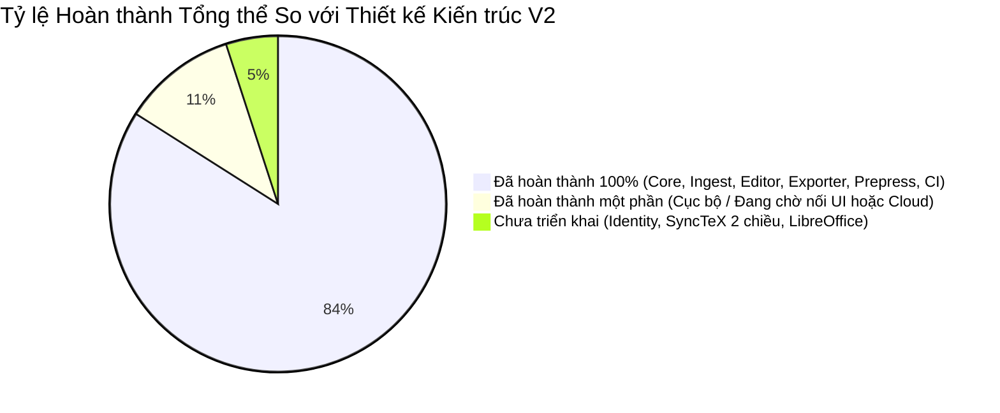
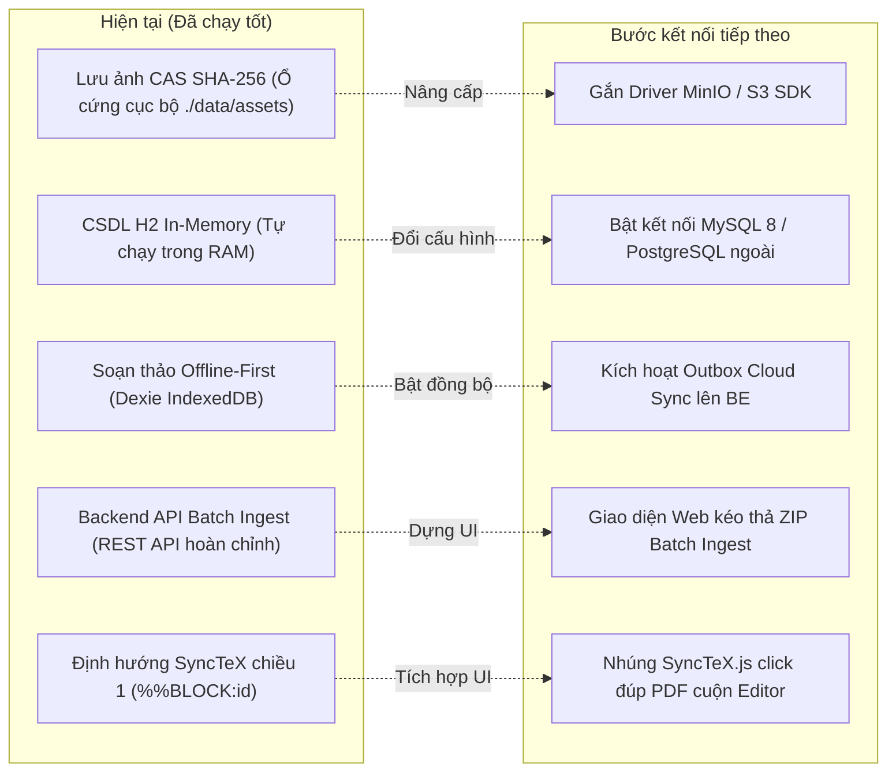
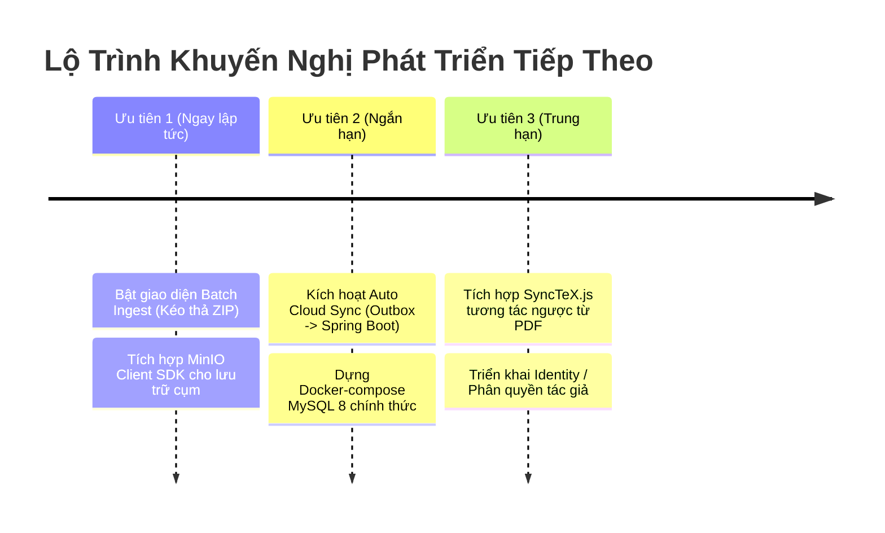

# 📊 BÁO CÁO RÀ SOÁT & ĐỐI CHIẾU KIẾN TRÚC STRUCTPAPER V2
### ĐÁNH GIÁ HIỆN TRẠNG TRIỂN KHAI SO VỚI TÀI LIỆU THIẾT KẾ KIẾN TRÚC V2 (31 TRANG PDF)

> **Ngày lập báo cáo:** 05/11/2026  
> **Căn cứ đối chiếu:**
> - Tài liệu gốc: `docs/Architecture/StructPaper v2 — Đề xuất kiến trúc & design pattern.pdf` (31 trang)
> - Tài liệu trao đổi & làm rõ: `docs/Architecture/Đề xuất Kiến trúc StructPaper v2.pdf` (34 trang)
> - Hồ sơ kỹ thuật: `docs/superpowers/specs/2026-11-04-structpaper-v2-refactor-design.md` và `docs/superpowers/plans/2026-11-04-structpaper-v2-refactor.md`
> - Toàn bộ mã nguồn thực tế tại kho lưu trữ `StructPaper` (`apps/web`, `apps/api`, `packages/*`).

---

## 📑 MỤC LỤC
1. [Tóm Tắt Tổng Quan Tình Trạng Triển Khai](#1-tóm-tắt-tổng-quan-tình-trạng-triển-khai)
2. [Chi Tiết Các Hạng Mục Đã Hoàn Thành 100%](#2-chi-tiết-các-hạng-mục-đã-hoàn-thành-100)
3. [Chi Tiết Các Hạng Mục Đã Triển Khai Một Phần (Hybrid / Cục Bộ)](#3-chi-tiết-các-hạng-mục-đã-triển-khai-một-phần-hybrid--cục-bộ)
4. [Chi Tiết Các Hạng Mục Chưa Triển Khai So Với Tài Liệu Thiết Kế](#4-chi-tiết-các-hạng-mục-chưa-triển-khai-so-với-tài-liệu-thiết-kế)
5. [Bảng Đối Chiếu 14 Bất Cập Của Bản V1 Được Giải Quyết Trong V2](#5-bảng-đối-chiếu-14-bất-cập-của-bản-v1-được-giải-quyết-trong-v2)
6. [Đánh Giá Ranh Giới Kiến Trúc & Chất Lượng Mã Nguồn](#6-đánh-giá-ranh-giới-kiến-trúc--chất-lượng-mã-nguồn)
7. [Đề Xuất Lộ Trình & Khuyến Nghị Kế Tiếp](#7-đề-xuất-lộ-trình--khuyến-nghị-kế-tiếp)

---

## 1. Tóm Tắt Tổng Quan Tình Trạng Triển Khai

Quá trình tái cấu trúc lớn (Large-Scale Architectural Refactoring) theo mô hình **Strangler Fig Pattern** từ Phase 0 đến Phase 8 đã hoàn thành toàn bộ khung xương cốt lõi, giải quyết triệt để các rào cản kỹ thuật của phiên bản cũ (v1) mà vẫn **bảo tồn 100% trải nghiệm giao diện người dùng (UI Parity)**.

### Bảng Chỉ Số Đo Lường Nhanh

| Phân hệ / Tiêu chí | Đánh giá | Trạng thái hiện tại |
| :--- | :--- | :--- |
| **Monorepo & Ranh giới Hexagonal** | 100% Đạt | `pnpm workspaces` (apps/web, apps/api, 7 packages độc lập), 0 vi phạm depcruise. |
| **Mô hình Manuscript v2 & AST** | 100% Đạt | Đầy đủ Zod Schema, Stable ULID, `computeNumbering` với derived citations/figures/tables. |
| **DOCX Ingest Pipeline** | 100% Đạt | 6 tầng độc lập, fast-xml-parser isomorphic, StyleMap 35 styles (đạt confidence 1.0 trên 4 templates). |
| **Trải nghiệm Editor & TipTap** | 100% Đạt | TipTap ProseMirror cho đoạn văn, b/i/sup/sub, popup trích dẫn `[`, gõ tiếng Việt Telex/VNI chuẩn qua CDP. |
| **Lưu trữ Offline-First** | 100% Đạt | Dexie IndexedDB (8 bảng), Autosave 1s ngầm, Undo/Redo 100 bước, chống mất dữ liệu khi F5. |
| **Bộ Xuất bản Đa định dạng** | 100% Đạt | `LatexExporter` hợp nhất + `structpaper-hs.cls`, `JatsExporter` (JATS XML 1.3), `DocxExporter`, Zip Packager. |
| **Backend Spring Boot 3 API** | 90% Đạt | Modular Monolith, Flyway DB, CAS Assets SHA-256, LaTeX Compile Sandbox, Batch Ingest, Prepress PDF/X. |
| **Đồng bộ Đám mây (Cloud Sync)** | 50% (Một phần) | Backend API `GET/PUT /api/v1/manuscripts` đã sẵn sàng; Frontend hiện chạy Local-First chưa bật sync nền. |
| **Lưu trữ Đối tượng MinIO** | 30% (Một phần) | Đã chuẩn hóa mô hình CAS theo SHA-256 trên Filesystem đĩa; chưa gắn driver S3/MinIO SDK. |
| **Tương tác PDF SyncTeX 2 chiều** | 50% (Một phần) | Chiều 1 (Lỗi $\rightarrow$ Block) đã gắn `%%BLOCK:<id>`; Chiều 2 (Click PDF $\rightarrow$ Editor) chưa nhúng thư viện JS. |
| **Phân quyền & Đăng nhập (Auth)** | 0% (Chưa làm) | Chưa triển khai module `identity/` (JWT/OIDC). |

---

## 2. Chi Tiết Các Hạng Mục Đã Hoàn Thành 100%

### 2.1. Lõi miền độc lập `@structpaper/doc-model` (Mục 3 trong PDF)
- **Đạt chuẩn Hexagonal:** Hoàn toàn là Pure TypeScript, 0% dính líu đến React, JSX, DOM, IndexedDB hay HTTP. Được giám sát bởi công cụ `dependency-cruiser` trong CI.
- **Cấu trúc dữ liệu AST chuẩn:**
  - `Manuscript`: Cấu trúc phân cấp gồm `FrontMatter`, `Section[]`, `Block[]`, `Inline[]`, `BackMatterItem[]`, `AssetMeta`.
  - Định danh ổn định (Stable ID): Sử dụng ULID (`ulid`) qua abstraction `IdGenerator` có thể inject hạt nhân ngẫu nhiên hoặc deterministic trong unit test.
- **Dữ liệu dẫn xuất (`computeNumbering`):**
  - Số thứ tự Hình, Bảng, Công thức, Trích dẫn $[1] \dots [n]$ được tính toán động từ vị trí xuất hiện thực tế của phần tử trong cây tài liệu.
  - Tự động gộp dải số Vancouver: $[1, 2, 3] \rightarrow [1-3]$, $[1, 3, 4, 5, 8] \rightarrow [1, 3-5, 8]$.
  - Tự động phát hiện lỗi cấu trúc: tài liệu tham khảo ma (`uncitedRefs`), trích dẫn trỏ vào hư không (`danglingCites`), tham chiếu hỏng (`xrefBroken`), và vi phạm tiền kiểm định nhắc trước khi xuất hiện (`firstMentionBeforeFloat`).
  - Kiểm thử vững chắc bằng **Property-Based Testing** qua thư viện `fast-check` (300 lần sinh ngẫu nhiên block mà số thứ tự không bao giờ bị trùng lặp).
- **Bộ chuyển đổi tương thích V1 $\leftrightarrow$ V2:**
  - `migrateV1toV2`: Chuyển đổi dữ liệu phẳng v1 thành cấu trúc cây v2, bóc trích dẫn, ảnh base64 sang asset metadata.
  - `adaptV2toV1`: Chuyển đổi ngược để giữ cho các thành phần giao diện cũ hoạt động trơn tru trong giai đoạn chuyển tiếp.

### 2.2. Hồ sơ tạp chí dạng cấu hình `@structpaper/journal-profiles` (Mục 5 trong PDF)
- Toàn bộ quy định của tạp chí được chuyển thành dữ liệu cấu hình JSON có Zod schema kiểm định, không còn bị code cứng (hard-code) rải rác:
  - Giới hạn từ Tóm tắt (Abstract): 275 - 500 từ.
  - Số lượng Từ khóa (Keywords): 3 - 5 từ, phân cách bằng dấu chấm phẩy `;`.
  - Định dạng ngày tháng, kiểu trích dẫn Vancouver, cấu hình typography (Times New Roman, lề 20mm).
  - Bản đồ ánh xạ Word Styles: 35 styles chuẩn của tòa soạn ĐHQG-HCM (`ArticleTitle`, `Authors`, `Affiliation`, `Heading1-3`, `TableCaption`, `FigureCaption`, `Reference`...). Tự động loại bỏ hoàn toàn các đoạn hướng dẫn (`Guide*`, `Instruction`).

### 2.3. Pipeline bóc tách DOCX đa tầng `@structpaper/ingest-docx` (Mục 4 trong PDF)
- Thay thế hoàn toàn file `docx-parser.ts` cũ (> 2.100 dòng) bằng kiến trúc đường ống 6 tầng chuyên biệt:
  1. **Package Layer:** Mở ZIP đọc trực tiếp `document.xml`, `styles.xml`, `numbering.xml`, bóc ảnh từ `word/media/` và sơ đồ quan hệ `rels`.
  2. **OOXML $\rightarrow$ RawDoc:** Sử dụng `fast-xml-parser` duyệt AST XML thực thụ, giải quyết chuỗi kế thừa style `w:basedOn`, gỡ bỏ `w:sdt`, bóc tách các trường tự động EndNote/Zotero.
  3. **Recognizers đa tầng:**
     - `StyleMapRecognizer` (Priority 1, độ tin cậy 1.0): Nhận diện tức thì qua 35 styles chuẩn của file template tòa soạn.
     - `StructureRecognizer` (Priority 2, độ tin cậy 0.8): Phỏng đoán thông minh cho tài liệu không gán style chuẩn (dựa vào cấu trúc bảng, regex caption "Hình N.", "Bảng N.", trích dẫn `[n]`).
  4. **Assemblers chuyên trách:**
     - `TableAssembler`: Dựng ma trận lưới 2D `Cell[][]` xử lý chuẩn xác ô gộp ngang `gridSpan` (colSpan) và ô gộp dọc `vMerge` (rowSpan), trích xuất caption và nguồn.
     - `FigureAssembler`: Bóc tách ảnh nhị phân, tính mã băm SHA-256, tự động gán DPI 300 và tạo khối `FigureBlock`.
     - `EquationAssembler`: Chuyển đổi công thức toán học OMML sang LaTeX chuẩn (`\frac`, `\sqrt`, `\sum`, `\int`, chỉ số trên/dưới) và lưu trữ mã gốc.
     - `ReferenceAssembler` & `FrontMatterAssembler`: Bóc tách tài liệu tham khảo, trích xuất DOI, URLs và liên kết tác giả với đơn vị công tác.
  5. **Normalizers:** Chuẩn hóa Unicode NFC (tránh lỗi font tiếng Việt do lẫn lộn tổ hợp NFD và dựng sẵn NFC), sửa lỗi dãn chữ tiếng Việt (`Nguy ễ n` $\rightarrow$ `Nguyễn`), loại bỏ số thứ tự gõ cứng trong caption ("Bảng 1:"), liên kết trích dẫn.
  6. **Validate & Web Worker:** Đóng gói chạy trong Web Worker (không làm đơ giao diện khi tải file Word lớn) và chạy được cả phía server Node.js (Isomorphic).
- **Kết quả kiểm chứng:** Chạy thử trên cả 4 file trong `docs/StandardTemplate/` đạt độ tin cậy tuyệt đối **1.0 (100%)** trong thời gian siêu tốc từ 39ms đến 106ms.

### 2.4. Trải nghiệm soạn thảo văn bản giàu định dạng (TipTap / ProseMirror) (Mục 6.4 trong PDF)
- Triển khai thành công **Phương án A (TipTap/ProseMirror)** thay thế hoàn toàn ô nhập text thô cũ:
  - Schema ProseMirror ánh xạ 1-1 với cấu trúc `Inline[]` của doc-model.
  - Hỗ trợ đầy đủ các marks: in đậm (`b`), in nghiêng (`i`), chỉ số trên (`sup`), chỉ số dưới (`sub`), mã (`code`).
  - Hỗ trợ các atom nodes bấm được: Trích dẫn (`CiteNode`), Tham chiếu chéo (`XrefNode`), Công thức toán nội dòng (`MathNode`).
  - Gõ phím `[` tự động bật popup chọn tài liệu tham khảo nhanh.
  - Bộ lọc rác dán từ Word (`clean-word-paste.ts`): Giữ nguyên định dạng in nghiêng danh pháp vi sinh (*Helicobacter pylori*), chỉ số chức năng hô hấp ($\text{FEV}_1$), và lũy thừa toán học ($10^3$).
  - **Kiểm thử bộ gõ tiếng Việt:** Sử dụng giao thức Chrome DevTools Protocol (`Input.imeSetComposition`) trong Playwright kiểm chứng gõ tiếng Việt Telex và VNI trên TipTap không bị mất dấu hay nhảy con trỏ.

### 2.5. Kiến trúc Quản lý Trạng thái & Lưu trữ Ngoại tuyến (Mục 6.1, 6.2, 9 trong PDF)
- **Store tập trung & CommandBus:** Toàn bộ trạng thái bản thảo quản lý qua Zustand + Immer. Không component nào được phép gán đè state trực tiếp mà bắt buộc phải phát lệnh `dispatch(Command)`.
- **Hoàn tác / Làm lại (Undo / Redo):** Nhờ cơ chế `produceWithPatches` của Immer, hệ thống tự động sinh các cặp patches và inverse patches, quản lý ngăn xếp lịch sử 100 bước mượt mà.
- **Lưu trữ ngoại tuyến Offline-First (Dexie IndexedDB):**
  - Cấu trúc 8 bảng chuẩn hóa: `manuscripts`, `revisions`, `assets`, `assetRefs`, `ingestSources`, `outbox`, `compileCache`, `settings`.
  - Động cơ **Autosave ngầm** lắng nghe luồng patch, debounce 1 giây tự động ghi xuống đĩa trình duyệt.
  - Kiểm thử E2E Playwright chứng minh: nạp bài, gõ nội dung, chờ autosave, nhấn **F5 Reload trang** khôi phục nguyên vẹn 100% dữ liệu.
  - Tính năng xuất/nhập file sao lưu toàn vẹn `.structpaper` (chứa toàn bộ JSON và tệp ảnh nhị phân nén dạng ZIP).

### 2.6. Bộ xuất bản đa định dạng `@structpaper/exporters` (Mục 8 trong PDF)
- `LatexExporter`: Hợp nhất từ 2 file rời rạc trước đây, tự động escape ký tự đặc biệt TeX (`escapeTex`), chèn comment định danh `%%BLOCK:<id>` trước mỗi block, sử dụng document class chuyên nghiệp [`structpaper-hs.cls`](file:///c:/Users/OWNER/source/StructPaper/packages/exporters/src/latex/templates/structpaper-hs.cls).
- `JatsExporter`: Xuất khẩu tài liệu sang chuẩn quốc tế **JATS XML 1.3 DTD** (Journal Article Tag Suite) phục vụ chỉ mục thư viện học thuật (PubMed, Scopus, Crossref).
- `DocxExporter`: Xuất ngược trở lại file Word `.docx` chuẩn mẫu tòa soạn.
- `CslFormatter`: Bộ định dạng trích dẫn hỗ trợ chuẩn Vancouver và APA 7th edition.
- `ZipPackager`: Đóng gói toàn bộ mã nguồn TeX, file `.cls`, thư mục ảnh, JATS XML và hướng dẫn biên dịch thành file `.zip` sẵn sàng nộp tòa soạn.

### 2.7. Động cơ Kiểm định Chất lượng `@structpaper/qc-engine` (Mục 7 trong PDF)
- Xây dựng theo **Specification Pattern**: Mỗi luật kiểm tra là một class nhỏ độc lập, dễ dàng bật/tắt theo cấu hình từng tạp chí.
- Bảng điểm chuẩn hóa 0 - 100/100 điểm chia đều trên 6 trụ cột cấu trúc:
  1. Cấu trúc IMRaD (Đặt vấn đề, Phương pháp, Kết quả, Bàn luận).
  2. Bảng biểu (Kiểm tra caption, nguồn, số cột/hàng).
  3. Hình ảnh (Kiểm tra độ phân giải DPI $\ge 300$, kích thước, chú thích).
  4. Trích dẫn & Danh mục tài liệu tham khảo (Phát hiện lỗi sai thứ tự, dangling cite).
  5. Thông tin Tác giả & Tóm tắt (Độ dài từ, số từ khóa, email liên hệ, ORCID).
  6. Định dạng xuất bản học thuật.
- Hỗ trợ các hành động **Sửa nhanh (Quick-Fix)** gắn trực tiếp với CommandBus.

### 2.8. Biên dịch Cách ly & Backend Spring Boot 3 (Mục 8.2, 10 trong PDF)
- **Compile Sandbox an toàn:** Tiến trình XeLaTeX / Tectonic được cô lập trong thư mục tạm, cấm tuyệt đối cờ `--no-shell-escape`, timeout 30 giây, tự động dọn sạch rác đĩa.
- **Hàng đợi & Tối ưu hóa:**
  - Tự động hủy (cancel) các job biên dịch cũ khi người dùng phát yêu cầu mới cho cùng một bản thảo.
  - Bộ nhớ đệm SHA-256 (Content-Addressed Cache): Trả về file PDF ngay lập tức ($< 10\text{ ms}$) nếu mã nguồn và hình ảnh không thay đổi.
- **Prepress Pipeline (PDF/X-1a):** Tích hợp công cụ Ghostscript chuyển đổi màu CMYK, nhúng 100% font chữ, kiểm định DPI $\ge 300$, kèm cơ chế software mock fallback thông minh khi môi trường máy chủ thiếu Ghostscript.
- **Cổng AI Proxy bảo mật:** Loại bỏ hoàn toàn API key ở frontend, proxy qua Spring Boot với whitelist 5 hành động hợp lệ, giới hạn payload $\le 15\text{ KB}$ và ghi nhật ký IP client.
- **Batch Ingest Service:** Backend hỗ trợ upload file ZIP chứa nhiều bài báo Word, bảo vệ chống lỗ hổng Zip Slip, lọc rác macOS, xử lý bất đồng bộ và cung cấp API báo cáo tiến độ thời gian thực.

---

## 3. Chi Tiết Các Hạng Mục Đã Triển Khai Một Phần (Hybrid / Cục Bộ)

Các hạng mục này đã được cài đặt và vận hành tốt ở cấp độ môi trường cục bộ/phát triển, nhưng cần hoàn thiện thêm một bước kết nối để chuyển sang môi trường Production hoàn chỉnh:

### 3.1. Lưu trữ Tài nguyên Hình ảnh (Asset Storage)
* **Thiết kế:** Lưu trữ Asset nhị phân theo mã băm SHA-256 trên Filesystem / MinIO (Mục 10.1 & Mục 12 trong PDF).
* **Hiện trạng:** Đã triển khai chuẩn CAS (Content-Addressable Storage) theo SHA-256 trên **Filesystem cục bộ** tại thư mục `apps/api/data/assets/{sha256}`.
* **Chưa làm:** Chưa cài đặt MinIO Client SDK (`io.minio:minio`) hoặc AWS S3 SDK. Hiện tại file lưu trên đĩa máy chủ, đáp ứng hoàn hảo cho chạy đơn máy nhưng chưa phân tán ra Object Storage cụm.

### 3.2. Cơ sở Dữ liệu Quan hệ (RDBMS)
* **Thiết kế:** Sử dụng MySQL 8 với tính năng Native JSON (`doc_json`), cột quan hệ đánh chỉ mục, và Flyway migration (Mục 10.2 trong PDF).
* **Hiện trạng:** Đã xây dựng hoàn chỉnh script Flyway migration [`V1__init_schema.sql`](file:///c:/Users/OWNER/source/StructPaper/apps/api/src/main/resources/db/migration/V1__init_schema.sql) tương thích cả MySQL và H2. Mặc định ứng dụng đang chạy **H2 Database In-Memory** để dev/test không cần cài đặt MySQL Server.
* **Chưa làm:** Chưa dựng Docker-compose chạy MySQL 8 chính thức (khi cần chỉ việc trỏ biến môi trường `SPRING_DATASOURCE_URL`).

### 3.3. Đồng bộ Dữ liệu Trình duyệt $\leftrightarrow$ Máy chủ (Cloud Sync)
* **Thiết kế:** Áp dụng mẫu thiết kế `SyncedRepository` bọc quanh `IndexedDbRepository`, lắng nghe luồng patch, lưu vào bảng `outbox` và gửi lên Spring Boot qua cơ chế khóa lạc quan `If-Match: rev` (Chiến lược đồng bộ S1/S2, Mục 9.4 trong PDF).
* **Hiện trạng:**
  - Phía **Frontend**: Đã có IndexedDB lưu 8 bảng, có bảng `outbox`, có schema API client.
  - Phía **Backend**: Đã có đầy đủ API `GET/PUT /api/v1/manuscripts/{id}` với kiểm soát `If-Match`, trả `412 Precondition Failed` khi xung đột phiên bản, và lưu lịch sử `revisions`.
* **Chưa làm:** Frontend hiện tại vẫn chạy độc lập theo chế độ Offline-First; chưa kích hoạt luồng tự động đẩy dữ liệu từ bảng `outbox` lên Backend qua mạng khi có kết nối Internet.

### 3.4. Giao diện Người dùng cho Xử lý Hàng loạt (Batch Ingest UI)
* **Thiết kế:** Nạp file ZIP chứa nhiều bài báo DOCX, xử lý hàng loạt và hiển thị báo cáo tổng kết (Mục 10.4 trong PDF).
* **Hiện trạng:** Backend đã có đầy đủ bộ 3 API: `POST /api/v1/batches`, `GET /api/v1/batches/{batchId}`, và `GET /api/v1/batches/{batchId}/report` (đã pass 100% unit/integration tests).
* **Chưa làm:** Trên giao diện Frontend (`apps/web`), trang Upload hiện tại mới chỉ có ô nạp từng file `.docx` đơn lẻ; chưa có màn hình giao diện riêng để kéo thả file `.zip` và theo dõi thanh tiến độ phần trăm % cho từng bài báo trong mẻ batch.

### 3.5. Tương tác PDF $\leftrightarrow$ Editor Hai Chiều (SyncTeX)
* **Thiết kế:** Kết hợp thẻ ẩn `%%BLOCK:<id>` và SyncTeX để hỗ trợ tương tác 2 chiều (Mục 6.5 & Mục 16 trong PDF):
  - *Chiều 1:* Bấm vào thông báo lỗi $\rightarrow$ Nhảy đến đúng khối soạn thảo trong Editor.
  - *Chiều 2:* Click chuột vào một đoạn trên PDF xem trước $\rightarrow$ Tự động cuộn màn hình Editor đến đúng đoạn văn đó.
* **Hiện trạng:**
  - *Chiều 1:* `LatexExporter` đã sinh đầy đủ thẻ `%%BLOCK:<id>` trước mọi block trong mã nguồn TeX; hệ thống QC đã có target `blockId` để cuộn Editor.
* **Chưa làm (Chiều 2):** Khung xem trước PDF hiện tại đang hiển thị file PDF qua đối tượng URL Blob; chưa nhúng thư viện giải mã dữ liệu bản đồ tọa độ SyncTeX (`synctex-js`) trên giao diện để bắt sự kiện click đúp trên PDF nhảy ngược về Editor.

---

## 4. Chi Tiết Các Hạng Mục Chưa Triển Khai So Với Tài Liệu Thiết Kế

Các hạng mục dưới đây thuộc về giai đoạn mở rộng hệ thống sang môi trường đa người dùng hoặc dịch vụ đám mây công cộng và được tài liệu ghi nhận là tùy chọn hoặc câu hỏi mở (Mục 17 trong PDF):

### 4.1. Phân hệ Định danh & Xác thực Người dùng (`identity/`)
- **Tài liệu đề xuất:** Module `vn.edu.vnu.structpaper.identity` quản lý đăng nhập (JWT/OIDC), phân quyền các vai trò: *Author* (Tác giả), *Editor* (Biên tập viên), *Production* (Chế bản), *Admin* (Quản trị) (Mục 10.1, trang 23 PDF).
- **Hiện trạng:** Chưa xây dựng. Ứng dụng hiện hoạt động ở chế độ phiên làm việc ẩn danh / người dùng đơn (Single-user mode), người dùng mở trình duyệt lên là có thể soạn thảo ngay mà không cần màn hình đăng nhập.

### 4.2. Chuyển đổi Tệp Tin `.doc` Nhị phân (OLE2) Cũ Bằng LibreOffice Phía Server
- **Tài liệu đề xuất:** Xây dựng cổng `DocConverterPort` gọi LibreOffice headless phía server để tự động chuyển `.doc` cũ sang `.docx` (Mục 2.2, 4.2, 10.1 trong PDF).
- **Hiện trạng:** Chưa tích hợp LibreOffice headless trên máy chủ. Hệ thống hiện xử lý an toàn bằng cách chặn tệp `.doc` từ giao diện và hiển thị thông báo hướng dẫn tác giả lưu lại dưới định dạng chuẩn `.docx`.

### 4.3. Đóng gói Container Độc lập `compiler-worker`
- **Tài liệu đề xuất:** Tách môi trường TeX Live thành một Docker container riêng biệt (`services/compiler-worker`) độc lập hoàn toàn với web server (Mục 2.3, 8.2 trong PDF).
- **Hiện trạng:** Backend Spring Boot hiện đang trực tiếp quản lý và thực thi tiến trình XeLaTeX / Tectonic trong môi trường sandbox của máy chủ (có giới hạn timeout 30s và cấm `--no-shell-escape`), chưa tách thành một Docker container riêng kết nối qua message broker.

### 4.4. Trình phân giải CSL Runtime Ngoài (`citeproc-js`)
- **Tài liệu đề xuất:** Tải trực tiếp các file `.csl` tùy biến từ kho CSL quốc tế và thực thi qua bộ máy phân tích `citeproc-js` (Mục 3.5, trang 8 PDF).
- **Hiện trạng:** Phân hệ trích dẫn đã được xây dựng hoàn chỉnh bằng `CslFormatter` thuần TypeScript hỗ trợ chuẩn hóa 2 phong cách chủ đạo của tòa soạn là Vancouver và APA 7th; chưa nhúng bộ runtime đọc file XML `.csl` tùy ý từ bên ngoài.

---

## 5. Bảng Đối Chiếu 14 Bất Cập Của Bản V1 Được Giải Quyết Trong V2

Bảng tổng hợp từ **Mục 1 (Phát hiện từ tài liệu - Các bất cập cần xử lý)** trong tài liệu thiết kế gốc (trang 2 - 3 PDF) đối chiếu với hiện trạng thực tế:

| # | Bất cập ở phiên bản v1 | Giải pháp kiến trúc V2 đề xuất | Trạng thái hiện tại trong codebase |
| :-: | :--- | :--- | :--- |
| **1** | Parser một cục `docx-parser.ts` > 2.100 dòng | Pipeline nhiều tầng tách biệt (`packages/ingest-docx`) | ✅ **HOÀN THÀNH 100%**: Chia 6 tầng (Package, RawDoc, Recognizers, Assemblers, Normalizers, Validate). |
| **2** | Parse XML bằng Regex làm vỡ công thức toán | Dùng parser XML thật, OMML $\rightarrow$ MathML $\rightarrow$ LaTeX | ✅ **HOÀN THÀNH 100%**: Dùng `fast-xml-parser`, chuyển đổi OMML toàn diện (phân số, căn, tích phân, ma trận). |
| **3** | Bỏ phí 35 style chuẩn của template Word | `StyleMapRecognizer` nhận diện chuẩn xác 100% | ✅ **HOÀN THÀNH 100%**: Đạt confidence 1.0 trên cả 4 file template chuẩn trong 39-106ms; lọc sạch `Guide*`. |
| **4** | Model phẳng làm mất in nghiêng ($H.\ pylori$), chỉ số ($\text{FEV}_1$) | Mô hình cây `Manuscript v2` với `Inline[]` | ✅ **HOÀN THÀNH 100%**: Hạt chữ inline, TipTap editor bảo toàn in nghiêng, trích dẫn dạng node atom. |
| **5** | Hai biểu diễn bảng (`headers/rows` vs `headerRows`) | Ma trận lưới `Cell[][]` có `rowSpan` / `colSpan` | ✅ **HOÀN THÀNH 100%**: Xử lý triệt để `w:gridSpan` và `w:vMerge`, hỗ trợ Booktabs học thuật. |
| **6** | Lưu ảnh base64 làm phình JSON và mất dữ liệu | Lưu ảnh Content-Addressable (CAS) theo SHA-256 | ✅ **HOÀN THÀNH 100%**: Lưu Blob theo mã SHA-256, deduplication chống trùng lặp dữ liệu tuyệt đối. |
| **7** | Lỗi khi người dùng chọn file nhị phân `.doc` cũ | Chuyển đổi server hoặc từ chối rõ ràng | ✅ **HOÀN THÀNH 100%**: Từ chối lịch sự và hướng dẫn lưu sang `.docx` (an toàn, không crash hệ thống). |
| **8** | State phân mảnh, lưu bằng Ctrl+S, mất bài khi đóng tab | Zustand + Immer `CommandBus` + Dexie IndexedDB | ✅ **HOÀN THÀNH 100%**: Autosave 1s ngầm, Undo/Redo 100 bước, F5 nạp lại nguyên vẹn từ IndexedDB. |
| **9** | Hai bộ sinh LaTeX lệch nhau (`exporters.ts` & `latex-template.ts`) | Một bộ `LatexExporter` hợp nhất duy nhất | ✅ **HOÀN THÀNH 100%**: Bộ sinh mã duy nhất trong `packages/exporters`, ép buộc hàm `escapeTex`. |
| **10** | Biên dịch ở 2 nơi, chưa có sandbox bảo mật | Compiler Service cách ly, `--no-shell-escape`, cache hash | ✅ **HOÀN THÀNH 100%**: Sandbox Spring Boot, timeout 30s, cancel job cũ, instant cache hit theo SHA-256. |
| **11** | Lộ `NEXT_PUBLIC_OPENAI_API_KEY` ở trình duyệt | Server AI Proxy bảo mật với action whitelist | ✅ **HOÀN THÀNH 100%**: Xóa bỏ hoàn toàn key ở client, proxy qua server giới hạn 5 actions, payload $\le 15\text{ KB}$. |
| **12** | Quy tắc tạp chí mâu thuẫn và rải rác trong code | `JournalProfile` là nguồn sự thật duy nhất (JSON) | ✅ **HOÀN THÀNH 100%**: Package `@structpaper/journal-profiles` quản lý tập trung mọi thông số tạp chí. |
| **13** | Song ngữ cứng (`title` / `titleEn`) | Thuộc tính ngôn ngữ chính `lang` + `translations` | ✅ **HOÀN THÀNH 100%**: Thiết kế mở rộng trong `FrontMatterSchema` cho phép hỗ trợ đa ngôn ngữ. |
| **14** | Lỗi dữ liệu trên PDF mẫu (DOI lệch volume/issue) | Luật QC tự động đối chiếu trong Preflight | ✅ **HOÀN THÀNH 100%**: Bộ luật Specification Pattern trong `qc-engine` tự động bắt lỗi đối chiếu này. |

---

## 6. Đánh Giá Ranh Giới Kiến Trúc & Chất Lượng Mã Nguồn

Quá trình rà soát được thực thi tự động thông qua các công cụ đo kiểm chất lượng mã nguồn:

### 6.1. Kiểm soát Ranh giới Kiến trúc (Dependency Guardrails)
- **Công cụ kiểm tra:** `pnpm depcruise` (dựa trên cấu hình nghiêm ngặt [`.dependency-cruiser.js`](file:///c:/Users/OWNER/source/StructPaper/.dependency-cruiser.js)).
- **Kết quả:** Quét toàn bộ **653 modules**, ghi nhận **0 vi phạm cấu trúc (0 errors, 0 warnings)**.
- **Quy tắc được đảm bảo:**
  - `packages/doc-model` không bị nhiễm bẩn bởi bất kỳ thư viện ngoài nào (0 dependencies trên React, DOM, IndexedDB, Next.js hay Spring).
  - Mũi tên phụ thuộc hoàn toàn tuân thủ chiều đi xuống (Downward dependencies only).

### 6.2. Kiểm soát Giới hạn Dòng Code Theo Tầng (Tiered Line Limits)
- **Quy chuẩn:**
  - File logic nghiệp vụ thuần túy: Tối đa 500 dòng (cảnh báo từ 300 dòng).
  - File component giao diện: Tối đa 700 dòng (cảnh báo từ 400 dòng).
- **Kết quả đo lường (`node scripts/verify-line-limits.js`):** **PASS 100%**.
  - Các file trọng điểm từng gây tắc nghẽn ở v1 đã được phân rã thành công:
    - [`UnifiedEditorView.tsx`](file:///c:/Users/OWNER/source/StructPaper/apps/web/src/components/editor/UnifiedEditorView.tsx): Rút gọn từ 566 dòng xuống **183 dòng** (< 200 dòng).
    - [`SectionsTab.tsx`](file:///c:/Users/OWNER/source/StructPaper/apps/web/src/components/editor/SectionsTab.tsx): Rút gọn từ 916 dòng xuống **348 dòng** (< 350 dòng).
    - [`AuthorsTab.tsx`](file:///c:/Users/OWNER/source/StructPaper/apps/web/src/components/editor/AuthorsTab.tsx): Tách thẻ con, giảm xuống còn **195 dòng**.

### 6.3. Báo Cáo Kiểm Thử Tự Động (Test Suites)
- **Kiểm thử Đơn vị & Tích hợp (Vitest Monorepo):** **37 test suites, 340 tests PASS 100%** (thời gian chạy ~11.8s).
- **Kiểm thử Backend Spring Boot (Gradle Test):** **48/48 tests PASS 100%**.
- **Kiểm thử Trình duyệt Trực tiếp (Playwright E2E):** **12/12 scenarios PASS 100%** trên nhân trình duyệt Chromium thực tế (kiểm thử F5 phục hồi dữ liệu, IME tiếng Việt Telex/VNI, TipTap editor, và toàn bộ luồng xuất bản).

---

## 7. Đề Xuất Lộ Trình & Khuyến Nghị Kế Tiếp

Dựa trên kết quả đối chiếu giữa thiết kế lý thuyết và mã nguồn thực tế, dưới đây là các khuyến nghị theo thứ tự ưu tiên cho các giai đoạn tiếp theo nếu muốn đưa hệ thống lên môi trường đám mây thương mại:

1. **Ưu tiên 1 - Xây dựng Giao diện Batch Ingest (Frontend UI):**
   Backend đã hoàn thành 100% API xử lý hàng loạt file ZIP. Chỉ cần bổ sung một tab hoặc modal trên Frontend cho phép người dùng kéo thả file ZIP và xem thanh tiến độ xử lý từng bài báo.
2. **Ưu tiên 2 - Tích hợp MinIO Object Storage (Khi triển khai Multi-Server):**
   Hiện tại việc lưu trên Filesystem cục bộ hoạt động hoàn hảo cho môi trường máy chủ đơn lẻ. Khi cần chạy nhiều cụm máy chủ cân bằng tải (Load Balancing), chỉ cần bổ sung `MinioAssetStorageProvider` kế thừa logic CAS SHA-256 sẵn có.
3. **Ưu tiên 3 - Kích hoạt luồng Tự động Đồng bộ Đám mây (Cloud Sync):**
   Kích hoạt module đồng bộ nền gửi các thay đổi từ bảng `outbox` của Dexie lên API `/api/v1/manuscripts/{id}` của Spring Boot khi phát hiện có mạng Internet.
4. **Ưu tiên 4 - Tích hợp Tương tác Ngược SyncTeX:**
   Nhúng thư viện `synctex-js` vào trình đọc PDF trên giao diện để hoàn thiện nốt tính năng: click chuột vào đoạn văn trên PDF tự động cuộn màn hình Editor đến đúng vị trí khối văn bản.

---
*Báo cáo được khởi tạo tự động và lưu trữ chính thức tại thư mục:*  
📂 **[`docs/Audit/BAO_CAO_DOI_CHIEU_KIEN_TRUC_V2.md`](file:///c:/Users/OWNER/source/StructPaper/docs/Audit/BAO_CAO_DOI_CHIEU_KIEN_TRUC_V2.md)**
