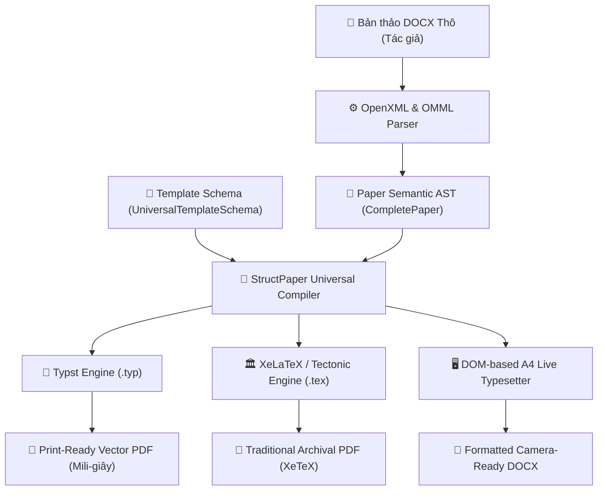
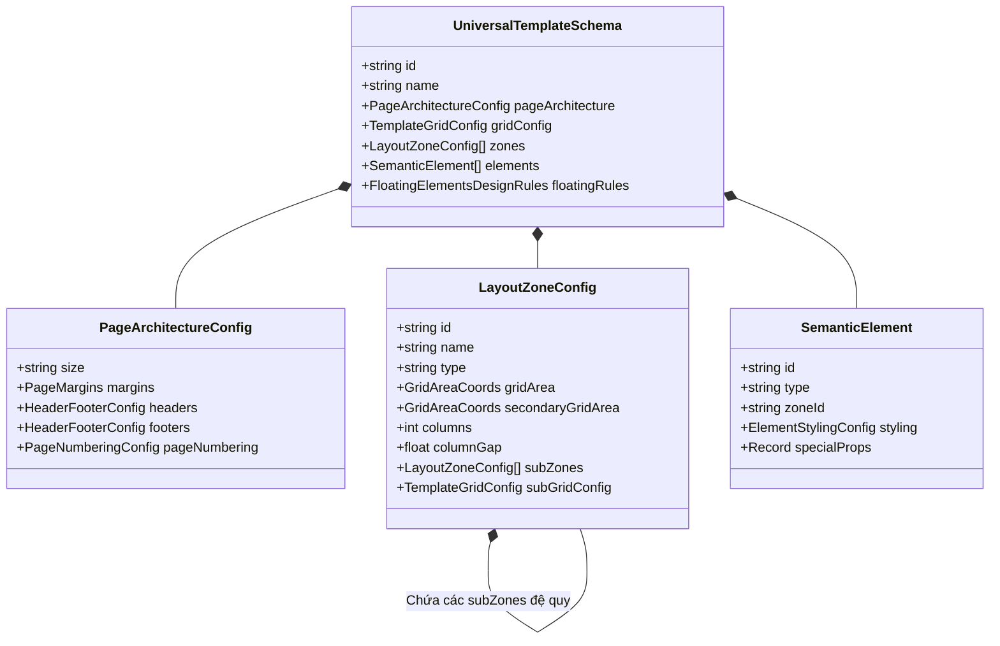

# 🔬 KIẾN TRÚC & CÔNG NGHỆ ĐỊNH DẠNG BÀI BÁO KHOA HỌC (STRUCTPAPER)

> **Tài liệu Kỹ thuật Chuyên sâu**  
> **Chủ đề:** Hệ thống Công nghệ, Động cơ Định dạng (Typesetting Engines), Cú pháp Typst/LaTeX, Mô hình Dữ liệu AST và Nguyên lý Cấu trúc Dàn trang Bài báo Học thuật.  
> **Phạm vi:** Trọng tâm vào **Lõi định dạng bài báo (Typesetting & Formatting Core)** — hoàn toàn không đề cập đến công nghệ web thông thường (Frontend/Backend).

---

## 📑 MỤC LỤC

1. [Tổng Quan Về Bài Toán Định Dạng Bài Báo Khoa Học](#1-tổng-quan-về-bài-toán-định-dạng-bài-báo-khoa-học)
2. [Các Động Cơ Định Dạng Trong Dự Án (Typesetting Engines)](#2-các-động-cơ-định-dạng-trong-dự-án-typesetting-engines)
   - [2.1. Động cơ Typst (Programmable Typesetting Engine Thế Hệ Mới)](#21-động-cơ-typst-programmable-typesetting-engine-thế-hệ-mới)
   - [2.2. Động cơ XeLaTeX & Tectonic (Dual-Engine TeX Pipeline Truyền Thống)](#22-động-cơ-xelatex--tectonic-dual-engine-tex-pipeline-truyền-thống)
   - [2.3. Động cơ Dàn trang Trực quan WYSIWYG DOM-based (Interactive Typesetter)](#23-động-cơ-dàn-trang-trực-quan-wysiwyg-dom-based-interactive-typesetter)
3. [Mô Hình Dữ Liệu & Nguyên Lý Cấu Trúc (Core Schemas & AST)](#3-mô-hình-dữ-liệu--nguyên-lý-cấu-trúc-core-schemas--ast)
   - [3.1. Cây Cú Pháp Trừu Tượng Bài Báo (Academic Paper AST - CompletePaper)](#31-cây-cú-pháp-trừu-tượng-bài-báo-academic-paper-ast---completepaper)
   - [3.2. Mô Hình Phân Vùng Lưới Đa Tầng (UniversalTemplateSchema & Grid Engine)](#32-mô-hình-phân-vùng-lưới-đa-tầng-universaltemplateschema--grid-engine)
   - [3.3. Bộ Quy Tắc Thiết Kế Cho Phần Tử Nổi (Floating Elements Design Rules)](#33-bộ-quy-tắc-thiết-kế-cho-phần-tử-nổi-floating-elements-design-rules)
4. [Động Cơ Bóc Tách & Chuyển Đổi Tài Liệu (Document Parsing Pipeline)](#4-động-cơ-bóc-tách--chuyển-đổi-tài-liệu-document-parsing-pipeline)
   - [4.1. Bóc tách Cấu trúc OpenXML DOCX Tầng Sâu](#41-bóc-tách-cấu-trúc-openxml-docx-tầng-sâu)
   - [4.2. Chuyển đổi Công thức Toán OMML sang LaTeX/Typst Math](#42-chuyển-đổi-công-thức-toán-omml-sang-latextypst-math)
   - [4.3. Khử Nhiễu Ký Tự Học Thuật & Làm Sạch Mã Trường EndNote](#43-khử-nhiễu-ký-tự-học-thuật--làm-sạch-mã-trường-endnote)
5. [Cơ Chế Điều Phối Luồng Văn Bản Liên Tục (Content Flow & Overflow)](#5-cơ-chế-điều-phối-luồng-văn-bản-liên-tục-content-flow--overflow)
6. [Bảng Đối Sánh Các Động Cơ Định Dạng (Comparative Analysis)](#6-bảng-đối-sánh-các-động-cơ-định-dạng-comparative-analysis)

---

## 1. Tổng Quan Về Bài Toán Định Dạng Bài Báo Khoa Học

Định dạng ấn phẩm khoa học (Scholarly Publishing Typesetting) đòi hỏi tiêu chuẩn khắt khe hơn rất nhiều so với văn bản văn phòng thông thường:
- **Tính đối xứng và cân bằng trang in:** Bố cục 2 cột cân bằng (Balanced Two-Column), lùi lề theo quy định xuất bản quốc tế.
- **Phức tạp về mặt cấu trúc (Hierarchical Layout):** Trang bìa thường có cấu trúc bất đối xứng (ví dụ: Tạp chí Y Dược ĐHQG-HCM sử dụng cột trái 24.5% chứa QR code, timeline nộp bài, DOI; cột phải 75.5% chứa Tóm tắt nền màu và thân bài dẫn nhập).
- **Phần tử nổi đặc thù (Floating Elements):** Bảng số liệu kiểu học thuật (*Booktabs* không kẻ sọc dọc), đồ thị minh họa trải rộng 1 cột hoặc 2 cột, công thức toán học nội dòng/độc lập, và chú thích tài liệu tham khảo theo chuẩn Vancouver hoặc IEEE.

### Triết Lý Tách Biệt Cốt Lõi (Separation of Concerns)

StructPaper giải quyết triệt để bài toán này bằng việc tách biệt tuyệt đối giữa:
1. **Nội dung Ngữ nghĩa (Semantic AST):** Tác giả, tiêu đề, các phần văn bản, bảng, hình, tài liệu tham khảo được lưu trữ độc lập dưới dạng cây dữ liệu (AST).
2. **Khuôn Mẫu Dàn Trang (Template Layout Specification):** Khổ giấy, lề, lưới phân vùng không gian (Grid Zones), font chữ, màu sắc, khoảng cách dòng.
3. **Động cơ Biên dịch (Compiler Engine):** Hợp nhất AST và Template để biên dịch ra tài liệu thành phẩm (PDF vector chất lượng in ấn hoặc Word định dạng chuẩn).



---

## 2. Các Động Cơ Định Dạng Trong Dự Án (Typesetting Engines)

Dự án StructPaper tích hợp một kiến trúc **đa động cơ định dạng (Multi-Engine Typesetting Architecture)**, kết hợp ưu điểm của cả công nghệ hiện đại nhất (Typst), truyền thống hàn lâm (XeLaTeX/Tectonic), và thời gian thực trên trình duyệt (DOM-based Typesetter).

---

### 2.1. Động cơ Typst (Programmable Typesetting Engine Thế Hệ Mới)

[Typst](https://typst.app/) là ngôn ngữ định dạng văn bản học thuật mới được phát triển bằng ngôn ngữ **Rust**, ra đời nhằm khắc phục toàn bộ các hạn chế kéo dài hàng thập kỷ của LaTeX.

#### Tại sao Typst được chọn làm công nghệ định dạng cốt lõi?
1. **Tốc độ biên dịch tức thời (Incremental Compilation):** Trong khi LaTeX mất từ 5 đến 30 giây cho một lần chạy tài liệu nhiều trang có bảng và ảnh, Typst hoàn thành việc biên dịch trong **vài chục mili-giây** (0.05s - 0.2s). Điều này cho phép người dùng gõ phím đến đâu, trang báo xem trước được làm mới tức thì đến đó.
2. **Hệ thống Font Unicode nguyên bản:** Typst nhận diện trực tiếp font hệ thống (TrueType `.ttf`, OpenType `.otf`) mà không cần cài đặt các gói font phức tạp như `fontspec` hay cấu hình đường dẫn phức tạp của TeX.
3. **Mô hình lập trình mạnh mẽ:** Hỗ trợ hàm, biến, mảng, tính toán hình học lề trang trực tiếp trong mã định dạng.

#### Kiến Trúc Trình Biên Dịch Typst Trong Dự Án
StructPaper sở hữu 2 module biên dịch Typst chuyên biệt:
- [typst-paper-compiler.ts](file:///c:/Users/OWNER/source/Eatzy/StructPaper/struct-paper-app/src/lib/authoring/typst-paper-compiler.ts): Biên dịch cây AST bài báo (`CompletePaper`) thành văn bản `.typ` hoàn chỉnh.
- [universal-typst-generator.ts](file:///c:/Users/OWNER/source/Eatzy/StructPaper/struct-paper-app/src/lib/template-builder/universal-typst-generator.ts): Biên dịch bất kỳ cấu hình template trực quan nào (`UniversalTemplateSchema`) thành cú pháp Typst chuẩn mực.

#### Cấu Trúc Mã Typst Được Sinh Ra Tự Động
Hệ thống chuyển đổi cây dữ liệu bài báo thành mã Typst theo trật tự lớp chuẩn:

##### a. Thiết lập Khổ giấy & Lề trang (`#set page`)
```typst
#set page(
  paper: "a4",
  margin: (top: 18mm, bottom: 20mm, left: 17mm, right: 13mm),
  header: locate(loc => {
    if loc.page() > 1 [
      #text(8pt, fill: luma(100), font: "Minion Pro")[
        #grid(
          columns: (1fr, auto),
          align: (left, right),
          [Tạp chí Phát triển Khoa học và Công nghệ – Health Sciences 2026],
          [Trang #loc.page()]
        )
        #v(-2pt)#line(length: 100%, stroke: 0.5pt + rgb("#2B74B7"))
      ]
    ]
  }),
  footer: locate(loc => {
    if loc.page() == 1 [
      #text(7pt, font: "Arial")[Trích dẫn bài báo: Vũ H, Phú V V. Sci. Tech. Dev. J. 2026]
    ]
  })
)
```

##### b. Kiểu chữ & Canh lề đoạn văn (`#set text`, `#set par`)
```typst
#set text(
  font: "Minion Pro",
  size: 8.55pt,
  lang: "vi",
  spacing: 120%,
)

#set par(
  justify: true,
  first-line-indent: 14pt,
  leading: 0.65em,
)
```

##### c. Phân vùng Bất đối xứng Trang đầu (Sidebar Split bằng `#grid`)
Trang đầu tiên của tạp chí y dược ĐHQG-HCM yêu cầu cột bên trái chứa mã QR, đơn vị công tác và DOI, còn cột bên phải chứa Tóm tắt và Thân bài dẫn nhập. Typst hiện thực hóa cấu trúc này thông qua hệ thống lưới cột:
```typst
#grid(
  columns: (24.5%, 75.5%),
  gutter: 4.23mm,
  // CỘT TRÁI (Metadata & Timeline)
  [
    #align(center)[#image("/assets/qr-code.png", width: 85%)]
    #text(6.8pt)[*Đơn vị công tác:* Bộ môn Nội - Khoa Y ĐHQG-HCM]
    #text(6.8pt)[*Lịch sử:* Nhận bài: 14-06-2025 | Chấp nhận: 14-04-2026]
  ],
  // CỘT PHẢI (Tóm tắt nền màu & Dẫn nhập)
  [
    #rect(width: 100%, fill: rgb("#E7ECF7"), radius: 0pt, inset: 4.2mm)[
      #text(7.8pt, weight: "bold", fill: rgb("#2B74B7"))[TÓM TẮT]
      #v(2pt)
      #text(7.8pt)[Bệnh loét dạ dày tá tràng hiện nay là một thách thức y tế...]
    ]
    #v(4mm)
    #columns(2, gutter: 4.23mm)[
      = GIỚI THIỆU
      Loét dạ dày tá tràng là tình trạng tổn thương niêm mạc...
    ]
  ]
)
```

##### d. Bảng Học Thuật Chuẩn Booktabs (`#figure(table(...))`)
Quy chuẩn tạp chí quốc tế cấm tuyệt đối các đường kẻ sọc dọc. Typst kiểm soát nét kẻ (*stroke*) theo tọa độ hàng và cột:
```typst
#figure(
  caption: [Các xét nghiệm chẩn đoán nhiễm H.pylori.],
  table(
    columns: (1fr, 2fr, 2fr),
    // Nét kẻ ngang: Dày ở biên trên/dưới (1.2pt), mỏng dưới header (0.8pt), triệt tiêu nét dọc
    stroke: (x, y) => if y == 0 { (top: 1.2pt + black, bottom: 0.8pt + black) } 
                      else if y == 6 { (bottom: 1.2pt + black) } 
                      else { none },
    align: (col, row) => if row == 0 { center + horizon } else { left + horizon },
    [*Xét nghiệm*], [*Chẩn đoán*], [*Hạn chế*],
    [Mô học], [Độ nhạy cao (95%-98%)], [Yêu cầu nội soi xâm lấn],
    [Test Ure nhanh], [Nhanh trong 1 giờ], [Âm tính giả khi xuất huyết]
  )
)
```

---

### 2.2. Động cơ XeLaTeX & Tectonic (Dual-Engine TeX Pipeline Truyền Thống)

Đối với các ấn phẩm yêu cầu xuất bản theo quy trình biên tập TeX truyền thống, StructPaper duy trì một pipeline kép gồm **Tectonic** và **XeLaTeX**.

#### Động cơ Tectonic (Self-contained TeX Engine)
- Tectonic đóng gói toàn bộ nhân biên dịch XeTeX vào một file nhị phân độc lập duy nhất (viết bằng ngôn ngữ Rust, nằm tại `bin/tectonic.exe`).
- **Ưu điểm vượt trội:** Người dùng và hệ thống không cần cài đặt bộ TeXLive hay MiKTeX cồng kềnh (thường nặng từ 4GB đến 7GB). Khi gặp một gói macro CTAN chưa có trên máy, Tectonic tự động kết nối kho lưu trữ đám mây để tải về bộ nhớ đệm và biên dịch trong một bước duy nhất (*Single-pass compile*).

#### Động cơ XeLaTeX
- Được triển khai thông qua dịch vụ backend [LatexCompilerServiceImpl.java](file:///c:/Users/OWNER/source/Eatzy/StructPaper/struct-paper-backend/src/main/java/vn/edu/vnu/structpaper/service/impl/LatexCompilerServiceImpl.java).
- Sử dụng mô hình môi trường cách ly (Isolated Sandbox): Mỗi lượt biên dịch được cấp phát một thư mục tạm riêng biệt, tự động sao chép tài nguyên ảnh, giải phóng tài nguyên khi hoàn tất để đảm bảo an toàn tuyệt đối.

#### Bộ Cơ Chế Thích Ứng Font Học Thuật Thông Minh (Smart Font Fallback Engine)
Một rào cản rất lớn khi biên dịch file LaTeX mẫu của Tạp chí ĐHQG-HCM là việc phụ thuộc vào các font thương mại độc quyền của Adobe (*Minion Pro*, *Myriad Pro*, *Univers LT Std*) và các gói package nội bộ không có trên CTAN công cộng (`tabcaptionwidth.sty`, `size9-edited.clo`).

Backend StructPaper tích hợp module [FontManagerService.java](file:///c:/Users/OWNER/source/Eatzy/StructPaper/struct-paper-backend/src/main/java/vn/edu/vnu/structpaper/service/FontManagerService.java) tự động kiểm tra sự hiện diện của font trong hệ điều hành:
- Nếu thiếu *Minion Pro* -> Tự động ánh xạ sang *Times New Roman* hoặc *TeX Gyre Termes*.
- Nếu thiếu *Myriad Pro* -> Tự động ánh xạ sang *Arial* hoặc *TeX Gyre Heros*.
- Tự động thay thế các lệnh font độc quyền bằng các lệnh chuẩn `fontspec` tương đương, đảm bảo tài liệu **luôn luôn biên dịch thành công 100% với chất lượng typographic tối đa mà không gây lỗi đứng dòng (halt error)**.

---

### 2.3. Động cơ Dàn trang Trực quan WYSIWYG DOM-based (Interactive Typesetter)

Nằm trong component [UniversalLiveA4Preview.tsx](file:///c:/Users/OWNER/source/Eatzy/StructPaper/struct-paper-app/src/components/template-builder/UniversalLiveA4Preview.tsx), đây là động cơ dựng hình A4 trực tiếp trên trình duyệt với tỷ lệ chuẩn xác từng milimet:
- Sử dụng tỷ lệ chuyển đổi vật lý: $1\text{ mm} = 3.7795275591\text{ px}$ (chuẩn 96 DPI CSS).
- Khổ giấy tiêu chuẩn A4 ($210\text{mm} \times 297\text{mm}$) hoặc khổ giấy tùy biến của ĐHQG-HCM ($216.15\text{mm} \times 279.4\text{mm}$).
- Mô phỏng chính xác đường lề trang (`margin`), viền Header/Footer, số trang tự động tăng, và đường lưới phân vùng không gian.
- Cho phép người dùng chỉnh sửa trực tiếp nội dung văn bản (Double-click để inline edit) và tương tác chuột phải để mở menu định dạng font/màu sắc tương tự Word.

---

## 3. Mô Hình Dữ Liệu & Nguyên Lý Cấu Trúc (Core Schemas & AST)

Lõi của hệ thống StructPaper vận hành dựa trên 2 cấu trúc dữ liệu chính: cây AST ngữ nghĩa bài báo và lược đồ định dạng phân vùng.

### 3.1. Cây Cú Pháp Trừu Tượng Bài Báo (Academic Paper AST - `CompletePaper`)

Được định nghĩa chi tiết tại [src/types/paper.ts](file:///c:/Users/OWNER/source/Eatzy/StructPaper/struct-paper-app/src/types/paper.ts):

```typescript
export interface CompletePaper {
  id: string;
  templateId: string;
  templateName: string;
  status: 'draft' | 'ready' | 'published';
  metadata: PaperMetadata;
  sections: PaperSection[];
  references: PaperReference[];
  preflightChecks?: PreflightCheck[];
}
```

#### Chi tiết các nhánh của AST:

1. **`PaperMetadata` (Thông tin học thuật):**
   - `title`: Tiêu đề tiếng Việt.
   - `titleEn`: Tiêu đề tiếng Anh song ngữ.
   - `authors`: Mảng đối tượng tác giả (`name`, `email`, `affiliationIds`, `isCorresponding`, `orcid`).
   - `affiliations`: Mảng đơn vị công tác (`id`, `name`).
   - `abstract`: Toàn bộ nội dung tóm tắt.
   - `keywords`: Mảng từ khóa khoa học.
   - `journalId`, `journalName`, `doi`, `volume`, `issue`, `year`: Các thông số xuất bản định danh.

2. **`PaperSection` (Khối nội dung thân bài):**
   Mỗi khối trong thân bài là một nút đa hình (`Polymorphic Node`):
   - `h1`, `h2`, `h3`: Các cấp độ tiêu đề phân nhánh (Đánh số la mã I, II hoặc số tự nhiên 1.1, 1.2).
   - `paragraph`: Đoạn văn bản chứa các chỉ mục trích dẫn đã được tách token.
   - `table`: Khối bảng biểu cấu trúc cao gồm `headers`, `rows`, `caption`, `source`, `zebraStriping`.
   - `figure`: Khối hình ảnh gồm `src`, `caption`, `isFullWidth`, `figureNumber`.

3. **`PaperReference` (Thư mục tài liệu tham khảo):**
   - `id`: Mã số trích dẫn (ví dụ `1`, `2`).
   - `raw`: Chuỗi thư mục hoàn chỉnh (theo chuẩn Vancouver hoặc APA).
   - `authors`, `title`, `journal`, `year`, `doi`: Các trường nguyên tử được trích xuất để tái định dạng theo bất kỳ phong cách nào.

---

### 3.2. Mô Hình Phân Vùng Lưới Đa Tầng (`UniversalTemplateSchema` & Grid Engine)

Được định nghĩa tại [src/types/template-builder.ts](file:///c:/Users/OWNER/source/Eatzy/StructPaper/struct-paper-app/src/types/template-builder.ts):



#### Các Kiểu Phân Vùng Không Gian (`LayoutZoneConfig.type`)

1. **`full-width` (Toàn chiều rộng):** Trải rộng 100% không gian trang giữa 2 mép lề. Thường dùng cho Banner tiêu đề bài báo, tên tác giả, hoặc hình ảnh cỡ lớn cần không gian toàn khổ.
2. **`sidebar-split` (Bố cục Bất đối xứng Trang bìa):** Chia trang thành 2 cột với tỷ lệ phần trăm tùy biến (ví dụ: Cột trái 24.5%, cột phải 75.5%). Đây là phong cách nhận diện thương hiệu của nhiều tạp chí Y Dược và Khoa học Tự nhiên.
3. **`multi-column` (Đa cột cân bằng):** Khối thân bài chia 2 cột đều nhau (hoặc 3 cột) với khoảng cách rãnh giữa các cột (`columnGap`, thường là 4.23mm tương đương 12pt).
4. **Phân vùng Con Lồng Nhau (Hierarchical Nested Sub-Zones):** Một phân vùng cha có thể chứa mảng `subZones` kèm cấu hình lưới con `subGridConfig`. Điều này cho phép tạo ra cấu trúc đệ quy: trong một cột của trang bìa tiếp tục chia thành các ô lưới con để xếp linh hoạt QR Code, logo tạp chí và đơn vị công tác.

---

### 3.3. Bộ Quy Tắc Thiết Kế Cho Phần Tử Nổi (`FloatingElementsDesignRules`)

Mỗi tạp chí có một bộ quy chuẩn riêng biệt về cách trình bày các thành phần đặc biệt:

```typescript
export interface FloatingElementsDesignRules {
  figure: {
    captionPosition: 'above' | 'below'; // Đa số tạp chí đặt dưới hình
    captionPrefix: string;              // "Hình", "Figure", "Fig."
    captionFontWeight: string;          // "bold"
    captionFontSize: number;            // 7.5pt - 8.5pt
    boxBackground: string;              // Màu nền bo khung (nếu có)
    allowFullWidthSpan: boolean;        // Cho phép tràn 2 cột hay không
  };
  table: {
    captionPosition: 'above' | 'below'; // Chuẩn quốc tế bắt buộc ĐẶT TRÊN bảng
    captionPrefix: string;              // "Bảng", "Table"
    borderMode: 'booktabs' | 'grid' | 'minimal';
    headerBackground: string;           // Màu nền tiêu đề cột
    zebraStripes: boolean;              // Tô màu xen kẽ hàng chẵn lẻ
    zebraColor: string;
  };
  citation: {
    citationStyle: 'vancouver' | 'ieee' | 'apa' | 'harvard';
    inTextFormat: 'superscript' | 'brackets'; // [1] hoặc dạng mũ ^1
    hangingIndent: number;                    // Lùi đầu dòng tài liệu tham khảo (4.5mm)
  };
}
```

---

## 4. Động Cơ Bóc Tách & Chuyển Đổi Tài Liệu (Document Parsing Pipeline)

Module [docx-parser.ts](file:///c:/Users/OWNER/source/Eatzy/StructPaper/struct-paper-app/src/lib/docx-parser.ts) đảm nhiệm việc tiếp nhận các file Word `.docx` thô do tác giả nộp và chuyển đổi thành cây AST học thuật hoàn chỉnh.

### 4.1. Bóc tách Cấu trúc OpenXML DOCX Tầng Sâu
File `.docx` thực chất là một kho lưu trữ nén định dạng ZIP chứa các tài liệu XML theo chuẩn Microsoft OpenXML. StructPaper sử dụng `JSZip` để giải nén trực tiếp trong bộ nhớ và phân tích các tệp XML trọng yếu:

- **`word/document.xml`:** Chứa toàn bộ cây cấu trúc phân cấp văn bản gồm các đoạn văn (`<w:p>`), các chuỗi ký tự cùng định dạng (`<w:r>`), các khối bảng (`<w:tbl>`), và các đối tượng đồ họa nhúng (`<w:drawing>`).
- **`word/styles.xml`:** Lưu trữ các định danh phong cách (Style ID). Thuật toán sẽ quét qua các thẻ `<w:pStyle w:val="Heading1"/>` hoặc đối chiếu kích thước chữ (`<w:sz w:val="28"/>`) và thuộc tính in đậm (`<w:b/>`) để tự động phân loại chính xác đâu là Tiêu đề cấp 1, Tiêu đề cấp 2, hay Đoạn thân bài.
- **`word/media/`:** Trích xuất tự động toàn bộ ảnh minh họa gốc ở độ phân giải nguyên bản của tác giả, chuyển đổi sang dữ liệu Base64 an toàn.

---

### 4.2. Chuyển đổi Công thức Toán OMML sang LaTeX/Typst Math

Trong file Word hiện đại, công thức toán học được lưu trữ dưới dạng **Office Math Markup Language (OMML)** với không gian tên `<m:oMath>`. 

Hàm `ommlToLatex` trong [docx-parser.ts](file:///c:/Users/OWNER/source/Eatzy/StructPaper/struct-paper-app/src/lib/docx-parser.ts#L48-L95) thực hiện chuyển đổi đệ quy từ các nút OMML sang cú pháp toán học chuẩn:
- Thẻ phân số `<m:f>` chứa `<m:num>` và `<m:den>` $\rightarrow$ `\frac{tử}{mẫu}`.
- Thẻ số mũ `<m:sSup>` chứa `<m:e>` và `<m:sup>` $\rightarrow$ `{cơ_số}^{mũ}`.
- Thẻ chỉ số dưới `<m:sSub>` chứa `<m:e>` và `<m:sub>` $\rightarrow$ `{cơ_số}_{chỉ_số}`.
- Thẻ căn thức `<m:rad>` $\rightarrow$ `\sqrt{biểu_thức}`.
- Thẻ dấu ngoặc tự co giãn `<m:d>` $\rightarrow$ `\left( ... \right)`.

Từ biểu thức toán học này, hệ thống có thể xuất trực tiếp sang LaTeX (`$E = mc^2$`) hoặc Typst (`$E = m c^2$`).

---

### 4.3. Khử Nhiễu Ký Tự Học Thuật & Làm Sạch Mã Trường EndNote

Các bài báo khoa học thường gặp 2 lỗi nghiêm trọng khi chuyển đổi từ Word:
1. **Lỗi ngắt rời âm tiết tiếng Việt do bộ gõ:** Từ "Nguyễn" bị tách thành `"Nguy ễ n"`, "Hùng" bị tách thành `"H ù ng"`. Hàm `normalizeVietnameseWordSpacing` dùng biểu thức chính quy (Regex) quét và gom các âm tiết tiếng Việt bị gõ ngắt quãng trở lại thành từ hoàn chỉnh.
2. **Mã nhúng nhị phân của phần mềm quản lý trích dẫn (EndNote / Mendeley):** Các khối trường `ADDIN EN.CITE` chèn hàng ngàn ký tự XML và Base64 rác vào giữa câu văn. Hàm `cleanEndNoteText` phát hiện và bóc tách sạch các mã trường này, chỉ giữ lại số trích dẫn thuần túy (ví dụ: `[1]`, `[1-3]`).

---

## 5. Cơ Chế Điều Phối Luồng Văn Bản Liên Tục (Content Flow & Overflow)

Một trong những thuật toán phức tạp nhất của StructPaper được cài đặt trong hàm `splitZoneElementsForFlow` tại [UniversalLiveA4Preview.tsx](file:///c:/Users/OWNER/source/Eatzy/StructPaper/struct-paper-app/src/components/template-builder/UniversalLiveA4Preview.tsx#L125-L236).

### Bài toán Luồng Văn Bản Liên Tục (Continuation Flow)
Trong các bài báo có trang đầu phức tạp, khối Dẫn nhập (Introduction) thường bắt đầu ở nửa dưới cột phải của Trang 1 (`Khối nguồn - Primary Block`). Khi văn bản chạy hết diện tích của khối này, **nó phải tự động ngắt dòng và chảy tiếp sang cột đầu tiên của Trang 2 (`Khối tiếp nối - Secondary Block`) mà không được làm mất chữ hay chèn khoảng trống thừa**.

```
TRANG 1 (Frontmatter Split)                 TRANG 2 (Subsequent 2-Column)
┌─────────────────────────────────┐        ┌─────────────────────────────────┐
│ Tiêu đề bài báo & Tác giả       │        │ Header trang 2                  │
├──────────────┬──────────────────┤        ├────────────────┬────────────────┤
│ QR Code      │ Tóm tắt (Abstract│        │ Đoạn văn       │ Thân bài       │
│ Đơn vị       ├──────────────────┤        │ tiếp nối       │ tiếp theo      │
│ Lịch sử      │ DẪN NHẬP         │        │ (flow_p2)      │                │
│ DOI          │ Đoạn văn phần 1  │───────>│ Bắt đầu từ     │                │
│              │ (flow_p1)        │        │ từ bị ngắt     │                │
│              │ [Đầy khung 1]    │        │ của khối 1     │                │
└──────────────┴──────────────────┘        └────────────────┴────────────────┘
```

### Thuật toán ước tính dung lượng ký tự hình học:
1. Hệ thống tính toán diện tích hữu dụng của Khối 1 dựa trên số cột (`colSpan`) và số hàng (`rowSpan`) trên lưới:
   $$\text{Words Capacity} = (\text{colSpan} \times 4.57) \times (\text{rowSpan} \times 10 - \text{Heading Lines})$$
2. Tách chuỗi từ vựng của đoạn văn tại chỉ số `splitPoint = min(totalWords, Words Capacity)`.
3. Sinh ra 2 phần tử ảo liên kết với nhau:
   - `flow_p1`: Đặt tại Khối 1 với thuộc tính `isFlowSource: true`.
   - `flow_p2`: Đặt tại Khối 2 với thuộc tính `isContinuation: true`, loại bỏ `dropCap` (chữ cái to đầu dòng) để nối chữ trơn tru.

---

## 6. Bảng Đối Sánh Các Động Cơ Định Dạng (Comparative Analysis)

| Tiêu Chí Kỹ Thuật | 🚀 Động Cơ Typst | 🏛️ Động Cơ XeLaTeX / Tectonic | 🖥️ Động Cơ DOM-based Live | 📘 Microsoft Word (.docx) |
|---|---|---|---|---|
| **Tốc độ biên dịch** | **Siêu tốc** (0.05s – 0.2s) | Chậm (5s – 30s) | Tức thời (React re-render) | N/A (Chỉnh sửa WYSIWYG) |
| **Độ chính xác Typographic** | **Rất cao** (Vector 100%) | **Tuyệt đối** (Chuẩn Knuth TeX) | Cao (Phụ thuộc CSS Webkit) | Trung bình (Dễ bị xô dòng) |
| **Bố cục 2 cột cân bằng** | Tự động cân bằng hoàn hảo (`#columns`) | Phụ thuộc gói `multicol` | Cần thuật toán chia dòng DOM | Rất khó căn chỉnh đều cột cuối |
| **Xử lý Font chữ** | Trực tiếp font OTF/TTF hệ thống | Cần `fontspec` / XeTeX engine | Phụ thuộc Web Fonts | Font cài đặt trên máy client |
| **Khả năng cài đặt & nhúng** | File nhị phân nhẹ (~30MB) | Tectonic (~40MB), TeXLive (>4GB) | Không cần cài đặt (Chạy trên browser) | Cần cài phần mềm Office |
| **Cú pháp định dạng** | Dễ đọc, hiện đại, hỗ trợ code | Cú pháp TeX cổ điển, phức tạp | CSS Flexbox / CSS Grid | Nhị phân nén XML OpenXML |
| **Mục đích tối ưu trong dự án** | **Biên dịch & xuất bản PDF chính** | **Lưu trữ & phục vụ tạp chí TeX** | **Chỉnh sửa & xem trước thời gian thực** | **Bóc tách đầu vào & xuất bản phụ** |

---

## 7. Kết Luận

Hệ thống định dạng của **StructPaper** không đơn thuần là một công cụ xuất file, mà là một **kiến trúc xử lý xuất bản khoa học đa tầng (Multi-layered Publishing Pipeline)**:
1. Chuẩn hóa bản thảo hỗn độn của tác giả từ định dạng Word sang cây cú pháp ngữ nghĩa độc lập (**AST**).
2. Tách rời hình thức dàn trang bằng lược đồ phân vùng lưới trực quan (**UniversalTemplateSchema**).
3. Sử dụng **Typst** làm động cơ thế hệ mới mang lại trải nghiệm biên dịch tính bằng mili-giây, kết hợp cùng **XeLaTeX/Tectonic** cho chất lượng in ấn hàn lâm truyền thống.
4. Điều phối dòng chảy văn bản thông minh bảo đảm ấn phẩm luôn cân đối, thẩm mỹ và tuân thủ tuyệt đối quy định của Tòa soạn.
