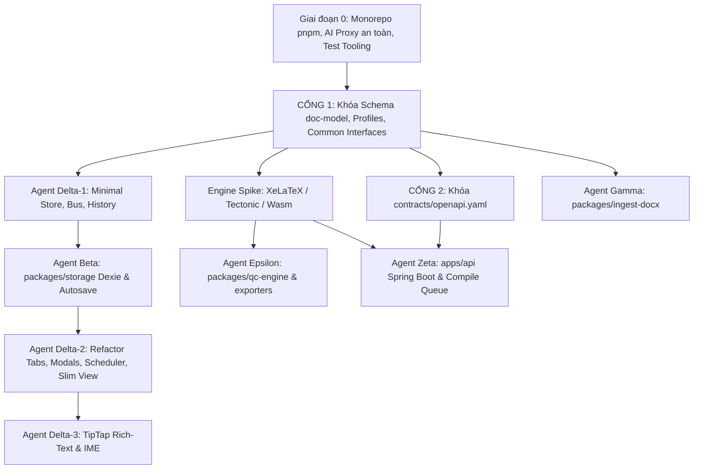

# Thiết kế Kiến trúc Tái cấu trúc StructPaper v2 (Design Document)

**Ngày lập:** 2026-11-04  
**Trạng thái:** Đã phê duyệt (Approved)  
**Tài liệu căn cứ:**  
- `docs/Architecture/StructPaper v2 — Đề xuất kiến trúc & design pattern.pdf` (31 trang)  
- `docs/StandardTemplate/Template_EN.docx`, `Template_VI.docx`, `Bài mẫu template tiếng Anh.docx`, `Bài mẫu template tiếng Việt.docx`  
- `docs/DOCS_HIEN_TRANG_UPLOAD_EDITOR.md`, `docs/DOCS_KIEN_TRUC_LUONG_DU_LIEU_UPLOAD_EDITOR.md`

---

## 1. Mục đích và Lý do (Intent & The Why)

Hệ thống StructPaper hiện tại (v1) đã thông luồng cơ bản: `Upload -> CompletePaper -> Editor -> LaTeX -> PDF`. Tuy nhiên, mã nguồn đang gặp các điểm nghẽn nghiêm trọng:
1. **Parser một cục khổng lồ:** Toàn bộ logic bóc tách DOCX nằm trong `docx-parser.ts` (>2.100 dòng), tự đoán bằng heuristic/regex mà bỏ qua hệ thống ~35 Word Styles chuẩn của tòa soạn trong `Template_EN/VI`.
2. **Mô hình dữ liệu phẳng:** `content: string` phẳng, số thứ tự `[1]`, `Hình 1` bị gõ chết trong văn bản, ảnh base64 phình to làm sập `sessionStorage` (hạn mức ~5MB), mất in nghiêng học thuật ($H.\ pylori$) và chỉ số ($\text{FEV}_1$).
3. **Editor dính chùm & thiếu an toàn:** `UnifiedEditorView.tsx` ôm đồm mọi thứ (state 2 tầng `formData` $\leftrightarrow$ `PaperContext`, lưu thủ công, thiếu Undo/Redo, thiếu autosave an toàn). Việc sinh mã LaTeX bị xé làm 2 file lệch nhau (`exporters.ts` và `latex-template.ts`).
4. **Bảo mật:** Biến môi trường `NEXT_PUBLIC_OPENAI_API_KEY` nằm ở client.

Cuộc tái cấu trúc v2 này chuyển đổi toàn diện hệ thống sang mô hình kiến trúc phân tầng (Hexagonal / Clean Architecture) theo chiến lược **Strangler Fig (chuyển đổi từng bước, hệ thống luôn chạy được sau mỗi giai đoạn)**.

---

## 2. Mục tiêu, Phi mục tiêu và Điều tối kỵ (Goals, Non-Goals, Anti-Goals)

### Mục tiêu (Goals)
1. **Lõi miền độc lập (`packages/doc-model`):** Cây Manuscript v2 phân cấp (Section $\rightarrow$ Block $\rightarrow$ Inline) với Stable ID (ULID). Số thứ tự Figure, Table, Equation, Citation là dữ liệu dẫn xuất (`computeNumbering(doc)`).
2. **Cấu hình Tạp chí (`packages/journal-profiles`):** Quản lý quy định tạp chí qua JSON có schema (Zod), bao gồm `styleMap` (~35 styles Word), quy chuẩn tóm tắt, từ khóa, font chữ và mẫu LaTeX `.cls`.
3. **Pipeline Ingest đa tầng (`packages/ingest-docx`):** Ưu tiên nhận diện theo style Word chuẩn (`StyleMapRecognizer`, độ tin cậy 1.0) xử lý trọn vẹn 4 file trong `docs/StandardTemplate/`. Tách biệt đọc thô (OOXML) và hiểu nghĩa (Assemblers). Xử lý ảnh tách riêng theo mã băm SHA-256. Giữ lại parser cũ chạy song song dưới feature flag để đảm bảo không hồi quy với file Word tự do.
4. **Lưu trữ Offline-first (`packages/storage`):** Sử dụng Dexie (IndexedDB), quản lý bản thảo, asset nhị phân Blob, chuỗi revision patch và autosave an toàn (debounce 1s).
5. **Editor theo kiến trúc Command (`packages/editor-core`):** Quản lý trạng thái bằng Zustand + Immer, mọi biến đổi đi qua `CommandBus`, tự động có Undo/Redo (`Ctrl+Z`, `Ctrl+Y`) qua Immer inverse patches.
6. **Soạn thảo Inline Rich-Text (TipTap):** Thay thế ruột `<textarea>` bằng TipTap ở Giai đoạn 4, giữ nguyên 100% hình hài khung ô cũ, hỗ trợ gõ tiếng Việt Telex/VNI chuẩn, bôi nghiêng, chỉ số và click vào badge trích dẫn/tham chiếu.
7. **Động cơ QC & Exporters chuẩn hóa (`packages/qc-engine`, `packages/exporters`):** Kiểm tra chất lượng tự động theo Specification pattern. Hợp nhất một bộ sinh LaTeX duy nhất gọi macro của lớp `structpaper-hs.cls`, sinh JATS XML 1.3 và Docx.
8. **Backend Spring Boot mô-đun hóa (`apps/api`):** Lưu trữ Hybrid MySQL (quan hệ + `doc_json`), quản lý asset theo SHA-256, dịch vụ biên dịch cách ly (sandbox, hàng đợi, cache hash).
9. **Bảo tồn toàn diện giao diện người dùng:** Mọi màn hình hiện tại (Upload, Unified Editor với hai cột, Dock, Tab Metadata, Authors, Sections, References, Preflight QC, Layout Settings, Table/Figure modals) phải giữ nguyên trải nghiệm và bố cục trực quan.

### Phi mục tiêu (Non-Goals)
- Không xây dựng cơ chế cộng tác thời gian thực nhiều người cùng gõ (CRDT / WebSockets) ở giai đoạn này. Dừng lại ở khóa lạc quan S1 (`If-Match: rev`) và lưu patch S2.
- Không ép buộc mua bản quyền font thương mại (Minion Pro, Myriad Pro); ưu tiên danh sách font tương đương nguồn mở chất lượng cao (TeX Gyre Termes, Liberation Serif, Times New Roman).

### Điều tối kỵ (Anti-Goals)
- **Nghiêm cấm thay đổi 180 độ giao diện người dùng hiện tại.** Người dùng không được cảm thấy bỡ ngỡ hoặc mất các luồng thao tác quen thuộc.
- **Quy tắc giới hạn số dòng (Tiered Line Limits):**
  - File mới không quá **500 dòng với logic** (cảnh báo từ 300) và **700 dòng với component giao diện** (cảnh báo từ 400). Bật `skipBlankLines: true` và `skipComments: true`.
  - File cũ vượt ngưỡng (như `docx-parser.ts`, `UnifiedEditorView.tsx`) đưa vào baseline allowlist và **chỉ được giảm, cấm phình thêm**.
  - File test, fixtures, và mã sinh tự động được miễn trừ.
- Không lưu ảnh base64 vào JSON hay database.
- Không dùng `contenteditable` thuần tự viết (tránh lỗi IME tiếng Việt Telex/VNI).

---

## 3. Lựa chọn Kiến trúc & Công nghệ (Architectural Decisions)

| Hạng mục | Lựa chọn chốt | Lý do |
| :--- | :--- | :--- |
| **Mô hình Repo** | Monorepo với `pnpm workspaces` (`apps/*`, `packages/*`) | Di chuyển bằng `git mv` giữ lịch sử commit; `transpilePackages` và tsconfig path mapping. |
| **Test Runner** | **Vitest** (Unit/Integration packages) + **Playwright** (E2E) | Tốc độ nhanh, tương thích TypeScript & ESM nguyên bản, test IME với CDP. |
| **Định danh khối (ID)** | ULID (`ulid`) qua interface `IdGenerator` | Injectable: production sinh ULID ngẫu nhiên có thứ tự thời gian; test dùng generator xác định để snapshot không lệch. |
| **Soạn thảo đoạn văn** | **TipTap / ProseMirror** (Option A) | Giao diện giữ nguyên viền/padding/font của ô textarea cũ. Schema ánh xạ 1-1 với `Inline[]`. Hỗ trợ phím tắt, paste từ Word giữ in nghiêng/chỉ số, gõ `[` mở popup chọn cite, an toàn với IME tiếng Việt. |
| **Quản lý State & History**| Zustand + Immer + `CommandBus` | Patch ngược của Immer tự động sinh Undo/Redo miễn phí; luồng patch cung cấp đầu vào trực tiếp cho Dexie Autosave. |
| **Điều phối biên dịch** | `packages/compiler-client` (`CompilerPort` + scheduler) | Quản lý debounce, cache hash, hủy job cũ khi nội dung đổi, độc lập khỏi UI. |
| **Engine LaTeX** | **XeLaTeX** (chính thức), spike với **Tectonic** và **WasmCompiler** | Spike ngay sau Cổng 1 để chốt engine trước khi viết `.cls` và compile queue. |
| **Lưu trữ Client** | **Dexie (IndexedDB)** Offline-First | Chống mất dữ liệu khi đóng tab, không giới hạn 5MB như sessionStorage, lưu Blob ảnh độc lập. |
| **CSL & Citation** | Interface `CitationStyle` (Vancouver ở Phase 1, `citeproc-js` ở Phase 5) | Đảm bảo tính toán đúng ngay từ đầu và có đường nâng cấp CSL rõ ràng. |

---

## 4. Các Cổng Khóa Hợp Đồng (Contract Freeze Gates)

Thứ tự khóa hợp đồng tuần tự và chặt chẽ, loại bỏ hoàn toàn mâu thuẫn phụ thuộc:

* **Cổng 1 (Gate 1 - Khóa vào cuối Ngày 3, do Agent Alpha phụ trách):**
  - Toàn bộ TypeScript types và Zod schemas của `packages/doc-model` (`Manuscript`, `Section`, `Block`, `Inline`, `Cell`, `Reference`).
  - Hàm thuần túy `computeNumbering(doc, citationStyle)`.
  - Hợp đồng dùng chung giữa Storage và Editor-Core: Interface `Command`, `Patch`, `InversePatch`, `ManuscriptRepository`, `AssetRepository`, và `IdGenerator`.
  - `packages/journal-profiles` chứa `styleMap` (~35 style Word).
  - *Các sub-agent khác chỉ bắt đầu nhánh việc chuyên biệt sau khi Cổng 1 đã khóa.*
* **Cổng 2 (Gate 2 - Khóa vào Ngày 4, do Agent Zeta phụ trách sau Cổng 1):**
  - File hợp đồng `contracts/openapi.yaml` định nghĩa đầy đủ API: manuscripts (tham chiếu schema của Cổng 1), assets sha256, compile jobs, AI extract proxy.

---

## 5. Lộ trình Triển khai Chi tiết theo 8 Giai đoạn (Strangler Fig)

### Giai đoạn 0: Đóng băng Hành vi, Monorepo pnpm, AI Proxy & Cấu hình Test
- **Việc chính:**
  1. **Bảo mật AI (Chống lộ key & Cửa hậu):**
     - Xây dựng route proxy bảo mật phía server Next.js (`/api/ai/proxy`) đọc `OPENAI_API_KEY` từ server environment (loại bỏ biến client `NEXT_PUBLIC_OPENAI_API_KEY`).
     - **Ràng buộc bảo vệ:** Route chỉ chấp nhận các action định sẵn trong whitelist (ví dụ: `extractFrontMatter`, `disambiguateSection`), cấm truyền prompt tùy do từ client, giới hạn kích thước payload (<100KB), kiểm tra `same-origin`, và áp dụng rate limiting cơ bản.
  2. **Cấu hình Monorepo:** Di chuyển thư mục bằng `git mv struct-paper-app apps/web` và `struct-paper-backend apps/api` để bảo toàn lịch sử Git. Tạo `pnpm-workspace.yaml`. Cập nhật `transpilePackages` trong `next.config.mjs` và paths trong `tsconfig.json`. Cập nhật đường dẫn deploy/CI.
  3. **Kiểm soát ranh giới & số dòng:** Cài đặt `dependency-cruiser` và cấu hình ESLint tiered rules (logic: 300/500, UI: 400/700). Đưa các file cũ vượt ngưỡng (`docx-parser.ts`, `UnifiedEditorView.tsx`) vào baseline allowlist (chỉ được giảm).
  4. **Cấu hình Test Runner:** Thiết lập **Vitest** cho unit test monorepo và **Playwright** cho E2E test.
  5. **Bộ Golden Fixtures (11 file bài báo thật):** 
     - 4 file chuẩn: `Template_EN.docx`, `Template_VI.docx`, `Bài mẫu template tiếng Anh.docx`, `Bài mẫu template tiếng Việt.docx`.
     - 7 bài báo Word thật từ `File demo/` và thư mục mẫu (loại trừ `Yêu cầu phần mềm.docx`). Các file nhạy cảm được ẩn danh hóa.
  6. Viết Characterization test chạy trên parser cũ để ghi nhận kết quả baseline.
- **Điều kiện hoàn thành (DoD):** `pnpm install` thành công, `pnpm build` (`next build`) xanh, `./gradlew test` (backend) xanh, route proxy AI hoạt động an toàn, không có vi phạm ranh giới package.

### Giai đoạn 1: Lõi miền `packages/doc-model` & `packages/journal-profiles` (CỔNG 1)
- **Việc chính:**
  1. Xây dựng `packages/doc-model`: Zod schemas, TypeScript types, tích hợp `IdGenerator` (mặc định `ulid`, có deterministic mock cho testing).
  2. Xây dựng hàm pure function `computeNumbering`: tính toán số thứ tự Figure, Table, Equation, Citation (Vancouver `[1]`, `[2-4]` sau interface `CitationStyle`), phát hiện `uncitedRefs`, `danglingCites`.
  3. Khóa hợp đồng interface: `Command`, `Patch`, `InversePatch`, `ManuscriptRepository`, `AssetRepository`.
  4. Xây dựng `packages/journal-profiles`: schema và profile mẫu cho `VNUHCM-HS` chứa `styleMap` (~35 style).
  5. Viết adapter chuyển đổi 2 chiều `migrateV1toV2` và `adaptV2toV1` (dùng tạm thời trong quá trình chuyển đổi UI).
- **Điều kiện hoàn thành (DoD):** 100% Vitest unit tests và Property-based tests cho `computeNumbering` xanh, Cổng 1 chính thức khóa.

### Giai đoạn 2: Minimal Store/Bus, Lưu trữ Offline-first & Engine Spike
- **Việc chính:**
  1. **Engine Spike (Đầu Ngày 4):** Tiến hành spike đối sánh XeLaTeX vs Tectonic vs WasmCompiler trong 1 ngày, chốt engine chính thức và cờ biên dịch để Zeta và Epsilon cùng sử dụng.
  2. Xây dựng bản tối thiểu của `packages/editor-core`: Store (Zustand + Immer), `CommandBus` cơ bản, và `HistoryManager` (quản lý patches/inversePatches cho Undo/Redo).
  3. Xây dựng `packages/storage` với Dexie: 8 bảng (`manuscripts`, `revisions`, `assets`, `assetRefs`, `ingestSources`, `outbox`, `compileCache`, `settings`).
  4. Nối tiến trình **Autosave** lắng nghe luồng patch từ `CommandBus`, debounce 1 giây ghi xuống Dexie.
  5. Lưu trữ ảnh dạng Blob tách biệt theo mã băm SHA-256. Xóa bỏ hoàn toàn việc lưu trữ ảnh trong `sessionStorage`.
  6. Thêm tính năng xuất bản sao lưu `.structpaper` (ZIP gồm JSON + Assets).
- **Điều kiện hoàn thành (DoD):** Test Playwright E2E chống mất dữ liệu: Tải bài $\rightarrow$ sửa tiêu đề $\rightarrow$ chờ 1s autosave $\rightarrow$ F5 reload $\rightarrow$ dữ liệu còn nguyên 100%.

### Giai đoạn 3: Pipeline bóc tách DOCX đa tầng `packages/ingest-docx`
- **Việc chính:**
  1. *Package Layer:* Đọc ZIP trích xuất XML và thư mục `media/`.
  2. *OOXML -> RawDoc:* Duyệt XML bằng `fast-xml-parser` (isomorphic), phân giải style inheritance `w:basedOn`, gỡ bỏ `w:sdt`, giải mã `w:instrText` (REF, SEQ, EndNote/Zotero citations).
  3. *Recognizers:* Xây dựng `StyleMapRecognizer` làm ưu tiên 1 (độ tin cậy 1.0) ánh xạ toàn bộ ~35 style chuẩn. Lọc bỏ sạch sẽ các đoạn `Guide*`, `Instruction`. Kế đến là `StructureRecognizer` (heuristic).
  4. *Cơ chế Fallback an toàn có định lượng:* Tính độ tin cậy bình quân có trọng số của các trường FrontMatter: Title (30%), Authors (30%), Sections (20%), Tables (20%). Nếu độ tin cậy tổng thể < 0.85, hệ thống tự động kích hoạt fallback parser cũ (dữ liệu đi qua `migrateV1toV2`) và sinh `IngestReport` cảnh báo.
  5. *Assemblers:* `TableAssembler` (lưới `rowSpan`/`colSpan`), `FigureAssembler` (tách asset sha256), `EquationAssembler` (OMML $\rightarrow$ MathML $\rightarrow$ LaTeX), `ReferenceAssembler`.
  6. *Normalizers:* Unicode NFC tiếng Việt, `VietnameseSpacing`, `CaptionNumberStripper`.
  7. Đóng gói chạy trong Web Worker (Comlink) được tích hợp tương thích với bundler của Next.js.
- **Điều kiện hoàn thành (DoD):** Đo lường ở cấp trường:
  - 4 file template chuẩn: Độ chính xác 100% ở Title, Authors, Sections, Tables, References.
  - 7 bài mẫu Word thực tế: Kết quả trích xuất ngang bằng hoặc vượt trội so với baseline của parser cũ.

### Giai đoạn 4: Hoàn thiện Editor Core, Phân rã Giao diện & Tích hợp TipTap Rich-Text
- **Việc chính (Phân chia rạch ròi trách nhiệm):**
  - **Task 4.1 (Delta-2: Chuyển đổi Feature Modules & Rút gọn Editor):** 
    - Refactor ruột kết nối state của từng Tab (`MetadataTab`, `AuthorsTab`, `ReferencesTab`) sang Zustand selectors và dispatch `CommandBus`.
    - Tab `PreflightQCTab` tạm thời bọc qua `computePreflightCheck` wrapper cũ và chuyển sang `qc-engine` ngay khi Epsilon hoàn thành.
    - Xây dựng `packages/compiler-client` (chứa `CompilerPort` và `compileScheduler` quản lý debounce, cache, hủy job) gắn vào `PreviewActionsToolbar`.
    - Refactor các modal và drawer: `TableSettingsModal`, `TableSpreadsheetModal` (lưới `rowSpan`/`colSpan` mới), `FigureSettingsModal`, `LayoutSettingsDrawer`, `EditorLeftDock`, trang `upload/page.tsx`.
    - **Rút gọn `UnifiedEditorView.tsx`:** Biến file từ >700 dòng thành layout shell mỏng (<200 dòng).
  - **Task 4.2 (Delta-2: SectionsTab & Ô nhập Đoạn văn Tạm thời):**
    - `SectionsTab` quản lý danh sách block, thêm/xóa/sắp xếp thứ tự.
    - Cung cấp một ô nhập đoạn văn tạm thời đọc/ghi trực tiếp `Inline[]` (chuyển đổi `Inline[]` $\leftrightarrow$ text hiển thị) để UI chạy trọn vẹn trên Manuscript v2 ngay lập tức.
    - **Gỡ bỏ hoàn toàn `adaptV2toV1`** ngay khi hoàn tất Task 4.2!
  - **Task 4.3 (Delta-3: Tích hợp TipTap Rich-Text & Kiểm thử IME):** 
    - Xây dựng TipTap editor nhỏ thay thế ruột của ô đoạn văn tạm trong `SectionsTab`.
    - Schema ánh xạ 1-1 với `Inline[]` (marks: `b`, `i`, `sup`, `sub`; nodes: `cite`, `xref`, `math`, `footnote`, `link`).
    - CSS khớp 100% khung card `<AutoResizeTextarea>` cũ (viền, font, padding).
    - Hỗ trợ gõ `[` mở modal chọn citation, phím tắt `Ctrl+B`, `Ctrl+I`.
    - Xử lý dán (paste) từ Word/Excel giữ in nghiêng/chỉ số, lọc style rác.
    - Áp dụng ảo hóa danh sách (virtualized list), debounce 150ms commit vào store.
- **Điều kiện hoàn thành (DoD):**
  - Thao tác sửa bất kỳ trường nào có thể ấn `Ctrl+Z` (Undo) và `Ctrl+Y` (Redo) tức thì;
  - `UnifiedEditorView.tsx` < 200 dòng, không còn `adaptV2toV1`;
  - **Kiểm thử gõ tiếng Việt (Hai lớp):**
    - *Lớp tự động:* Test Playwright kết hợp Chrome DevTools Protocol (`Input.imeSetComposition`) mô phỏng sự kiện composition của IME Telex/VNI pass 100%.
    - *Lớp thủ công:* Thực hiện checklist kiểm tra trực tiếp trên Windows 11 với bộ gõ Unikey/EVKey gõ văn bản có dấu, $H.\ pylori$, $\text{FEV}_1$ không bị mất ký tự hay nhảy trỏ chuột.

### Giai đoạn 5: Động cơ QC & Bộ Xuất bản Đa định dạng `packages/exporters`
- **Việc chính:**
  1. `packages/qc-engine`: Xây dựng rule engine theo Specification pattern (`Rule` interface). Kiểm tra Metadata, cấu trúc IMRAD, số thứ tự float, trích dẫn thừa/thiếu, độ phân giải ảnh DPI, tràn chữ LaTeX. Nút "Sửa nhanh" dispatch trực tiếp `Command`.
  2. `packages/exporters/latex`: Hợp nhất `exporters.ts` và `latex-template.ts` thành `LatexExporter` duy nhất. Sinh mã LaTeX gọi macro định nghĩa trong `structpaper-hs.cls` (đã chốt sau Spike). Chèn comment ẩn `%%BLOCK:<id>` hỗ trợ SyncTeX và định vị lỗi.
  3. `packages/exporters/jats`: Xuất JATS XML 1.3 cho xuất bản trực tuyến.
  4. `packages/exporters/docx`: Xuất ngược file Word đúng bộ style chuẩn.
  5. Đóng gói ZIP (`.tex` + `.bib` + assets) cho nộp tòa soạn / Overleaf.
  6. Tích hợp `citeproc-js` cho hệ thống CSL để format danh mục tham khảo tự động.
- **Điều kiện hoàn thành (DoD):** Golden test xuất LaTeX khớp mẫu; JATS XML hợp lệ; Visual regression test PDF mẫu ID630_HS đạt ngưỡng pixelmatch cho phép (có dung sai chấp nhận font nguồn mở thay thế).

### Giai đoạn 6: Backend Spring Boot & Dịch vụ Biên dịch Cách ly
- **Lưu ý:** Từ Giai đoạn 0 tới Giai đoạn 6, route compile cục bộ Next.js vẫn được giữ làm chế độ dev/nội bộ.
- **Việc chính:**
  1. `apps/api`: Xây dựng Modular Monolith (Spring Boot 3) theo `contracts/openapi.yaml` (Cổng 2).
  2. CSDL MySQL: Lưu trữ Hybrid bảng `manuscripts` với cột `doc_json` (MySQL 8 Native JSON) kết hợp các cột quan hệ đánh index (`id`, `owner_id`, `journal_id`, `rev`, `status`). Khóa lạc quan `@Version`.
  3. Lưu trữ Asset nhị phân theo SHA-256 trên Filesystem / MinIO.
  4. Biên dịch cách ly: Quản lý biên dịch XeLaTeX qua hàng đợi (Queue), cờ an toàn `--no-shell-escape`, cache hash nội dung, hỗ trợ cancel job cũ khi có thay đổi mới.
  5. Thay thế route AI proxy của Next.js bằng endpoint Spring Boot AI proxy chính thức.
- **Điều kiện hoàn thành (DoD):** Backend pass toàn bộ test contract OpenAPI; biên dịch PDF thành công qua API không truyền lại base64.

### Giai đoạn 7: Prepress & Tự động hóa
- **Việc chính:**
  1. Pipeline prepress: XeLaTeX $\rightarrow$ Ghostscript chuyển đổi xuất bản PDF/X hoặc PDF/A, nhúng 100% font chữ, kiểm tra DPI $\ge 300$.
  2. Batch Processing: Node worker nạp ZIP chứa nhiều file `.docx`, tự động chạy pipeline Ingest $\rightarrow$ QC $\rightarrow$ Compile và xuất báo cáo tổng hợp.
- **Điều kiện hoàn thành (DoD):** Xuất file PDF/X đạt chuẩn; xử lý batch thành công danh sách file nộp.

---

## 6. Ma trận Phân công Sub-Agents & Lịch Trình Đồng Bộ

```mermaid
gantt
    title Lộ trình Thi công Chuẩn Hóa StructPaper v2
    dateFormat  X
    axisFormat Ngày %d
    section Nền tảng & Cổng Khóa
    Agent Alpha (Monorepo, doc-model, Profiles -> CỔNG 1) :active, 0, 3
    Engine Spike (XeLaTeX, Tectonic, Wasm)                 :3, 4
    Agent Zeta (OpenAPI contract -> CỔNG 2)                 :3, 4
    section Lõi Client & Storage
    Agent Delta-1 (Minimal Store, Bus, History)            :3, 5
    Agent Beta (Storage Dexie, Autosave, E2E Data)         :5, 7
    Agent Gamma (Ingest DOCX & Fallback Parser)            :3, 7
    section Giao diện & Biên tập
    Agent Delta-2 (Refactor Tabs, Modals, Scheduler, View) :6, 9
    Agent Delta-3 (TipTap Rich-Text & IME)                 :8, 11
    Agent Epsilon (QC Engine, LaTeX Exporter, JATS, CSL)   :4, 8
    section Backend & Hoàn thiện
    Agent Zeta (Spring Boot MySQL, Compile Queue)          :4, 8
    Agent Omega (Kiểm thử tích hợp & E2E từng chặng)       :0, 11
```

### Bảng Phân công & Định nghĩa Hoàn thành (DoD)

| Sub-Agent | Phạm vi sở hữu | Phụ thuộc đầu vào | Định nghĩa Hoàn thành (DoD) |
| :--- | :--- | :--- | :--- |
| **Agent Alpha** | `packages/doc-model`, `packages/journal-profiles` | Không | Zod schema & types hoàn thiện; interface Command/Repo/IdGenerator chuẩn; `computeNumbering` pass property tests; `pnpm build` xanh; **KHÓA CỔNG 1 (Ngày 3)**. |
| **Agent Zeta (Gate 2)** | `contracts/openapi.yaml` | Cổng 1 | File OpenAPI hợp lệ tham chiếu Manuscript v2; **KHÓA CỔNG 2 (Ngày 4)**. |
| **Agent Delta-1** | `packages/editor-core` (Store, Bus, History) | Cổng 1 | Store Zustand + Immer hoạt động; `CommandBus` dispatch và sinh patch; Undo/Redo hoạt động. |
| **Agent Beta** | `packages/storage` | Cổng 1, Delta-1 | Dexie 8 bảng; Autosave lắng nghe patch; Asset SHA-256 Blob; Test E2E lưu bài & F5 xanh. |
| **Agent Gamma** | `packages/ingest-docx` | Cổng 1 | Ingest đa tầng; StyleMapRecognizer cho ~35 style; fallback parser cũ; golden test 11 file đạt chuẩn. |
| **Agent Delta-2** | UI Tabs, Modals, Drawers, Compiler Scheduler & Slim View | Delta-1, Beta | Các Tab/Modal kết nối CommandBus; `SectionsTab` có ô đoạn văn tạm đọc ghi Inline[]; `UnifiedEditorView` < 200 dòng; **gỡ bỏ hoàn toàn `adaptV2toV1`**. |
| **Agent Delta-3** | TipTap Rich-Text Inline trong `SectionsTab` | Delta-1, Delta-2 | Thay thế ô tạm bằng TipTap; khớp visual 100% ô cũ; gõ Telex/VNI chuẩn (test CDP + manual checklist); bôi nghiêng, chỉ số, badge cite `[n]`. |
| **Agent Epsilon** | QC Engine, Exporters (`LatexExporter`, JATS, Docx), CSL | Cổng 1, Engine Spike | Rule engine Specification pattern; `LatexExporter` hợp nhất gọi macro `.cls`; JATS XML; CSL `citeproc-js`; golden export test xanh. |
| **Agent Zeta** | `apps/api` (Spring Boot Modular Monolith) | Cổng 2, Engine Spike | MySQL `doc_json` hybrid; Asset storage SHA-256; Compiler sandbox & queue; AI proxy chính thức. |
| **Agent Omega** | Kiểm thử Tích hợp & E2E Trực tiếp | Từng chặng | Chạy test sau mỗi chặng; kiểm tra ranh giới package; mở trình duyệt thực tế test luồng Upload $\rightarrow$ Edit $\rightarrow$ Preview. |

---

## 7. Kế hoạch Kiểm thử Toàn diện của Agent Omega (Continuous Verification)

1. **Kiểm tra Ranh giới Kiến trúc (Architecture Guardrails):** Chạy `dependency-cruiser` và kiểm tra tiered line limits sau mỗi commit để đảm bảo tính trong sạch của kiến trúc.
2. **Kiểm tra Dữ liệu Bền vững (Data Loss E2E):** Tự động tải lên file mẫu $\rightarrow$ thực hiện sửa đổi qua giao diện $\rightarrow$ mô phỏng F5 / tắt tab $\rightarrow$ khôi phục lại 100% dữ liệu từ IndexedDB.
3. **Kiểm tra Soạn thảo Tiếng Việt (IME & Typing):**
   - *Tự động:* Playwright + Chrome DevTools Protocol (`Input.imeSetComposition`) kiểm tra sự kiện gõ phím.
   - *Thủ công:* Bảng kiểm chứng (manual checklist) gõ chữ hoa, chữ thường, dấu tiếng Việt trên Windows 11 với Unikey / EVKey.
4. **Kiểm tra Trích xuất & Biên dịch Mù (End-to-End Golden Test):** Nạp 4 file `Template_EN/VI` và 7 bài mẫu Word thực tế $\rightarrow$ Ingest $\rightarrow$ Export LaTeX $\rightarrow$ Biên dịch ra PDF và kiểm tra tính toàn vẹn của kết quả.
