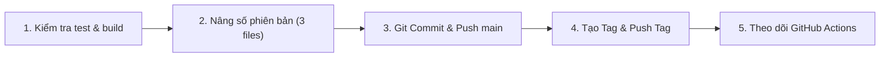

# Hướng Dẫn Quy Trình Tạo Bản Release Mới — StructPaper Desktop & Web

Tài liệu này hướng dẫn chi tiết từng bước để tạo và phát hành (release) một phiên bản mới của ứng dụng StructPaper (bao gồm ứng dụng Desktop Windows/macOS và bản Web), từ việc cập nhật file cấu hình, kiểm tra mã nguồn, gắn Git Tag, cho đến khi GitHub Actions tự động đóng gói bộ cài đặt `.exe` và `.dmg`.

---

## 1. Cơ Chế Hoạt Động Của Hệ Thống Release

StructPaper sử dụng hệ thống CI/CD tự động bằng **GitHub Actions** (`.github/workflows/release.yml`):
- **Cơ chế kích hoạt:** Mỗi khi bạn tạo và đẩy (push) một **Git Tag** có định dạng `v*` (ví dụ `v1.0.11`, `v1.1.0`) lên GitHub, hệ thống CI/CD sẽ tự động:
  1. Khởi động 2 máy ảo song song: **Windows (`windows-latest`)** và **macOS (`macos-latest`)**.
  2. Tự động tải động cơ LaTeX ngoại tuyến Tectonic và bộ công cụ NSIS / DMG.
  3. Biên dịch ứng dụng Desktop bằng **Tauri v2**.
  4. Ký số bảo mật cho gói cập nhật tự động (**Auto-updater**) bằng thuật toán Minisign (Ed25519).
  5. Xuất bản phiên bản lên mục **GitHub Releases** với đầy đủ các file cài đặt:
     - `StructPaper_<version>_x64-setup.exe` (Windows Installer)
     - `StructPaper_<version>_aarch64.dmg` (macOS Apple Silicon Installer)
     - `latest.json` + `*.sig` (Dành cho tính năng kiểm tra và tự động cập nhật trong ứng dụng).

---

## 2. Quy Trình 5 Bước Phát Hành Bản Release Mới



---

### Bước 1: Kiểm Tra & Xác Nhận Mã Nguồn (Pre-flight Check)

Trước khi đóng gói một phiên bản mới gửi đến người dùng, luôn đảm bảo code không có lỗi Typecheck và toàn bộ unit/integration tests đều vượt qua:

Mở terminal tại thư mục gốc `StructPaper/`:

```bash
# 1. Kiểm tra TypeScript (phải ra 0 lỗi)
pnpm --filter @structpaper/web exec tsc --noEmit

# 2. Chạy toàn bộ test suites của web & editor
pnpm --filter @structpaper/web test
```

> [!IMPORTANT]
> Chỉ tiếp tục bước tiếp theo khi cả TypeScript và Unit Tests đều vượt qua màu xanh (Passed).

---

### Bước 2: Nâng Số Phiên Bản (Version Bump) Đồng Bộ Ở 3 File Bắt Buộc

StructPaper là dự án kết hợp giữa **Next.js (TypeScript)** và **Tauri v2 (Rust)**. Khi nâng version (ví dụ từ `1.0.10` lên `1.0.11`), bạn **BẮT BUỘC** phải sửa đồng thời cả 3 file sau với cùng một số version:

| STT | Đường dẫn file | Dòng cần sửa | Giải thích |
| :--- | :--- | :--- | :--- |
| **1** | `apps/web/package.json` | `"version": "1.0.11"` | Phiên bản frontend Next.js, hiển thị trong mục Cài đặt và UI. |
| **2** | `apps/web/src-tauri/tauri.conf.json` | `"version": "1.0.11"` | Cấu hình Tauri Bundle, dùng để tạo metadata bộ cài và `latest.json`. |
| **3** | `apps/web/src-tauri/Cargo.toml` | `version = "1.0.11"` | Phiên bản Rust Crate của Tauri, Rust compiler yêu cầu file này. |

#### Chi tiết cách sửa từng file:

1. **`apps/web/package.json`**:
   ```json
   {
     "name": "@structpaper/web",
     "version": "1.0.11",  <-- Sửa tại đây
     "private": true,
     ...
   }
   ```

2. **`apps/web/src-tauri/tauri.conf.json`**:
   ```json
   {
     "$schema": "https://schema.tauri.app/config/2",
     "productName": "StructPaper",
     "version": "1.0.11",  <-- Sửa tại đây
     "identifier": "com.structpaper.app",
     ...
   }
   ```

3. **`apps/web/src-tauri/Cargo.toml`**:
   ```toml
   [package]
   name = "structpaper"
   version = "1.0.11"      # <-- Sửa tại đây
   description = "StructPaper Academic Publishing Desktop"
   ...
   ```

> [!WARNING]
> Nếu 3 file này không trùng khớp số phiên bản, trình biên dịch Tauri hoặc Tauri-Action trên GitHub Actions có thể báo lỗi hoặc file cập nhật `latest.json` sẽ không khớp với phiên bản cài đặt.

---

### Bước 3: Commit Các Thay Đổi Nâng Version Vào Nhánh `main`

Sau khi sửa xong 3 file, kiểm tra lại bằng `git status` và commit:

```bash
# Kiểm tra lại các file đã sửa
git status

# Đưa 3 file vào staging
git add apps/web/package.json apps/web/src-tauri/tauri.conf.json apps/web/src-tauri/Cargo.toml

# Commit với thông điệp rõ ràng theo chuẩn Conventional Commits
git commit -m "chore(release): bump version to 1.0.11"

# Đẩy commit lên nhánh chính GitHub
git push origin main
```

---

### Bước 4: Tạo Git Tag Và Đẩy Lên GitHub (Kích Hoạt CI/CD)

Đây là bước quan trọng nhất kích hoạt quy trình tự động build release trên server:

```bash
# 1. Tạo tag phiên bản (Lưu ý: BẮT BUỘC có chữ 'v' ở đầu)
git tag v1.0.11

# 2. Đẩy tag lên GitHub
git push origin v1.0.11
```

*(Mẹo: Bạn cũng có thể tạo Annotated Tag kèm nội dung tóm tắt tính năng bằng lệnh):*
```bash
git tag -a v1.0.11 -m "StructPaper Release v1.0.11: Tích hợp Auto-save và Navigation Guard"
git push origin v1.0.11
```

---

### Bước 5: Theo Dõi & Kiểm Tra Bản Release Trên GitHub Actions

1. Truy cập vào kho mã nguồn trên trình duyệt:  
   `https://github.com/StructPaper/StructPaper/actions`
2. Bạn sẽ thấy một workflow có tên **Release Desktop App** đang chạy ứng với tag bạn vừa push.
3. Chờ khoảng 10 – 15 phút để GitHub hoàn tất build cho cả 2 hệ điều hành:
   - **windows-latest**: Đóng gói file `.exe` (NSIS) và nén `.nsis.zip`.
   - **macos-latest**: Đóng gói file `.dmg` cho chip Apple Silicon.
4. Khi cả 2 job hiện dấu tích xanh lá (**Success**), bạn vào mục:  
   `https://github.com/StructPaper/StructPaper/releases`
5. Tại đây bạn sẽ thấy bản Release mới nhất gồm:
   - `StructPaper_1.0.11_x64-setup.exe` (Dành cho máy Windows).
   - `StructPaper_1.0.11_aarch64.dmg` (Dành cho máy macOS).
   - `latest.json` (File metadata phục vụ tính năng tự cập nhật phiên bản mới).

---

## 3. Script Tiện Ích: Cập Nhật Nhanh Phiên Bản Bằng 1 Lệnh

Nếu bạn không muốn mở từng file để sửa bằng tay, có thể chạy đoạn lệnh PowerShell sau tại thư mục gốc `StructPaper/` (thay `1.0.11` bằng số version mong muốn):

```powershell
$NEW_VER = "1.0.11"

# 1. Sửa apps/web/package.json
(Get-Content "apps/web/package.json") -replace '"version": ".*?"', "`"version`": `"$NEW_VER`"" | Set-Content "apps/web/package.json"

# 2. Sửa apps/web/src-tauri/tauri.conf.json
(Get-Content "apps/web/src-tauri/tauri.conf.json") -replace '"version": ".*?"', "`"version`": `"$NEW_VER`"" | Set-Content "apps/web/src-tauri/tauri.conf.json"

# 3. Sửa apps/web/src-tauri/Cargo.toml
(Get-Content "apps/web/src-tauri/Cargo.toml") -replace 'version = ".*?"', "version = `"$NEW_VER`"" | Set-Content "apps/web/src-tauri/Cargo.toml"

Write-Host "Da cap nhat thanh cong version $NEW_VER cho ca 3 files!" -ForegroundColor Green
```

Sau khi chạy xong đoạn script trên, bạn chỉ cần thực hiện tiếp Bước 3 và Bước 4.

---

## 4. Xử Lý Các Sự Cố Thường Gặp (Troubleshooting)

### Q1: Đã push commit nhưng sao không thấy GitHub Actions chạy build release?
- **Nguyên nhân:** Bạn mới chỉ `git push origin main` mà **chưa push tag**. Workflow chỉ kích hoạt khi có Git Tag bắt đầu bằng `v*`.
- **Khắc phục:** Chạy `git tag v1.0.x` và `git push origin v1.0.x`.

### Q2: Nếu lỡ tạo nhầm tag hoặc push sai số version thì làm sao?
Bạn có thể xóa tag cả ở máy cục bộ và trên GitHub để làm lại:
```bash
# Xóa tag ở máy cục bộ
git tag -d v1.0.11

# Xóa tag trên GitHub
git push origin --delete v1.0.11
```

### Q3: Job GitHub Actions báo lỗi ở bước `Build Desktop Application with Tauri` (Tauri-action)?
- **Nguyên nhân phổ biến:** Thiếu Secret `TAURI_SIGNING_PRIVATE_KEY` trong Repository Secrets. Secret này dùng để ký khóa riêng tư cho file `latest.json`.
- **Khắc phục:** Tham khảo tài liệu [`scripts/updater-signing-guide.md`](../../scripts/updater-signing-guide.md) để kiểm tra lại khóa ký Minisign trong mục **Settings -> Secrets and variables -> Actions** của kho GitHub.
